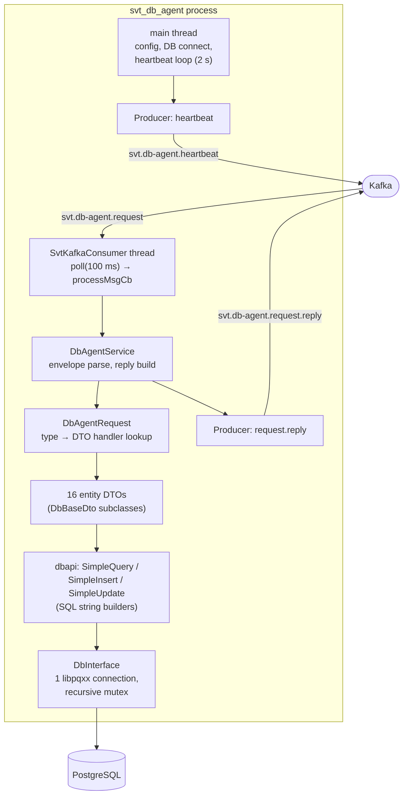
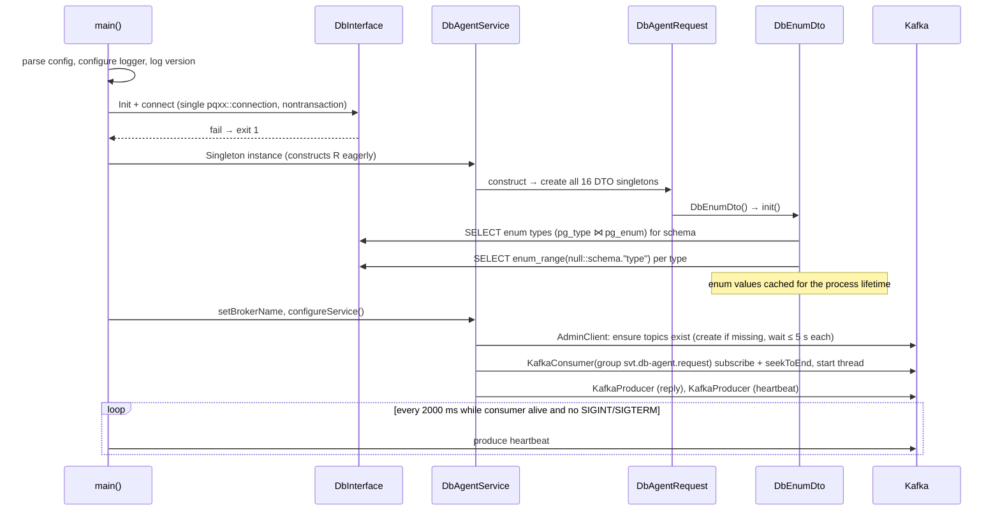
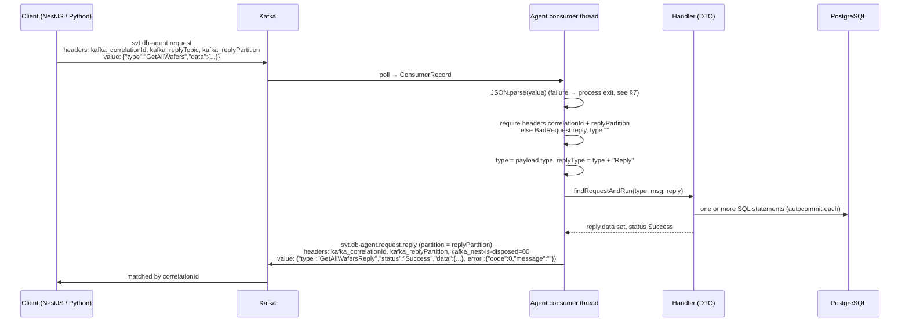

# 01. Runtime architecture

How the agent process runs, from config to reply. Source files: `app/src/svt_db_agent.cpp`,
`app/src/DbAgentService/*`, `common/C++/kafka/*`, `app/src/Database/DbInterface.cpp`.

## 1. Components



Everything is **one process, two threads, one database connection**. The consumer thread handles
one record at a time, synchronously, end to end (parse, query, reply). The main thread only emits
heartbeats. There is no request concurrency: a slow query delays every queued request.

## 2. Configuration

The binary takes one argument, a JSON config file. In Docker, `docker-entrypoint.sh` copies
`configs/SvtDbAgent_config.example.json` to a runtime file, overlays environment variables with `jq`,
and `chmod 600`s it (it holds the DB password).

| JSON path | Env override | Used for |
|---|---|---|
| `logger.filePath` | `SVT_DB_AGENT_LOGGER_FILE_PATH` | Log file prefix. Directory is created by the entrypoint, not by the agent. |
| `logger.termVerbosity` | `SVT_DB_AGENT_LOGGER_TERM_VERBOSITY` | One of `PRODUCTION`, `STANDARD`, `VERBOSE`, `DEBUG` (ascending). |
| `logger.fileVerbosity` | `SVT_DB_AGENT_LOGGER_FILE_VERBOSITY` | Same values. |
| `database.psqlHost` / `psqlPort` / `psqlUser` / `psqlPass` / `psqlDbName` | `SVT_DB_AGENT_DB_HOST` / `_PORT` / `_USER` / `_PASS` / `_NAME` | libpq connection string. All six database keys are mandatory; a missing one aborts startup. |
| `database.psqlDbSchema` | `SVT_DB_AGENT_DB_SCHEMA` | Schema prefix for generated SQL (`"main"` in every environment). **Quirk**: three hand-written queries hardcode `main.` regardless (see [05](05-request-handlers.md)). |
| `kafka.server` / `kafka.port` | `SVT_DB_AGENT_KAFKA_SERVER` / `_PORT` | Joined into `bootstrap.servers`. |
| `kafka.recreateTopics` | none | Present in the example config, **not read by the code**. |

## 3. Startup sequence



Startup fails (exit code 1) if: the config is unreadable or incomplete, the DB does not connect, any
topic cannot be created within 5 s, or Kafka clients cannot be created. The enum cache is loaded
**before** Kafka is touched, so a DB that is up but has no enum types does not block startup; an
unreadable `pg_type` does (exception out of the DTO constructor).

## 4. Kafka topics and client settings

| Topic | Direction | Created by agent with | Notes |
|---|---|---|---|
| `svt.db-agent.request` | in | 1 partition, RF 1, broker defaults | Consumed with `group.id = svt.db-agent.request`. |
| `svt.db-agent.request.reply` | out | 1 partition, RF 1 | Reply partition comes from the request header (see §5). The reply topic name is **fixed**; the `kafka_replyTopic` header is ignored. |
| `svt.db-agent.heartbeat` | out | 1 partition, RF 1, `retention.ms=60000`, `segment.ms=120000` | One JSON record every 2 s. |

Consumer: `enable.auto.commit=false`, `auto.offset.reset=latest`, `enable.partition.eof=false`,
`log_level=4`. On creation it **subscribes and seeks to the end**, so anything produced while the
agent was down is skipped. After each non-empty `poll(100 ms)` batch it `commitAsync()`s. A record
with a fatal error stops the consumer thread, which ends the main loop and the process.

Reply producer: value is the JSON string; key is null; headers copied from the reply envelope;
partition = `int(kafka_replyPartition)` if the header exists, else 0. A delivery-report callback
logs success or failure; failures are not retried and the request is not re-processed.

Message size: Kafka's default 1 MB cap is exceeded by list replies. The brokers are configured for
50 MiB (`Dev/README.md`, `Environment/*`). The C++ producer does **not** compress (the NestJS mock
in `UI/apps/epic-db-agent` does, with gzip).

## 5. Request / reply envelope

The protocol is NestJS's Kafka request-reply convention; the C++ imitates it, down to the
`kafka_nest-is-disposed` header.



### Request

```jsonc
// headers (strings)
{ "kafka_correlationId": "<uuid>", "kafka_replyTopic": "svt.db-agent.request.reply", "kafka_replyPartition": "0" }
// value
{ "type": "<MessageType>", "data": { /* handler specific */ } }
```

- `kafka_correlationId` and `kafka_replyPartition` are **required**. Missing either → reply
  `BadRequest`, `type: ""`, `error.message` = "Failed to retrieve <header> from message headers: …".
  `kafka_replyTopic` is read by nobody.
- `type` must be a string. `data` must be an object. **Quirk**: a payload without `type` or without
  `data` is undefined behaviour in the C++ (unchecked `operator[]` on a const JSON object); a `type`
  that is not a string throws outside the guarded block and kills the process (§7).

### Reply

```jsonc
// headers
{ "kafka_correlationId": "<same>", "kafka_replyPartition": "<same>", "kafka_nest-is-disposed": "00" }
// value, keys always in this order
{ "type": "<MessageType>Reply", "status": "Success" | "BadRequest", "data": { ... } | null,
  "error": { "code": 0, "message": "" } }
```

| Situation | `status` | `type` | `data` | `error` |
|---|---|---|---|---|
| Handler finished | `Success` | `<type>Reply` | handler payload | `{code: 0, message: ""}` |
| Missing required header | `BadRequest` | `""` | `null` | `{code: -1, message: "Failed to retrieve …"}` |
| `type` is `""` | `BadRequest` | `""` | `null` | `{code: -1, message: "Empty type"}` |
| No handler for `type` | `BadRequest` | `<type>Reply` | `null` | `{code: -1, message: "Error: Request <type> not Found"}` |
| Handler threw (validation, SQL error, anything) | `BadRequest` | `<type>Reply` | `null` | `{code: -1, message: e.what()}` |

The contract defines `NotFound` and `UnexpectedError`. **The code never emits either.** The enum in
`SvtKafkaMessage.h` has `NotFound` commented out, and `UnexpectedError` is assigned in one branch
and then overwritten by `Success` before any reply is built. Every failure, including a DB
connection loss, is a `BadRequest` with `code: -1`. `error.message` is the raw exception text and
frequently contains the SQL statement (see [04 §8](04-request-engine.md#8-errors)).

Handler payload shapes are exactly three (plus the enum special case):

| Shape | JSON | Used by |
|---|---|---|
| List | `{"items": [ {...}, ... ], "totalCount": n}` | every `GetAll*`; `totalCount` omitted for location-history lists |
| Entity | `{"entity": {...}}` | every `Create*`, `Update*`, `Get*Body`, `GetWaferTypeMap` |
| Enum map | `{"<enumType>": ["v1", ...], ...}` | `GetAllEnums` only |

Entity keys are emitted in **alphabetical order** (the C++ stores rows in a `std::map`). Clients
must not depend on key order.

## 6. Threading and concurrency

- One consumer thread; records are processed strictly sequentially. Offsets are committed
  asynchronously after the batch, so a crash mid-batch may re-deliver already-handled records
  after restart (but see the seek-to-end note in §4: in practice they are skipped).
- One DB connection guarded by a recursive mutex. The mutex is only contended by the main thread's
  shutdown path; there is no parallel SQL.
- There are **no database transactions**. See [04 §7](04-request-engine.md#7-transaction-semantics).
- DTOs are process-wide singletons with mutable state only in `DbEnumDto` (the cache).

## 7. Failure and recovery behaviour

| Event | Behaviour today |
|---|---|
| Payload is not valid JSON | Exception escapes the consumer thread → `std::terminate` → **process exits**. Docker `restart: unless-stopped` restarts it; on restart the consumer seeks to the end, so the poison message and anything queued behind it are skipped. |
| `type` is missing, or not a string; `data` missing | Undefined / process exit (see §5). |
| Handler exception | `BadRequest` reply, agent continues. |
| DB connection lost | `executeQuery` notices `!is_open()`, tries one reconnect, `dbapi::doGenericQuery` retries the statement once. If still failing → handler exception → `BadRequest`. |
| Kafka broker unreachable at startup | Topic creation times out after 5 s → exit 1. |
| Kafka broker lost at runtime | librdkafka reconnects internally; replies produced meanwhile are reported as delivery failures in the log and lost. |
| SIGINT / SIGTERM | `running = false`; main loop exits; consumer `commitSync` + `close`; DB connection closed; exit 0. A second signal is ignored. |

## 8. Heartbeat and health check

Every 2000 ms the main thread produces to `svt.db-agent.heartbeat`:

```json
{ "timestamp": "1762500000.123456" }
```

`timestamp` is a **string**: seconds since the epoch with six decimals. No headers, no key.

`svt-db-agent-healthcheck -b <broker>` (second binary in the image) assigns partition 0 of the
heartbeat topic, seeks to the end, and waits up to 10 s for one record; exit 0 if one arrives, 1
otherwise. Docker runs it with `interval=30s timeout=10s retries=3 start-period=30s`. Nothing else in
the system consumes the heartbeat (WPAgent has its own, unrelated heartbeat).

Note what this does **not** check: the DB connection. An agent with a dead DB connection is
"healthy" and answers every request with `BadRequest`.

## 9. Logging

Four levels, `PRODUCTION < STANDARD < VERBOSE < DEBUG`, configured separately for terminal and file.
Each request logs its offset, key and type at `VERBOSE`. Full request/reply payload dumping exists
behind a compile-time-off flag (`setLogMessages`). SQL statements are logged only when they fail,
and then **with the full statement including literal values**.

## 10. Developer tools shipped in the image

| Binary | Purpose |
|---|---|
| `svt_db_agent <config.json>` | the agent |
| `svt-db-agent-healthcheck -b host:port [-t seconds]` | heartbeat probe (§8) |
| `test-kafka-producer -b host:port -t topic <file.json>` | sends each top-level element of the JSON file as a payload. It sets **no** correlation headers, so the agent answers `BadRequest`; useful only to see the agent react. |
| `test-kafka-consumer -b host:port -g group -t topic` | prints records of a topic |

## 11. Deployment shape (for parity, details in ../README.md)

Image `ghcr.io/svt-wp2/svt-db-agent:<tag>`, built from `DbAgent/Dockerfile` (Ubuntu 24.04, apt
`libpq-dev librdkafka-dev`, CMake FetchContent for libpqxx 8.0.1, modern-cpp-kafka, nlohmann/json,
magic_enum). Runs as service `svt-db-agent` in `Environment/<env>/docker-compose-svtsw-<env>.yml`,
version pinned in `versions.env`, config via the `SVT_DB_AGENT_*` env vars of §2, logs bind-mounted
at `/var/log/svt-db-agent`.
