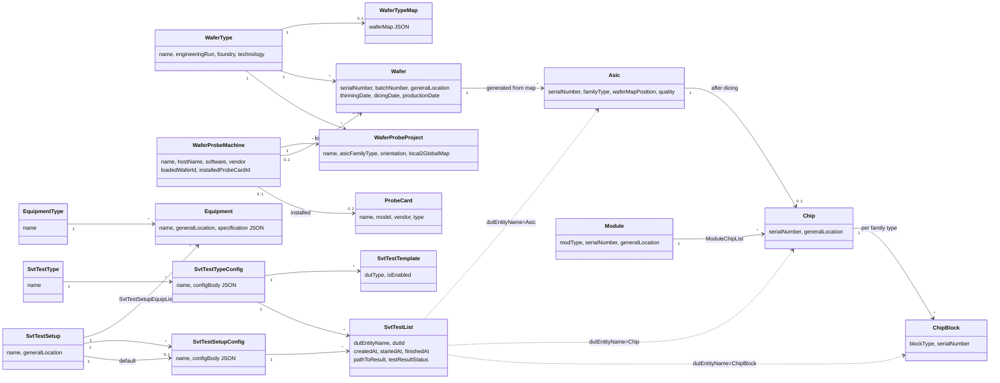
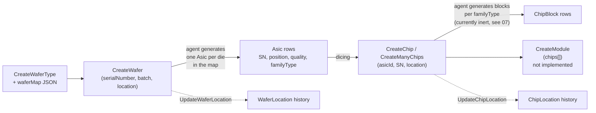
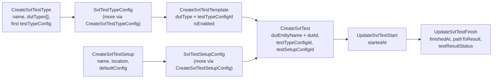
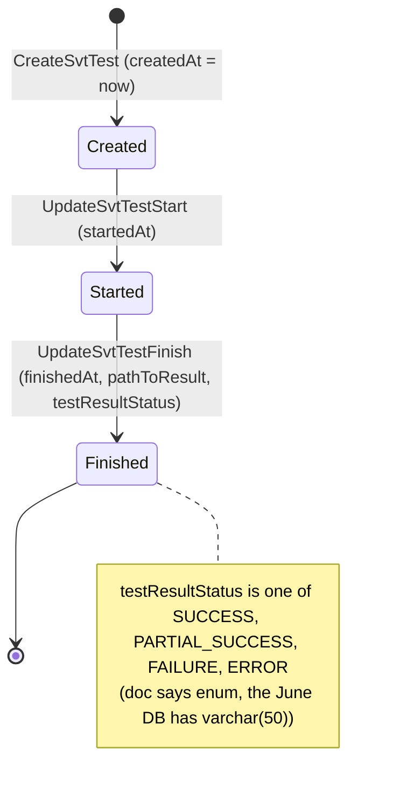
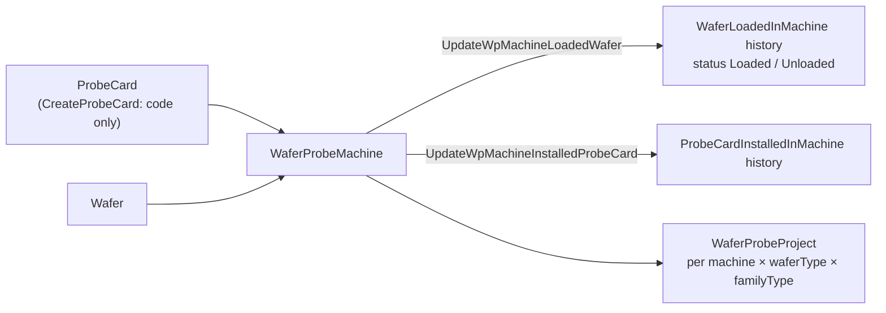

# 02. Domain model

What the data means, in the language of the ITS3 / SVT wafer-probing and module-testing workflow.
Table and column names are given for orientation; the full schema is in
[03-database-schema.md](03-database-schema.md).

## 1. Glossary

| Term | Meaning | Table |
|---|---|---|
| **Engineering run** | A fabrication run of a chip design (`ER1`, `ER2`, `ER3`, `LAS1`, `AncMPW1`, `AncMPW2`). | enum `engineeringRun` |
| **Wafer type** | The design of a wafer: which engineering run, foundry and technology. One wafer type per engineering run (unique). | `WaferType` |
| **Wafer type map** | A JSON document attached to a wafer type that describes every die on a wafer of that type: which **groups** of ASICs exist, where they sit, their family type and mechanical quality. Used to generate ASIC rows automatically when a wafer is registered. Format in [06-wafer-map.md](06-wafer-map.md). | `WaferTypeMap` |
| **Wafer type image** | A base64 picture of the wafer layout for the UI. Not served by any message type today. | `WaferTypeImage` |
| **Wafer** | A physical silicon wafer, identified by its foundry serial number and batch number. Has a current location and optional thinning / dicing / production dates. | `Wafer` |
| **ASIC** | One die on a wafer. Created in bulk from the wafer type map at wafer registration, never individually by users in the normal flow (`CreateAsic` exists but the UI does not use it). Has a family type (the chip design, e.g. `MOSAIX`, `BABYMOSS`, `AncMPW2`), a position on the wafer map (`"<row>_<col>"`) and a mechanical quality. | `Asic` |
| **ASIC family type** | The chip design an ASIC implements; an enum with ~90 values. Also drives which **blocks** a chip has. | enum `asicFamilyType` |
| **Chip** | An ASIC after dicing, i.e. a singulated die that is handled as its own object: it gets its own serial number and its own location history. Links back to exactly one ASIC. The schema does not forbid two chips for one ASIC, but the agent's ASIC query assumes at most one (`LEFT JOIN`). | `Chip` |
| **Chip block** | A functional sub-block of an *ancillary* ASIC (`SLDO`, `NVBG`, `CML_TRANSCEIVER`), tracked as its own test subject. Which blocks a family type has is configuration data (`AsicFamilyTypeBlockList`). Serial number is `<blockType>_<chipSerialNumber>`. | `ChipBlock` |
| **Module** | An assembly of several chips (`IB0`, `IB1`, `IB2`). Has its own location history. **Work in progress**: tables exist in the schema doc, the C++ handler is unfinished and not wired up. | `Module`, `ModuleChipList` |
| **General location** | Where an object physically is: an institute or room (`CERN`, `CERN_186_R_E10`, `Prague`, `BNL`, …). Wafers, chips, equipment and modules carry a current `generalLocation` plus an append-only **location history** with date, user and note. | enum `wpGeneralLocation`, `*Location` tables |
| **Wafer probe machine** (WP machine, prober) | A wafer prober station: vendor, software, network address. Carries live state: which wafer is currently loaded (and in which orientation) and which probe card is installed. Each change is appended to a history table. | `WaferProbeMachine`, `WaferLoadedInMachine`, `ProbeCardInstalledInMachine` |
| **Probe card** | The needle card mounted on a prober. Has vendor, model, type, cleaning interval, and the ASIC family types it can probe. | `ProbeCard`, `ProbeCardFamilyType` |
| **Wafer probe project** | A prober-side project definition for probing one ASIC family type on one wafer type on one machine: orientation, alignment die, home die, and the local-to-global coordinate map (JSON). | `WaferProbeProject` |
| **Equipment** / **equipment type** | Lab instruments (power supplies, scopes…) with a type, a location history and a free-form JSON specification. | `Equipment`, `EquipmentType` |
| **Test setup** | A test bench at a location, composed of equipment. Has one or more **setup configs** (JSON) and a designated default config. | `SvtTestSetup`, `SvtTestSetupEquipList`, `SvtTestSetupDefaultConfig` |
| **Test setup config** | A named JSON configuration body for a setup. Config bodies are large, so lists return metadata only and the body is fetched separately. | `SvtTestSetupConfig` |
| **Test type** | A kind of test (e.g. an IV scan). Declares which **DUT types** it applies to. | `SvtTestType`, `SvtTestTypeDUTTypeList` |
| **Test type config** | A named JSON configuration body for a test type. Created together with the test type (first config) or later. | `SvtTestTypeConfig` |
| **DUT type** | The device-under-test category a test applies to (`MOSAIX`, `BABYMOSAIX`, `AncMPW2_SLDO`). Conceptually a subset of ASIC family type plus block type. | enum `dutType` |
| **Test template** | "Test type config X is (enabled / disabled) for DUT type Y." The menu of tests the TestAgent may run on a DUT type. | `SvtTestTemplate` |
| **Test** (SvtTestList row) | One execution of a test type config on one DUT, on one setup config. The DUT is referenced polymorphically by **entity name** (`Asic`, `Chip`, `ChipBlock`) plus id. Lifecycle: created → started → finished with a result status and a path to results. | `SvtTestList` + link tables |
| **Enum** | Postgres enum types in the schema; the agent exposes their values so UIs can build dropdowns. Values are added directly in the DB by the DB owner. | `pg_enum` |

## 2. Entity relationships

Location history tables (`WaferLocation`, `ChipLocation`, `EquipmentLocation`, `ModuleLocation`)
and machine history tables (`WaferLoadedInMachine`, `ProbeCardInstalledInMachine`) are omitted
from the diagram; they are append-only logs hanging off their parent.

## 3. The two product flows

### 3.1 Silicon: from wafer type to module

Business rules enforced by the agent (as opposed to the DB):

- An ASIC's **serial number** is derived, not entered: `<waferSN>_<row>_<col>`, or
  `<SN_prefix>[_<n>]_<waferSN>` for mechanically intact ASICs in a map row that declares a prefix
  (rule in [06 §4](06-wafer-map.md#4-asic-generation-algorithm)).
- An ASIC's **quality** (`MechanicallyInteger`, `MechanicallyDamaged`, `CoveredByGreenLayer`) comes
  from the map, and each die must be in exactly one of the three quality lists.
- A chip's **family type** is not stored on the chip; it is read through the ASIC.
- A chip block's serial number is `<blockType>_<chipSerialNumber>`.
- A wafer's, chip's or equipment's `generalLocation` **cannot be changed by the generic update**;
  only through the `Update*Location` message, which appends a history row and copies the most
  recent location onto the parent.
- Every created wafer/chip/equipment gets an initial history row with note `"Location at creation"`.

### 3.2 Testing: from test type to test result

The agent does **not** enforce this state machine. `UpdateSvtTestStart` and `UpdateSvtTestFinish`
are the same generic update; nothing stops a finish before a start or a second start. The
TestAgent is expected to call them in order.

Config bodies are **opaque JSON** to the agent. It validates nothing inside them. Lists of configs
exclude the body; `GetSvtTestTypeConfigBody` / `GetSvtTestSetupConfigBody` fetch it by id.

### 3.3 Prober operations

WPAgent (the prober control software) is the main caller here: it loads machines and projects at
startup, looks up ASICs by id during probing, and records load/unload events.

## 4. Identity and keys

- Every top-level entity has an integer surrogate `id` from a Postgres sequence. There are no UUIDs.
- Business keys are enforced as `UNIQUE` in the DB: wafer / ASIC / chip / chip-block / probe-card /
  machine serial numbers; wafer-type, equipment-type, equipment, probe-card, machine, project and
  test-type names; one wafer type per engineering run; one config name per test setup globally
  (`SvtTestSetupConfig.name` unique) but per test type for test-type configs
  (`(testTypeId, name)`); one template per `(dutType, testTypeConfigId)`.
- History and link tables mostly have **no primary key** in the real DB (see
  [03 §4](03-database-schema.md#4-tables-without-a-primary-key)). The agent never updates or deletes
  rows in them; it only inserts and reads.
- The agent exposes **no delete** operation of any kind.

## 5. What the agent does not know about

Things a reader might expect in this domain that are absent from the agent (and therefore must be
elsewhere or nowhere): users and permissions (the `username` on history rows is a free string sent
by the client); test results content (only `pathToResult`); probe card maintenance / cleaning
counters (tables commented out in the schema doc); ASIC probing outcomes; audit trails beyond the
location/machine histories; any notion of soft delete or archival.
