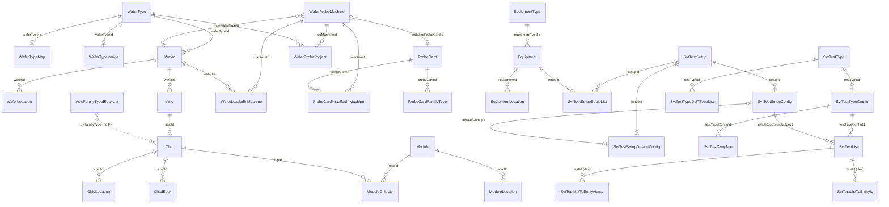
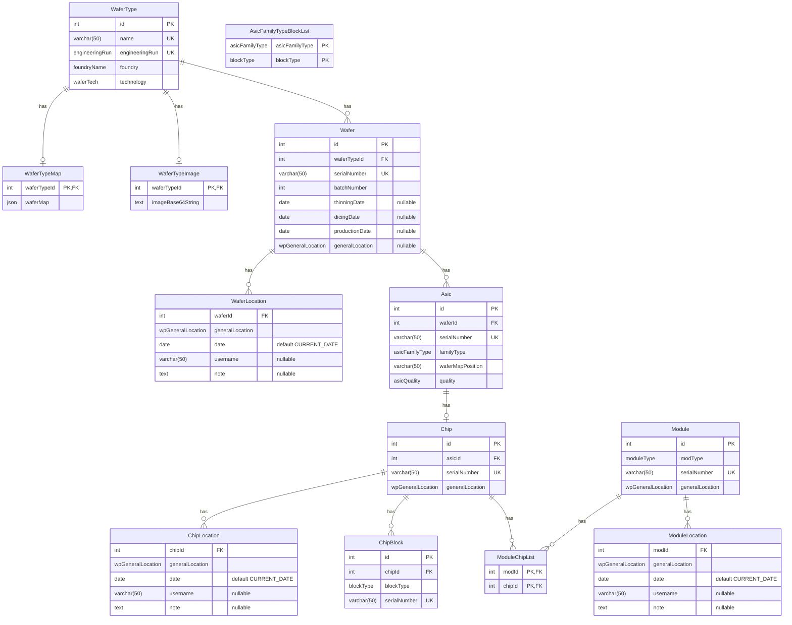
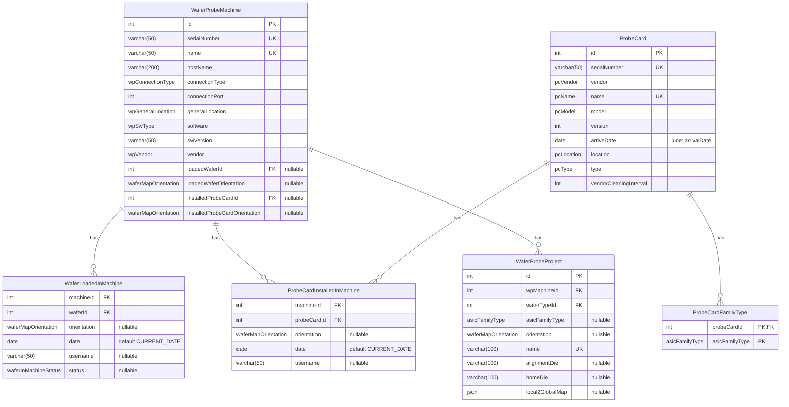
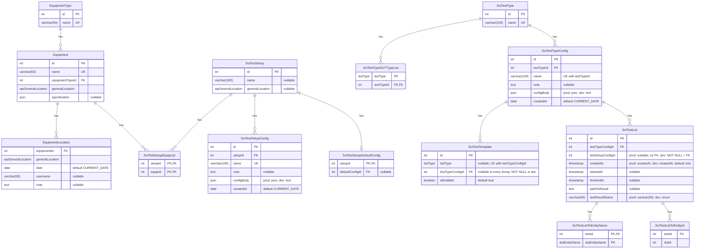

# 03. Database schema

PostgreSQL, schema `main`. The DDL below comes from the three dumps in `Dev/db-example/`
(see its [README](../../Dev/db-example/README.md)), extracted with `pg_restore --schema-only`:
**june** (`db-example-2026-06-01.dump`), **dev** (`2026-11-08-backup.dump`, database
`svt_sw_db_test`) and **prod** (`2026-11-08-backup_prod.dump`, database `svt_sw_db`). It is
cross-checked against the **doc** (`SVT_DB_Tables_SourceOfTruth.txt`) and the column lists the
**code** uses. Dev and prod differ from each other (§5): dev matches the code on `master`, prod has
not received the `SvtTestList` changes the code adopted on 2026-09-27. Section 7 summarises the
data in the two 2026-11-08 dumps.

## 1. Conventions in the real database

- Identifiers are **camelCase and quoted**: `"waferId"`, `main."WaferType"`. Every query must quote
  them.
- Surrogate keys: `id integer GENERATED BY DEFAULT AS IDENTITY` (sequence `main."<Table>_id_seq"`,
  start 1, increment 1) on every top-level entity. The agent never supplies ids; it reads back
  `MAX(id)` after insert.
- Enumerations are **native Postgres enum types** in schema `main`: 19 in prod, 21 in dev (§6). Adding a value is
  a DDL change done by the DB owner; the agent discovers types and values from the catalog at
  startup.
- Dates: history and config tables use `date` (day resolution) with `DEFAULT CURRENT_DATE`.
  `SvtTestList` uses `timestamp without time zone`.
- JSON payloads (`waferMap`, `configBody`, `specification`, `local2GlobalMap`) are `json` columns.
- Every foreign key is declared `DEFERRABLE` (but not `INITIALLY DEFERRED`).
- No triggers, functions, views or extensions exist. All behaviour is in the agent.
- Many history and link tables have **no primary key** (§4).

## 2. Overview

Prod still links tests to DUTs through `SvtAsicTestList`, `SvtChipTestList` and
`SvtChipBlockTestList` (all empty); dev, the doc and the code use the two `SvtTestListToEntity*`
tables shown.

## 3. Tables

Legend: **PK** primary key, **UK** unique, **FK** foreign key, ∅ nullable. "Code" lists the columns
the DTO registers (⁺ = registered optional); a column the code does not list is invisible to the
agent (never read, never written).

### 3.1 Silicon

| Table | Source | Code columns | Notes |
|---|---|---|---|
| `WaferType` | all dumps | id, name, engineeringRun, foundry, technology | `engineeringRun` is UNIQUE: one wafer type per run. |
| `WaferTypeMap` | all dumps | waferTypeId, waferMap | Written as a JSON **string** from the client; see [06](06-wafer-map.md). |
| `WaferTypeImage` | all dumps | none | Not used by any message type. |
| `Wafer` | all dumps | id, batchNumber, waferTypeId, serialNumber, generalLocation, thinningDate, dicingDate, productionDate | `generalLocation` nullable in DB, but the agent always writes it. |
| `WaferLocation` | all dumps | waferId, generalLocation, date, username, note | No PK. Append-only. |
| `Asic` | all dumps | id, waferId, chipId⁺ (virtual, from LEFT JOIN Chip), serialNumber, familyType, waferMapPosition, quality | Rows generated from the map ([06](06-wafer-map.md)). |
| `Chip` | all dumps | id, asicId, asicFamilyType⁺ (virtual, from LEFT JOIN Asic as `familyType`), serialNumber, generalLocation | No uniqueness on `asicId`: the 1:1 with Asic is by convention. |
| `ChipLocation` | all dumps | chipId, generalLocation, date, username, note | No PK. |
| `ChipBlock` | all dumps | code registers table **`Block`** with id, chipId, blockType, serialNumber | **Code/DB mismatch** on the table name; the code path is inert anyway (05 §3). |
| `AsicFamilyTypeBlockList` | all dumps | asicFamilyType, blockType | Configuration data: which blocks each ancillary family type has. Maintained by hand by the developer user, per chip design that has blocks (author, Q7). |
| `Module`, `ModuleChipList`, `ModuleLocation` | dev + prod (empty) | id, modType, serialNumber⁺, generalLocation; relation `ModuleChipList(modId, chipId)` | Added after June. `Module.serialNumber` is `NOT NULL UNIQUE` in the DB while the code registers it optional. Handler unfinished. |

### 3.2 Prober

| Table | Source | Code columns | Notes |
|---|---|---|---|
| `WaferProbeMachine` | all dumps | all 14 (last four optional) | Current state lives here; history in the two tables below. |
| `WaferLoadedInMachine` | all dumps | machineId, waferId, **waferOrientation**, date, username, status | No PK. Code registers `waferOrientation` but inserts the key `orientation` (matches DB). `status` ∈ Loaded/Unloaded. |
| `ProbeCardInstalledInMachine` | all dumps | machineId, probeCardId, **probeCardOrientation**, date, username | No PK. Same `orientation` note. |
| `ProbeCard` | all dumps | id, version, vendorCleaningInterval, serialNumber, name, vendor, model, **arriveDate**, location, type | June had `arrivalDate`; dev and prod have `arriveDate` (the code followed on 2026-10-11, commit `a73b0868`). `name` is an **enum** (`pcName`), unique. |
| `ProbeCardFamilyType` | all dumps | none | The contract's `ProbeCardDto.asicFamilyTypes` would come from here; the code never reads it. |
| `WaferProbeProject` | all dumps | all 9 | `local2GlobalMap` is JSON stored from a client string. |

### 3.3 Equipment and testing

| Table | Source | Code columns | Notes |
|---|---|---|---|
| `EquipmentType` | all dumps | id, name | |
| `Equipment` | all dumps | id, name, equipmentTypeId, generalLocation, specification | `specification` JSON from a client string. |
| `EquipmentLocation` | all dumps | equipmentId, generalLocation, date, username, note | No PK. |
| `SvtTestSetup` | all dumps | id, name, generalLocation | |
| `SvtTestSetupEquipList` | all dumps | setupId, equipId (relation DTO, read only) | **No message type writes this table.** |
| `SvtTestSetupDefaultConfig` | all dumps | setupId, defaultConfigId (relation, scalar) | PK on `setupId` in the dump → at most one default per setup. |
| `SvtTestSetupConfig` | all dumps | id, setupId, name, note, configBody, createdAt⁺ | `name` unique **globally**, not per setup. `configBody` excluded from list replies; `json` in prod, `text` in dev. |
| `SvtTestType` | all dumps | id, name | |
| `SvtTestTypeDUTTypeList` | all dumps | testTypeId, dutType (relation, array `dutTypes`) | |
| `SvtTestTypeConfig` | all dumps | id, testTypeId, name, note, configBody, createdAt⁺ | `(testTypeId, name)` unique. `configBody` is `json` in prod, `text` in dev. |
| `SvtTestTemplate` | all dumps | id, dutType, testTypeConfigId, testTypeId⁺ (virtual, JOIN), isEnabled⁺ | `(dutType, testTypeConfigId)` unique. |
| `SvtTestList` | all dumps | id, testTypeConfigId, testSetupConfigId, **createdAt**⁺, startedAt⁺, finishedAt⁺, pathToResult⁺, testResultStatus⁺ | June, prod and the doc spell the column `createsAt`; dev and the code use `createdAt` (§5, S2). Empty in prod. |
| `SvtTestListToEntityName` | **dev only** | testId, dutEntityName (relation, scalar) | Replaces `SvtAsicTestList` / `SvtChipTestList` / `SvtChipBlockTestList`. PK `(dutEntityName, testId)`. |
| `SvtTestListToEntityId` | **dev only** | testId, dutId (relation, scalar) | No PK, no FK on `dutId` (polymorphic). |
| `SvtAsicTestList`, `SvtChipTestList`, `SvtChipBlockTestList` | june + prod (empty) | none | `(asicId|chipId|blockId, testId)` link tables, superseded by the two above; the code never reads them. |

## 4. Tables without a primary key

In every dump: `WaferLocation`, `ChipLocation`, `EquipmentLocation`, `WaferLoadedInMachine`,
`ProbeCardInstalledInMachine`. In dev and prod also `ModuleLocation`; in dev also
`SvtTestListToEntityId`. They are append-only logs the agent only inserts into and lists; no code
path names an `id` on them. Author (Q32): deliberate, for simplicity.

## 5. Where dump, doc and code disagree

Resolved against the 2026-11-08 dumps where possible. **Prod lags dev** on everything the code
changed on 2026-09-27 (commit `fc14b6be`: `createdAt`, the `SvtTestListToEntity*` tables, the
`dutEntityName` and `testResultStatus` enums, the FK on `testSetupConfigId`).

| # | Subject | june | prod 2026-11-08 | dev 2026-11-08 | doc | code | Status |
|---|---|---|---|---|---|---|---|
| S1 | `ProbeCard` date column | `arrivalDate` | `arriveDate` | `arriveDate` | `arriveDate` | `arriveDate` | **Resolved**: `arriveDate` everywhere live. |
| S2 | `SvtTestList` creation column | `createsAt` | `createsAt` | `createdAt` | `createsAt` | `createdAt` | **Prod and master disagree.** Master's `GetAllSvtTests` / `CreateSvtTest` cannot run against prod. Prod has no test rows, so no data is affected yet. Author (Q31): prod is outdated and the schema doc is the one to deploy; which build runs in prod was not said. |
| S3 | `SvtTestList.testSetupConfigId` | nullable, no FK | nullable, no FK | NOT NULL, FK → `SvtTestSetupConfig` | NOT NULL, FK | required on create | Prod lags dev. |
| S4 | `SvtTestList.testResultStatus` | `varchar(50)` | `varchar(50)` | enum `testResultStatus` | enum | free string | Prod lags dev. |
| S5 | Test ↔ DUT link | `SvtAsicTestList`, `SvtChipTestList`, `SvtChipBlockTestList` | same three, empty | `SvtTestListToEntityName`, `SvtTestListToEntityId` | the two dev tables | the two dev tables | Prod lags dev; master's `CreateSvtTest` cannot run against prod. |
| S6 | Modules | absent | present, empty | present, empty | present | handler unfinished | **Resolved**: tables and `moduleType` exist in both. |
| S7 | Enums `dutEntityName`, `testResultStatus`, `moduleType` | absent | `moduleType` only | all three | all three | `dutEntityName` used as a value column | Prod lags dev for `dutEntityName`, `testResultStatus`. |
| S8 | `pcModel` values | 6 | 7 | 7 | 7 | n/a | **Resolved**: prod, dev and doc agree. |
| S9 | `pcName` values | 3 | 4 | 4 | 4 | n/a | **Resolved**: agree. |
| S10 | `configBody` type (both config tables) | `json` | `json` | **`text`** | `text` | writes a string | **Dev and prod differ.** Both accept the strings the agent writes. Author (Q27, Q31): `text` is intended; dev is the version under test and prod follows once it is validated. |
| S11 | `SvtTestTemplate.testTypeConfigId` | nullable | nullable | nullable | NOT NULL | required | Doc is stricter than every database. Author (Q33): probably NOT NULL. |
| S12 | `SvtTestSetupDefaultConfig` | PK(`setupId`) | PK(`setupId`) | PK(`setupId`) | no PK | scalar relation (assumes ≤ 1) | **Resolved**: PK exists everywhere. |
| S13 | `ChipBlock` table name | `ChipBlock` | `ChipBlock` | `ChipBlock` | `ChipBlock` | `Block` (DbBlockDto) | Code refers to a table that does not exist; the path is inert (05 §5). |
| S14 | `WaferLoadedInMachine` / `ProbeCardInstalledInMachine` orientation column | `orientation` | `orientation` | `orientation` | `orientation` | registers `waferOrientation` / `probeCardOrientation`, inserts `orientation` | Harmless: the inserted key matches the DB. |
| S15 | Enum `blockType` vs contract `chipBlockType` | `blockType` | `blockType` | `blockType` | `blockType` | `blockType` | Naming differs between the contract (`chipBlockType` in `GetAllEnums`, `GetAllChipBlocks`) and the DB. Author (Q30): `chipBlockType` survives; the DB type and the schema doc are to be renamed. |
| S16 | Schema name | `main` | `main` | `main` | `main` | `main` hardcoded in 3 queries, configurable elsewhere | Code detail; only matters if the schema is ever renamed. |

## 6. Enum types and values

Prod, dev and the doc hold **identical values** for every type that exists in prod (the only
additions since June are `moduleType`, one `pcModel` and one `pcName` value). Dev additionally has
`dutEntityName` and `testResultStatus`. Author (Q29): replacing the Postgres enums by a lookup
table would be acceptable. Values as of 2026-11-08:

| Type | Values |
|---|---|
| `asicFamilyType` | 86 values: `MOST`, `MOSS`, `BABYMOSS`, `BABYMOST`, `NKF5/6/7`, `MOSAIX`, `BABYMOSAIX`, `LAS`, `AncMPW1`, `AncMPW2`, `AncMPW3`, `AncBrain`, `AncASIC`, `CE65_*` (18 variants), `AO10`, `AO10P`, `AO10B`, `S`, `DESY`, `NONAME1/2/5`, `dPTS`, `dPTSN`, `AF15`, `AF15P`, `AF15B`, `RAL_TXRX_ER1`, `TTS_1..5`, `SEU_1/2_INFN_BAR_GDR`, `ER2_*` (32 variants). Grows per engineering run. |
| `asicQuality` | `MechanicallyDamaged`, `MechanicallyInteger`, `CoveredByGreenLayer` |
| `blockType` | `AncMPW1_SLDO`, `AncMPW1_NVBG`, `AncMPW1_CML_TRANSCEIVER`, `AncMPW2_SLDO`, `AncMPW2_NVBG`, `AncMPW2_CML_TRANSCEIVER` |
| `dutType` | `MOSAIX`, `BABYMOSAIX`, `AncMPW2_SLDO` |
| `engineeringRun` | `ER1`, `ER2`, `ER3`, `LAS1`, `AncMPW1`, `AncMPW2` |
| `foundryName` | `TowerSemiconductor`, `Xfab` |
| `pcLocation` | `CERN`, `Prague`, `LosAlamos`, `BNL`, `RAL` |
| `pcModel` | `NKF7-TS3500-CABLEOUT-MLO(EVS-P)`, `MOSAIX-LEC-TS3500-CABLEOUT-OTHERS-MLOO-EVS-P-VY540`, `MosaixLeft`, `MosaixRight`, `LAS`, `BabyMOSS`, `Ancillary` |
| `pcName` | `NKF7_MPI`, `MOSAIX_LEC`, `BabyMOSS_Korea`, `Mosaix_Korea` |
| `pcType` | `Vertical`, `Cantilever` |
| `pcVendor` | `MPI`, `Korea`, `Synergie`, `FormFactorPC` |
| `waferInMachineStatus` | `Loaded`, `Unloaded` |
| `waferMapOrientation` | `North`, `South`, `East`, `West` |
| `waferTech` | `TPSCo65`, `Xfab110` |
| `wpConnectionType` | `TCPIP`, `GPIB`, `RS232`, `USB`, `Ethernet`, `Modbus`, `LAN` |
| `wpGeneralLocation` | `CERN`, `CERN_186_R_E10`, `Prague`, `LosAlamos`, `BNL`, `RAL`, `Darsburry`, `Brunel`, `Birmingham`, `Liverpool`, `LBL` |
| `wpSwType` | `Sentio`, `VeloxCascade` |
| `wpVendor` | `MPI`, `CascadeMicrotech`, `FormFactor` |
| `moduleType` | `IB0`, `IB1`, `IB2` |
| dev only: `dutEntityName` | `Asic`, `Chip`, `ChipBlock` |
| dev only: `testResultStatus` | `SUCCESS`, `PARTIAL_SUCCESS`, `FAILURE`, `ERROR` |

Note `pcModel` contains a value with parentheses and hyphens, and values are case-sensitive
(`MosaixLeft` vs `MOSAIX`). The agent's enum parser splits `enum_range()` output on commas and
strips only the surrounding braces, so a value containing a comma, or one Postgres chooses to
double-quote (spaces, special characters), would come back mangled.

### 6.1 Values actually used (2026-11-08 data)

| Type | Used in prod | Used in dev beyond prod | Declared but never used |
|---|---|---|---|
| `asicFamilyType` | 81 of 86 (ER2 dies dominate: `ER2_SERIALIZER` 2712, `ER2_APTS_SF_10_P5` 2016, …; `BABYMOSAIX` 580) | `AncMPW2` (one die) | `LAS`, `AncMPW1`, `AncMPW3`, `AncBrain`, `AncASIC` |
| `asicQuality` | all three (`MechanicallyInteger` 37764, `CoveredByGreenLayer` 2208, `MechanicallyDamaged` 1080) | | |
| `blockType` | none | `AncMPW2_SLDO`, `AncMPW2_NVBG`, `AncMPW2_CML_TRANSCEIVER` | the three `AncMPW1_*` |
| `dutType` | none | all three | |
| `engineeringRun` | `ER2` | `ER1`, `AncMPW2` | `ER3`, `LAS1`, `AncMPW1` |
| `foundryName` | `TowerSemiconductor` | `Xfab` | |
| `moduleType` | none | none | all |
| `pcLocation` | `CERN` | | the other four |
| `pcModel` | the two `*-TS3500-*` values | | `MosaixLeft`, `MosaixRight`, `LAS`, `BabyMOSS`, `Ancillary` |
| `pcName` | `NKF7_MPI`, `MOSAIX_LEC` | | `BabyMOSS_Korea`, `Mosaix_Korea` |
| `pcType` | `Vertical` | | `Cantilever` |
| `pcVendor` | `MPI` | | `Korea`, `Synergie`, `FormFactorPC` |
| `waferInMachineStatus` | `Loaded` | `Unloaded` (once) | |
| `waferMapOrientation` | `West` | `East` | `North`, `South` |
| `waferTech` | `TPSCo65` | | `Xfab110` |
| `wpConnectionType` | `TCPIP` | | the other six |
| `wpGeneralLocation` | `CERN_186_R_E10`, `CERN` | `Brunel` | the other eight |
| `wpSwType` | `Sentio` | | `VeloxCascade` |
| `wpVendor` | `MPI` | | `CascadeMicrotech`, `FormFactor` |
| dev `dutEntityName` | n/a | `Asic` | `Chip`, `ChipBlock` |
| dev `testResultStatus` | n/a | none | all |

## 7. Data in the 2026-11-08 dumps

Row counts (dev `svt_sw_db_test` | prod `svt_sw_db`). Empty tables omitted unless notable.

| Table | dev | prod | Table | dev | prod |
|---|---|---|---|---|---|
| `WaferType` | 3 | 1 | `ProbeCard` | 2 | 2 |
| `WaferTypeMap` | 3 | 1 | `ProbeCardFamilyType` | 3 | 3 |
| `WaferTypeImage` | 0 | 0 | `WaferProbeMachine` | 2 | 1 |
| `Wafer` | 15 | 12 | `WaferLoadedInMachine` | 15 | 2 |
| `WaferLocation` | 18 | 12 | `ProbeCardInstalledInMachine` | 3 | 1 |
| `Asic` | 48 910 | 41 052 | `WaferProbeProject` | 11 | 6 |
| `Chip` | 1 | 0 | `EquipmentType` / `Equipment` | 3 / 2 | 0 / 0 |
| `ChipBlock` | 3 | 0 | `SvtTestSetup` / `…Config` / `…DefaultConfig` | 3 / 3 / 3 | 0 |
| `AsicFamilyTypeBlockList` | 3 | 0 | `SvtTestType` / `…DUTTypeList` / `…Config` | 5 / 7 / 22 | 0 |
| `Module*` | 0 | 0 | `SvtTestTemplate` | 6 | 0 |
| `SvtTestSetupEquipList` | 0 | 0 | `SvtTestList` (+ entity links) | 2 (+2 +2) | 0 |

What the data says:

- **Prod is a wafer-probing database.** One wafer type (`ER2`, map JSON-identical to
  `Configurations/WaferTypeMappings/ER2WaferMap_v0.json`), 12 wafers of batch 2695 (plus one of
  batch 1) at `CERN_186_R_E10`, 3 421 ASICs each, two MPI probe cards with their family types, one
  prober (`WPMIT`, Sentio) with wafer 4 loaded and card 2 installed, six probe projects. Nothing
  in the chip, module, equipment or test tables.
- **Dev is prod plus fixtures**: `ER1` and `AncMPW2` wafer types (ER1 map identical to the repo
  file; the `AncMPW2` map is a one-die map with `FileName: "string"`), one chip with three blocks,
  three test setups, five test types with 22 configs, six templates, two tests.
- **Every ASIC row regenerates from its wafer type map** with the algorithm in
  [06 §4](06-wafer-map.md#4-asic-generation-algorithm): 12 of 12 prod wafers and 15 of 15 dev
  wafers match exactly on serial number, position, family type and quality.
- `WaferLoadedInMachine` in prod has two `Loaded` rows and no `Unloaded` row although the loaded
  wafer changed (05 §7, Q-H8a; by design according to the author, Q13). `username` is NULL in
  every history row of both databases (not implemented yet, Q11).
- The three dev `ChipBlock` serial numbers are `SLDO_AncMPW2-W1_0_0`, `NVBG_…`, `CML_TRANSCEIVER_…`:
  the family prefix of the block type is stripped. The agent's code has always built
  `<blockType>_<chipSN>`, so these rows did not come from it (05 §5); the author (Q6) confirms
  they were test data.
- One dev wafer serial number (`HS02695-19A2`) ends in a tab character; nothing validates
  serial numbers.
- `ProbeCardFamilyType` is populated (3 rows) although no message type reads or writes it; the rows
  are entered with psql (author, Q16).
