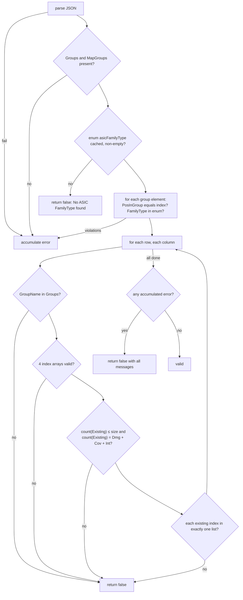

# 06. Wafer type map: format, validation, ASIC generation

The wafer type map is the one piece of real domain logic in the agent. It is a JSON document
stored per wafer type (`WaferTypeMap.waferMap`) that describes every die on a wafer of that type.
When a wafer is registered (`CreateWafer`), the agent reads the map of the wafer's type and
**creates one `Asic` row per existing die**, deriving serial number, position, family type and
quality from the map.

Source: `app/src/DbAgentDto/DbWaferTypeDto.cpp` (`checkWaferTypeMap`, `extractRange`),
`app/src/DbAgentDto/DbWaferDto.cpp` (`createAllAsics`). Real maps: `Configurations/WaferTypeMappings/`.

## 1. Where the map travels

- `CreateWaferType` carries it as a **string** (`data.create.waferMap`, stringified JSON). The agent
  validates it (§3) and stores the string in the `json` column `WaferTypeMap.waferMap`.
- `GetWaferTypeMap` returns `{ entity: { waferTypeId, waferMap } }` with `waferMap` as the stored
  text (a string, see [04 §3](04-request-engine.md#3-reading-rows-from-postgresql)).
- `CreateWafer` loads it by `waferTypeId`, parses it, and runs §4.

## 2. Format

```jsonc
{
  // Informational header: not read by the agent
  "FileName": "ER2WaferMap_v0", "MotherFilename": "ER2_mother", "DateOfCreation": "…",
  "DateOfLastUpdate": "…", "Revision": "0.0.0", "Orientation": "North",

  // Groups: named lists of die designs. A group is a repeating unit (e.g. one reticle column).
  "Groups": {
    "Group_0": [ { "PosInGroup": 0, "FamilyType": "MOSAIX" } ],
    "Group_1": [ { "PosInGroup": 0, "FamilyType": "BABYMOSAIX" }, { "PosInGroup": 1, "FamilyType": "BABYMOSAIX" } ]
  },

  // MapGroups: the physical layout, row by row. Each row is a list of group instances (columns).
  "MapGroups": {
    "MapGroupsRow0": {
      "SN_prefix": "MOSAIX-1",                    // optional; see §4 serial-number rule
      "MapGroupsColumns": [
        {
          "GroupName": "Group_0",                 // must exist in Groups
          "Property": "WithMechanicallyIntegerASICs",   // informational, not read
          "ExistingAsics":            ["All"],    // which PosInGroup indices physically exist in this instance
          "MechanicallyDamagedASICs": [],         // subset of ExistingAsics
          "ASICsCoveredByGreenLayer": [],         // subset of ExistingAsics
          "MechanicallyIntegerASICs": ["All"]     // subset of ExistingAsics
        }
      ]
    },
    "MapGroupsRow1": { "MapGroupsColumns": [ /* … */ ] }
  }
}
```

**Index arrays** (`ExistingAsics` and the three quality lists) accept three forms:

| Value | Meaning |
|---|---|
| `null`, missing, or `[]` | no indices |
| `["All"]` (first element is the string `"All"`) | every index `0 … Groups[GroupName].length - 1` |
| `[0, 3, 4]` (all numbers) | exactly those `PosInGroup` indices |
| anything else | invalid |

Observed in the real files: ER1 has 61 rows and no `SN_prefix`; ER2 has 37 rows, 6 groups, 34
distinct family types, and prefixes `MOSAIX-1 … MOSAIX-5`, `babyMOSAIX-1 … babyMOSAIX-4`.

## 3. Validation (`checkWaferTypeMap`)

Run on `CreateWaferType`. Checks in this order; the first group of checks **accumulates** messages
(all violations reported together), the second group **stops at the first** violation.

Accumulating:

1. The string parses as JSON. (Error: `WaferTypeMap don't follow json format.`)
2. Both `Groups` and `MapGroups` exist. (`Wrong json format. Missing Groups or MapGroups objects.`)
3. The DB enum `asicFamilyType` has at least one value in the agent's cache; otherwise stop with
   `No ASIC FamilyType found.`
4. For every group, every element: `PosInGroup` equals its 0-based array index
   (`Unmatching PosInGroup index: i from expected j in group G`), and `FamilyType` is a value of the
   `asicFamilyType` enum (`Asic Family type: X is not part of enum value in the DB`).

Stop-at-first, for every `MapGroups` row and every column in it:

5. `GroupName` exists in `Groups`. (`Map Group: R Col: C group name Gwas not found`, sic)
6. All four index arrays are valid per §2. (`Map Group: R Col: C Wrong array found`)
7. `|ExistingAsics| ≤ groupSize` and `|ExistingAsics| = |Damaged| + |Covered| + |Integer|`.
   (`Map Group: R Col: C, unmaching number of asics and properties size`)
8. Every index in `ExistingAsics` appears in **exactly one** of the three quality lists.
   (`Map Group: R Col: C, asic index i has more than one property`)

Not checked: indices inside the quality lists that are not
in `ExistingAsics`; indices out of the group's range; duplicate indices; `SN_prefix` type; whether
the resulting ASIC serial numbers would collide.



Author (Q3): additional checks (indices outside `ExistingAsics`, duplicates, out-of-range indices,
serial-number collisions) would be welcome.

## 4. ASIC generation algorithm

Called by `CreateWafer` after the wafer and its first location row are inserted. Inputs: the new
`waferId`, the wafer `serialNumber` (`waferSN`), the parsed map.

```ts
function generateAsics(waferId: number, waferSN: string, map: WaferMap): AsicRow[] {
    // Rows are processed in numeric order of the suffix after "MapGroupsRow" (string sort would put Row10 before Row2)
    const rows = Object.keys(map.MapGroups)
        .map(key => ({ key, index: parseInt(key.slice('MapGroupsRow'.length)) }))
        .sort((a, b) => a.index - b.index)

    const out: AsicRow[] = []
    for (const { key, index: row } of rows) {
        const rowDef   = map.MapGroups[key]
        const snPrefix = rowDef.SN_prefix ?? ''
        let col = 0                       // running die index across ALL columns of this row
        let goodBabyMosaix = 0            // per-row counter, only used with a "babyMOSAIX-" prefix

        for (const column of rowDef.MapGroupsColumns) {
            const group    = map.Groups[column.GroupName]
            const existing = expand(column.ExistingAsics,            group.length)
            const damaged  = expand(column.MechanicallyDamagedASICs, group.length)
            const covered  = expand(column.ASICsCoveredByGreenLayer, group.length)
            const intact   = expand(column.MechanicallyIntegerASICs, group.length)

            for (const i of existing) {
                const position = `${row}_${col}`
                const quality  = damaged.includes(i) ? 'MechanicallyDamaged'
                               : covered.includes(i) ? 'CoveredByGreenLayer'
                               : intact.includes(i)  ? 'MechanicallyInteger'
                               : fail(`Wrong Asic quality property for asic ${i}`)
                const familyType = group[i].FamilyType || fail('invalid familyType')

                let serialNumber: string
                if (quality === 'MechanicallyInteger' && snPrefix !== '') {
                    serialNumber = snPrefix
                    if (snPrefix.includes('babyMOSAIX-')) serialNumber += `_${++goodBabyMosaix}`
                    serialNumber += `_${waferSN}`
                } else {
                    serialNumber = `${waferSN}_${position}`
                }

                out.push({ waferId, serialNumber, waferMapPosition: position, familyType, quality })
                col++
            }
        }
    }
    return out
}

function expand(arr: unknown, size: number): number[] {
    if (arr == null || (Array.isArray(arr) && arr.length === 0)) return []
    if (Array.isArray(arr) && arr[0] === 'All') return [...Array(size).keys()]
    if (Array.isArray(arr) && arr.every(x => typeof x === 'number')) return arr as number[]
    fail('Wrong array found')
}
```

In the C++ each `AsicRow` is inserted immediately, one `INSERT` per die, with no transaction:
a failure (e.g. a duplicate serial number) leaves the wafer, its location row and the dies inserted
so far in the database and returns `BadRequest` to the client. ER1 has hundreds of dies per wafer.

Rules worth stating in words:

- **Position** `"<row>_<col>"`: `row` is the number in the `MapGroupsRow<n>` key; `col` counts
  existing dies from the start of the row across all its columns, so it is not the index within a
  group and skips nothing for non-existing dies.
- **Serial number**, default: `<waferSN>_<row>_<col>`.
- **Serial number**, intact die in a row with `SN_prefix`: `<prefix>_<waferSN>`; if the prefix
  contains `babyMOSAIX-`, a per-row 1-based counter of intact dies is inserted:
  `<prefix>_<k>_<waferSN>`. Damaged or covered dies in such rows fall back to the default form.
  The counter counts only intact dies, so the k-th intact baby MOSAIX in a row is `_k`.
- A `MOSAIX-n` row (no `baby`) therefore yields the same serial number for every intact die in that
  row; the map author is responsible for having exactly one intact die per such row, since
  `Asic.serialNumber` is `UNIQUE` and a second one fails the insert.
- Quality precedence when (invalidly) listed in several lists: damaged > covered > intact. Validation
  (§3 rule 8) normally prevents this.

**Verified against data (2026-11-08 dumps).** Running the algorithm above on the map stored for
each wafer type reproduces the `Asic` table exactly: 12 of 12 prod wafers (41 052 rows, all ER2)
and 15 of 15 dev wafers (ER1 with 4 436 dies, ER2, and a one-die AncMPW2 map) match on serial
number, position, family type and quality, including the `babyMOSAIX-n_k` numbering and the
`MOSAIX-n` rows. See [03 §7](03-database-schema.md#7-data-in-the-2026-11-08-dumps).

Author (Q1, Q2): the rule is intended for ER2, where mechanically intact MOSAIX and babyMOSAIX dies
follow the ITS3 naming; what ER3 and later runs will do is not decided yet. The `<row>_<col>`
position numbering is the convention downstream relies on and must be kept exactly.

## 5. Worked examples

### 5.1 `dummy_MPW1_WaferMap.json`

One group with one die, one row with one column, `ExistingAsics: ["All"]`,
`MechanicallyIntegerASICs: ["All"]`, no prefix. Registering wafer `W-001` creates:

| serialNumber | waferMapPosition | familyType | quality |
|---|---|---|---|
| `W-001_0_0` | `0_0` | `AncMPW1` | `MechanicallyInteger` |

### 5.2 An ER2 row with a prefix

Row `MapGroupsRow7` with `SN_prefix: "babyMOSAIX-1"` and two columns:

| column | GroupName | ExistingAsics | Damaged | Covered | Integer |
|---|---|---|---|---|---|
| 0 | `Group_1` (2 dies, BABYMOSAIX) | `[0, 1]` | `[1]` | `[]` | `[0]` |
| 1 | `Group_1` | `["All"]` | `[]` | `[]` | `["All"]` |

For wafer `HS01769-12A4`:

| col | die | serialNumber | position | quality |
|---|---|---|---|---|
| 0 | col0 / i=0 | `babyMOSAIX-1_1_HS01769-12A4` | `7_0` | MechanicallyInteger |
| 1 | col0 / i=1 | `HS01769-12A4_7_1` | `7_1` | MechanicallyDamaged |
| 2 | col1 / i=0 | `babyMOSAIX-1_2_HS01769-12A4` | `7_2` | MechanicallyInteger |
| 3 | col1 / i=1 | `babyMOSAIX-1_3_HS01769-12A4` | `7_3` | MechanicallyInteger |

A row with `SN_prefix: "MOSAIX-3"` and a single intact MOSAIX die yields `MOSAIX-3_HS01769-12A4`.

## 6. Reference files

| File | Content |
|---|---|
| `Configurations/WaferTypeMappings/ER1WaferMap_v0.json` | ER1 layout: 61 rows, no serial prefixes |
| `Configurations/WaferTypeMappings/ER2WaferMap_v0.json` | ER2 layout: 37 rows, 6 groups, MOSAIX / babyMOSAIX prefixes |
| `Configurations/WaferTypeMappings/dummy_MPW1_WaferMap.json` | minimal valid map (one die) |
| `Configurations/WaferTypeMappings/ER1_mother.json` | a "mother" file (engineering run, foundry, technology, wafer serial numbers, allowed ASICs). Not read by the agent; input to whatever tool produces the maps. |

The maps stored in the databases (2026-11-08) are JSON-identical to these files: prod holds
`ER2WaferMap_v0.json` (wafer type `ER2`); dev holds `ER1WaferMap_v0.json` and `ER2WaferMap_v0.json`
plus a one-die `AncMPW2` map in the shape of `dummy_MPW1_WaferMap.json`.

Author (Q4): the maps are written by hand; scripts to derive them from the engineering design were
being worked on (Stefano), status unknown.
