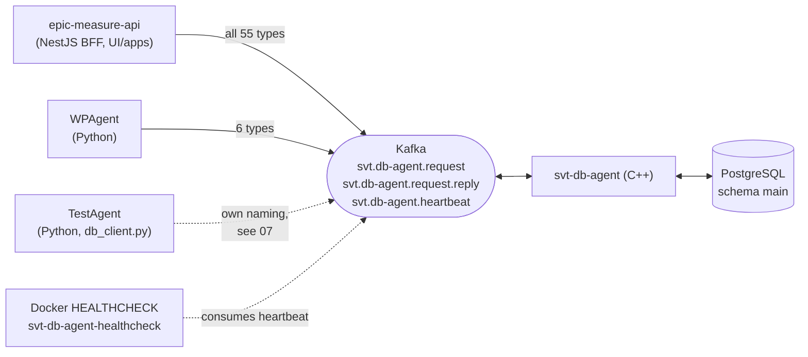

# SVT DB Agent, behavioural documentation

What the C++ DB Agent does today, described precisely enough to be checked line by line against
the code and to serve as the reference for anything that talks to it or replaces it. Written from
the code on `master` at commit `850572ad` (2026-11-07), the June 2026 example database dump, and
the Kafka contract in `Documentation/Kafka`.

**Status: draft; the questions of intent were answered by the author on 2026-11-08**
([08](08-questions-for-the-author.md): 30 of 43 resolved, their confirmations carried into the other
docs with `Author (Q-n)` markers; the 13 still open are listed at the top of 08). The behavioural
claims were derived by reading the code and three database dumps (June 2026, and dev and prod of
2026-11-08); nothing was executed against a running agent, and the by-code-reading claims below are
still unconfirmed. One algorithm, the ASIC generation of [06 §4](06-wafer-map.md#4-asic-generation-algorithm),
was verified by regenerating all 41 052 ASICs of the prod dump from their wafer maps. See
[How to review](#how-to-review) for the claims that most need confirming.

This folder documents the **current state only**. Notes about re-implementing the agent (what to
keep, what to change, migration steps) are kept separately in
[UI/docs/db-agent-clone](../../UI/docs/db-agent-clone/README.md).

For building, running, versioning and deploying the agent, see [../README.md](../README.md). For
the local stack, see [../../Dev/README.md](../../Dev/README.md).

## Reading order

| Doc | What it answers |
|---|---|
| [01-architecture.md](01-architecture.md) | How the process runs: config, startup, Kafka topics, request/reply envelope, error mapping, heartbeat, threading, failure behaviour. |
| [02-domain-model.md](02-domain-model.md) | What the entities are and how they relate, in business terms. Glossary. |
| [03-database-schema.md](03-database-schema.md) | Every table, column, enum and constraint, with ER diagrams. Where the three schema sources disagree. |
| [04-request-engine.md](04-request-engine.md) | The generic list / create / update engine every handler is built on: filters, pagination, relation merging, type mapping, transaction semantics, error messages. **Read this before 05.** |
| [05-request-handlers.md](05-request-handlers.md) | Every Kafka message type: table, columns, filters, and the exact algorithm, including the non-generic ones (wafer creation, chip creation, machine load/unload, locations, test setup/type creation, enums). |
| [06-wafer-map.md](06-wafer-map.md) | The WaferTypeMap JSON format, its validation rules, and the ASIC generation algorithm with a worked example. |
| [07-contract-drift-and-quirks.md](07-contract-drift-and-quirks.md) | Where contract, code, database and consumers disagree, and observed behaviours worth confirming. |
| [08-questions-for-the-author.md](08-questions-for-the-author.md) | The questions only the author can answer: intent, domain rules, schema decisions, operations. Answered on 2026-11-08; each carries a status, and the open ones are listed at the top. |

## Three sources of truth, and how they are labelled

The schema and the behaviour are described by artefacts that have drifted apart. Every statement
in these docs says which one it comes from:

| Label | Artefact | Status |
|---|---|---|
| **code** | `DbAgent/app/**` on `master` | What runs in production today. The authority for behaviour. |
| **contract** | `Documentation/Kafka/svt.db-agent.kafka.yaml` (55 message types) | What consumers were told. Authored on the UI side. The re-implementation documents its own behaviour in `svt.db-agent-next.kafka.yaml` next to it. |
| **june** | `Dev/db-example/db-example-2026-06-01.dump` | The database as of 2026-06-01. Superseded by the two below; kept for history. |
| **dev** | `Dev/db-example/2026-11-08-backup.dump` (database `svt_sw_db_test`) | The dev database on 2026-11-08. Matches the code on `master`. |
| **prod** | `Dev/db-example/2026-11-08-backup_prod.dump` (database `svt_sw_db`) | The production database on 2026-11-08. Lags dev on the `SvtTestList` changes of September ([03 §5](03-database-schema.md#5-where-dump-doc-and-code-disagree)). |
| **doc** | `Documentation/DB/DBTables/SVT_DB_Tables_SourceOfTruth.txt` (dbdiagram.io text) | The schema the DB owner intended. Hand-maintained; matches dev except where noted. |

Schemas were extracted with `pg_restore --schema-only`; see
[Dev/db-example/README.md](../../Dev/db-example/README.md) for the dumps and how to use them.

Where they disagree, [07-contract-drift-and-quirks.md](07-contract-drift-and-quirks.md) has the
consolidated list, and [03 §5](03-database-schema.md#5-where-dump-doc-and-code-disagree) the schema
part. The per-handler docs flag each case inline with a **Drift** or **Quirk** marker.

## Conventions used in these docs

- Message types are written as `GetAllWafers`; tables as `Wafer`; columns as `waferId`.
- Algorithms are given in TypeScript-flavoured pseudo-code. They describe observable behaviour,
  not the C++ structure.
- "Required" on a column means the C++ DTO registered it as required, which only affects the
  **count** check on create (see [04 §5](04-request-engine.md#5-create)). It is not the same as
  `NOT NULL` in the database.
- **Quirk** (`Q-…`): behaviour that looks unintended but is what runs today.
- **Drift** (`D-…`, `R-…`): contract and code disagree.
- **By code reading**: a conclusion derived from reading the C++ that was not confirmed against a
  running agent. These are the first things to review.
- "Apparent intent": what the structure of the code suggests was meant, where the result differs.
  Only the author can confirm these.

## How to review

For the author of the agent. The goal is a document that can be trusted as the description of the
current behaviour, so the questions are "is this what the code does?" and, where marked, "is this
what was intended?". Corrections can be made directly in the files.

Schema facts, checked against the dev and prod dumps of 2026-11-08
([03 §5](03-database-schema.md#5-where-dump-doc-and-code-disagree)):

- [x] S1: the live column is `ProbeCard.arriveDate` (dev and prod)
- [x] S6, S7, S8, S9, S12: Module tables, `moduleType`, the newer `pcModel` / `pcName` values and the `SvtTestSetupDefaultConfig` PK exist in both
- [x] S2, S3, S4, S5: prod still has `createsAt`, a nullable `testSetupConfigId` without FK, a `varchar` `testResultStatus` and the three `Svt*TestList` tables, while `master` and dev use `createdAt`, the FK, the enum and `SvtTestListToEntityName/Id`. Author (Q31): prod is outdated; the schema doc is the one to deploy. Which build runs in prod was not said.
- [x] S10: `configBody` is `json` in prod and `text` in dev. Author (Q27, Q31): `text`, as the schema doc says; prod follows once the dev schema is validated.
- [x] S11: `SvtTestTemplate.testTypeConfigId` is nullable in every database but `NOT NULL` in the schema doc. Author (Q33): probably NOT NULL.

Behaviour verified against data:

- [x] [06 §4](06-wafer-map.md#4-asic-generation-algorithm): ASIC generation regenerates all 41 052 prod ASICs and all 48 910 dev ASICs exactly

Behaviour derived **by code reading**, not observed:

- [ ] [05 §5](05-request-handlers.md#5-chip) Q-H3: `GetAllChips` with `filter.familyTypes` fails (column not registered)
- [ ] [05 §4](05-request-handlers.md#4-asic) Q-H4: `GetAllAsics` with `filter.chipId` produces invalid SQL
- [ ] [05 §5](05-request-handlers.md#5-chip) Q-H5: `CreateChip` never creates `ChipBlock` rows (filter rejected, error only logged)
- [ ] [05 §5](05-request-handlers.md#5-chip) Q-H6: `CreateManyChips` requires `data.items` and replies with all chips
- [ ] [05 §13](05-request-handlers.md#13-svttesttype) Q-H9: the `dutTypes` filter on `GetAllSvtTestTypes` is a no-op
- [ ] [05 §13](05-request-handlers.md#13-svttesttype) Q-H10: `UpdateSvtTestType` reads `data.testTypeId` and `data.dutTypes`
- [ ] [05 §7](05-request-handlers.md#7-waferprobemachine) Q-H8a: a wafer swap writes one `Loaded` row and no `Unloaded` row
- [ ] [05 §7](05-request-handlers.md#7-waferprobemachine) Q-H8b: `UpdateWpMachineInstalledProbeCard` with a null card fails on `NOT NULL`
- [ ] [05 §2](05-request-handlers.md#2-wafertype) Q-H1: `CreateWaferType` requires a `data.waferMap` key in addition to `data.create.waferMap`
- [ ] [05 §1](05-request-handlers.md#1-shared-pattern-location-tracked-entities) Q-H7: `Update*Location` needs all five keys; the current location is the newest by `date`
- [ ] [04 §4.4](04-request-engine.md#44-mergerelations) Q-R2: a scalar relation with zero rows fails the whole list
- [ ] [04 §5](04-request-engine.md#5-create) Q-C1: boolean values are dropped from INSERTs
- [ ] [04 §4.5](04-request-engine.md#45-page) Q-P1: unpaged lists above 5000 rows reply with an empty list
- [ ] [04 §7](04-request-engine.md#7-transaction-semantics): `commit;` / `abort()` on a `nontransaction` do not form transactions
- [ ] [01 §5](01-architecture.md#5-request--reply-envelope), [§7](01-architecture.md#7-failure-and-recovery-behaviour): a non-JSON payload ends the process; a payload without `type` or `data` is undefined behaviour
- [ ] [01 §5](01-architecture.md#5-request--reply-envelope): `NotFound` and `UnexpectedError` are never emitted

Questions of **intent**, domain rules, schema decisions and operations are collected in
[08-questions-for-the-author.md](08-questions-for-the-author.md); the author answered them on
2026-11-08. Of the starred ones, the schema divergence (Q31), chip block naming (Q6), module design
(Q9), the DUT model (Q21), the `configBody` type (Q27), location semantics (Q10) and the
authoritative contract (Q36) are settled; the test record scheme (Q24) and the result status (Q25)
are still open.

## Who talks to the agent

WPAgent uses exactly: `GetAllWaferProbeProjects`, `GetAllWaferProbeMachines`, `GetAllAsics`
(filter `ids` + pager), `UpdateWpMachineLoadedWafer`, `UpdateWpMachineInstalledProbeCard`, and
`GetAllWaferProbeMachines` again as a connectivity probe (`WPAgent/services/WPDbKafkaClient.py`).

The TestAgent's own message names are not part of the contract: the author confirmed (Q36) that
`svt.db-agent.kafka.yaml` is the only contract, so the TestAgent is expected to move to it.
