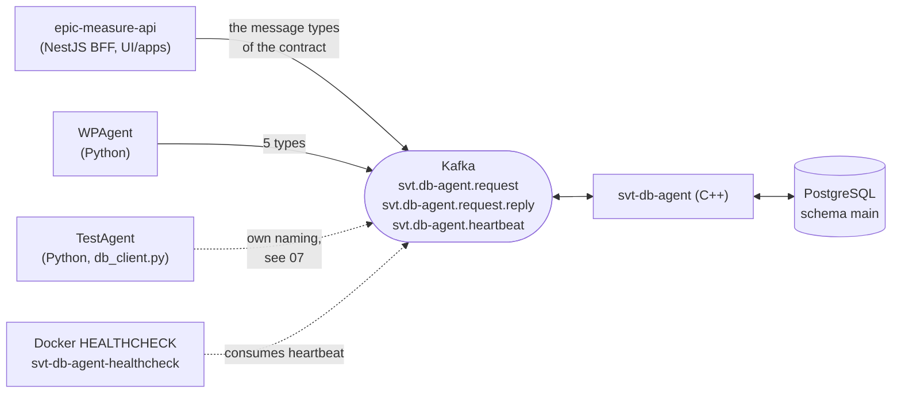

# SVT DB Agent (C++), behavioural documentation

> **Frozen.** The C++ DB agent is frozen since 2026-11-15, and this folder with it. Development of the
> DB agent continues in the NestJS re-implementation [`DbAgentNext/`](../../DbAgentNext/README.md).
> Why, and the state at the freeze: [the fork note](../../Documentation/decisions/2026-11-db-agent-clone.md).
> Since 2026-11-18 the C++ agent gets no support, and `svt-db-agent-next` is the DB agent of every environment
> ([decision](../../Documentation/decisions/2026-11-db-agent-next-only.md)).

## What this folder is

The description of what the C++ DB agent does: the code of `DbAgent/` at the freeze (last code change
`efb41102`, 2026-10-31), defects included. It is precise enough to be checked line by line against the
code. Use it for two things:

- to operate the C++ container of the production stack until that stack is switched;
- to compare the DB agent `svt-db-agent-next` with it, if that is ever necessary
  ([`DbAgentNext/test-parity`](../../DbAgentNext/test-parity/README.md)). No log of differences is kept: such a
  comparison is made from this folder and from `DbAgentNext/docs`.

For building, running, versioning and deploying the agent, see [../README.md](../README.md). For the
local stack, see [../../Dev/README.md](../../Dev/README.md).

## What this folder is not

The re-implementation started as a copy of the behaviour described here. Its docs and this folder
therefore describe almost the same entities, relations, tables and messages. They are two
descriptions of two programs, and they move apart with every change of the re-implementation.

**Do not use this folder as the source of truth for the system under development.** This applies
most of all to the domain model ([02](02-domain-model.md)) and the schema
([03](03-database-schema.md)): they look current, and they are a snapshot.

| Subject | Authority for the system under development | What this folder has |
|---|---|---|
| The domain: entities, relations, lifecycles, terms | [`DbAgentNext/docs/domain-model.md`](../../DbAgentNext/docs/domain-model.md), [`Documentation/domain-model.md`](../../Documentation/domain-model.md), [`Documentation/glossary.md`](../../Documentation/glossary.md) | [02](02-domain-model.md): the C++ agent's view at the freeze |
| The database schema | [`DbAgentNext/docs/database-schema.md`](../../DbAgentNext/docs/database-schema.md), which the migrations of `DbAgentNext/src/migrations` build | [03](03-database-schema.md): the dev and prod databases of 2026-11-08. [`DBTables/`](DBTables/README.md): the schema file that the DB owner maintained by hand until the freeze |
| The Kafka contract | [`svt.db-agent-next.kafka.yaml`](../../Documentation/Kafka/svt.db-agent-next.kafka.yaml) | [`svt.db-agent.kafka.yaml`](../../Documentation/Kafka/svt.db-agent.kafka.yaml), [04](04-request-engine.md), [05](05-request-handlers.md): what the C++ serves |
| What the agent does for a request | [`DbAgentNext/docs/messages.md`](../../DbAgentNext/docs/messages.md) | [04](04-request-engine.md), [05](05-request-handlers.md): what the C++ does |
| The wafer map and the ASIC generation | [`DbAgentNext/docs/wafer-map.md`](../../DbAgentNext/docs/wafer-map.md) | [06](06-wafer-map.md): the C++ algorithm |
| The reasons for a behaviour | [`DbAgentNext/docs`](../../DbAgentNext/docs/README.md) | [07](07-contract-drift-and-quirks.md): the defects of the C++, each with an id |

No log of what the re-implementation changed after the fork is kept. Its own docs describe its current state.

## Rules for this folder

- The code of `DbAgent/` does not change, and this folder describes that code. Change a page only to
  correct a statement that does not agree with the frozen code. Do not describe the behaviour of the
  re-implementation here.
- An answer to an open question of [08](08-questions-for-the-author.md) may still be recorded there.
- The ids of [07](07-contract-drift-and-quirks.md) (`D-…`, `R-…`, `X-…`), the quirk ids (`Q-H3`, `Q-C1`, …)
  and the question numbers of 08 (`Q31`) do not change: both Kafka contracts and `DbAgentNext/docs`
  quote them.

## Reading order

| Doc | What it answers |
|---|---|
| [01-architecture.md](01-architecture.md) | How the process runs: config, startup, Kafka topics, request/reply envelope, error mapping, heartbeat, threading, failure behaviour. |
| [02-domain-model.md](02-domain-model.md) | What the entities are and how they relate, as the C++ agent sees them. Glossary. |
| [03-database-schema.md](03-database-schema.md) | Every table, column, enum and constraint, with ER diagrams. Where the schema sources disagree. |
| [04-request-engine.md](04-request-engine.md) | The generic list / create / update engine every handler is built on: filters, pagination, relation merging, type mapping, transaction semantics, error messages. **Read this before 05.** |
| [05-request-handlers.md](05-request-handlers.md) | Every Kafka message type: table, columns, filters, and the exact algorithm, including the non-generic ones (wafer creation, chip creation, machine load/unload, locations, test setup/type creation, enums). |
| [06-wafer-map.md](06-wafer-map.md) | The WaferTypeMap JSON format, its validation rules, and the ASIC generation algorithm with a worked example. |
| [07-contract-drift-and-quirks.md](07-contract-drift-and-quirks.md) | Where the contract (before its alignment), the code, the database and the consumers disagree, and the defects of the code. |
| [08-questions-for-the-author.md](08-questions-for-the-author.md) | The questions of intent, domain rules, schema decisions and operations, with the author's answers of 2026-11-08. The 13 still open are listed at its top. |
| [DBTables/](DBTables/README.md) | `SVT_DB_Tables_SourceOfTruth.txt`: the schema as dbdiagram.io text, as the DB owner maintained it by hand. It was `Documentation/DB/DBTables/` until 2026-11-18. It is frozen with this folder and is not maintained. |

## The sources, and how they are labelled

The schema and the behaviour are described by artefacts that differ from each other. Every statement
in these docs says which one it comes from:

| Label | Artefact | Status |
|---|---|---|
| **code** | `DbAgent/app/**` | The frozen C++ code. The authority for the behaviour of the C++ agent. |
| **contract** | `Documentation/Kafka/svt.db-agent.kafka.yaml` **before 2026-11-18** (git: `850572ad`, 55 message types) | What the consumers were told: the intended behaviour, authored on the UI side. On 2026-11-18 the file was aligned with the code (53 message types); since then it says what the code does, and [07](07-contract-drift-and-quirks.md) keeps the differences. |
| **june** | `Dev/db-example/db-example-2026-06-01.dump` | The database as of 2026-06-01. Superseded by the two below; kept for history. |
| **dev** | `Dev/db-example/2026-11-08-backup.dump` (database `svt_sw_db_test`) | The dev database on 2026-11-08. Matches the code. |
| **prod** | `Dev/db-example/2026-11-08-backup_prod.dump` (database `svt_sw_db`) | The production database on 2026-11-08. Lags dev on the `SvtTestList` changes of September ([03 §5](03-database-schema.md#5-where-dump-doc-and-code-disagree)). |
| **doc** | [`DBTables/SVT_DB_Tables_SourceOfTruth.txt`](DBTables/SVT_DB_Tables_SourceOfTruth.txt) (dbdiagram.io text; `Documentation/DB/DBTables/` until 2026-11-18, and the pages of this folder still give that path) | The schema the DB owner intended. Hand-maintained until the freeze; matches dev except where noted. |
| **recorded** | `DbAgentNext/test-parity/snapshots/cpp.json` | The replies of the C++ agent to the 396 requests of the parity suite, on a restore of the dev dump, 2026-11-14. |

Schemas were extracted with `pg_restore --schema-only`; see
[Dev/db-example/README.md](../../Dev/db-example/README.md) for the dumps and how to use them.

Where the sources disagree, [07-contract-drift-and-quirks.md](07-contract-drift-and-quirks.md) has the
consolidated list, and [03 §5](03-database-schema.md#5-where-dump-doc-and-code-disagree) the schema
part. The per-handler docs flag each case inline with a **Drift** or **Quirk** marker.

## Conventions used in these docs

- Message types are written as `GetAllWafers`; tables as `Wafer`; columns as `waferId`.
- Algorithms are given in TypeScript-flavoured pseudo-code. They describe observable behaviour,
  not the C++ structure.
- "Required" on a column means the C++ DTO registered it as required, which only affects the
  **count** check on create (see [04 §5](04-request-engine.md#5-create)). It is not the same as
  `NOT NULL` in the database.
- **Quirk** (`Q-…`): behaviour that looks unintended but is what the code does.
- **Drift** (`D-…`, `R-…`): the contract (before its alignment) and the code disagree.
- **By code reading**: a conclusion derived from reading the C++. The table below says which of these
  the recorded replies confirm.
- "Apparent intent": what the structure of the code suggests was meant, where the result differs.
- `Author (Q-n)`: confirmed by the author of the C++ agent in the answer to question n of 08.

## How it was verified

- **The code.** Every statement of behaviour was derived by reading the C++.
- **The databases.** The schema facts were checked against the dev and prod dumps of 2026-11-08
  ([03 §5](03-database-schema.md#5-where-dump-doc-and-code-disagree), S1 to S16). Prod lags dev on the
  `SvtTestList` changes; the author (Q27, Q31, Q33) settled which side is intended.
- **The data.** The ASIC generation of [06 §4](06-wafer-map.md#4-asic-generation-algorithm) regenerates
  all 41 052 ASICs of the prod dump and all 48 910 of the dev dump exactly.
- **The author.** The questions of intent were answered on 2026-11-08 (08): 30 of 43 resolved.
- **The recorded replies.** On 2026-11-14 the C++ agent, built from `DbAgent/`, answered the 396
  requests of the parity suite. The table shows what the replies say about the statements that came
  from code reading alone. All 393 replies have the status `Success` or `BadRequest`; three malformed
  records got no reply.

| Statement | Recorded replies |
|---|---|
| [05 §5](05-request-handlers.md#5-chip) Q-H3: `GetAllChips` with `filter.familyTypes` fails | confirmed |
| [05 §4](05-request-handlers.md#4-asic) Q-H4: `GetAllAsics` with `filter.chipId` fails | confirmed (`Error: getting entries`) |
| [05 §5](05-request-handlers.md#5-chip) Q-H5: `CreateChip` never creates `ChipBlock` rows | not covered: no message of the agent lists chip blocks |
| [05 §5](05-request-handlers.md#5-chip) Q-H6: `CreateManyChips` requires `data.items` and replies with all chips | confirmed |
| [05 §13](05-request-handlers.md#13-svttesttype) Q-H9: the `dutTypes` filter on `GetAllSvtTestTypes` | **corrected**: not a no-op; the reply is always an empty list without `totalCount` |
| [05 §13](05-request-handlers.md#13-svttesttype) Q-H10: `UpdateSvtTestType` reads `data.testTypeId` and `data.dutTypes` | confirmed |
| [05 §7](05-request-handlers.md#7-waferprobemachine) Q-H8a: a wafer swap writes one `Loaded` row and no `Unloaded` row | not covered: no message of the agent lists that history |
| [05 §7](05-request-handlers.md#7-waferprobemachine): a wafer load needs an orientation | **corrected**: only an explicit `null` is rejected; a request without the key is accepted |
| [05 §7](05-request-handlers.md#7-waferprobemachine) Q-H8b: `UpdateWpMachineInstalledProbeCard` with a null card fails on `NOT NULL` | confirmed |
| [05 §2](05-request-handlers.md#2-wafertype) Q-H1: `CreateWaferType` requires a `data.waferMap` key | confirmed |
| [05 §1](05-request-handlers.md#1-shared-pattern-location-tracked-entities) Q-H7: `Update*Location` needs all five keys; the current location is the newest by `date` | confirmed, both |
| [05 §11](05-request-handlers.md#11-svttestsetup): `CreateSvtTestSetup` creates the setup, its config and the default-config row | **corrected**: it always fails after it wrote the setup row (Q-R2) |
| [05 §12](05-request-handlers.md#12-svttestsetupconfig-and-svttesttypeconfig) Q-H20: `Get*ConfigBody` with an unknown id | **corrected**: `entity: null`, not `entity: {}` |
| [04 §4.4](04-request-engine.md#44-mergerelations) Q-R2: a scalar relation with zero rows fails the whole list | confirmed (`vector::_M_range_check…`) |
| [04 §5](04-request-engine.md#5-create) Q-C1: boolean values are dropped from INSERTs | confirmed (a template created with `isEnabled: false` is enabled) |
| [04 §5](04-request-engine.md#5-create) Q-C3: the count check on create | confirmed |
| [04 §4.3](04-request-engine.md#43-selectentries--where-generation) Q-F1: `null` and `true` as filter values are ignored | confirmed |
| [04 §4.5](04-request-engine.md#45-page) Q-P1: unpaged lists above 5000 rows reply with an empty list | confirmed (`GetAllAsics` without a filter) |
| [04 §7](04-request-engine.md#7-transaction-semantics): no transactions | confirmed for one case: the failed `CreateSvtTestSetup` left its setup row |
| [04 §9](04-request-engine.md#9-sql-generation-rules) Q-S1: a `'` in a value breaks the statement | confirmed |
| [01 §5](01-architecture.md#5-request--reply-envelope), [§7](01-architecture.md#7-failure-and-recovery-behaviour): a non-JSON payload ends the process | confirmed; so does a payload without `type` or with a numeric `type`. A list request without `data` was served. |
| [01 §5](01-architecture.md#5-request--reply-envelope): `NotFound` and `UnexpectedError` are never emitted | confirmed in all 393 replies |

The corrections are carried into 01, 04, 05 and 07.

## Who talked to the agent at the freeze

WPAgent uses exactly: `GetAllWaferProbeProjects`, `GetAllWaferProbeMachines` (also as a connectivity
probe), `GetAllAsics` (filter `ids` + pager), `UpdateWpMachineLoadedWafer` and
`UpdateWpMachineInstalledProbeCard` (`WPAgent/services/WPDbKafkaClient.py`).

The TestAgent's own message names are not part of the contract: the author confirmed (Q36) that
`svt.db-agent.kafka.yaml` is the only contract, so the TestAgent is expected to move to it.

The same consumers talk to the re-implementation on the same topics: it holds the consumer group of
the C++ agent, so only one of the two agents serves an environment.
