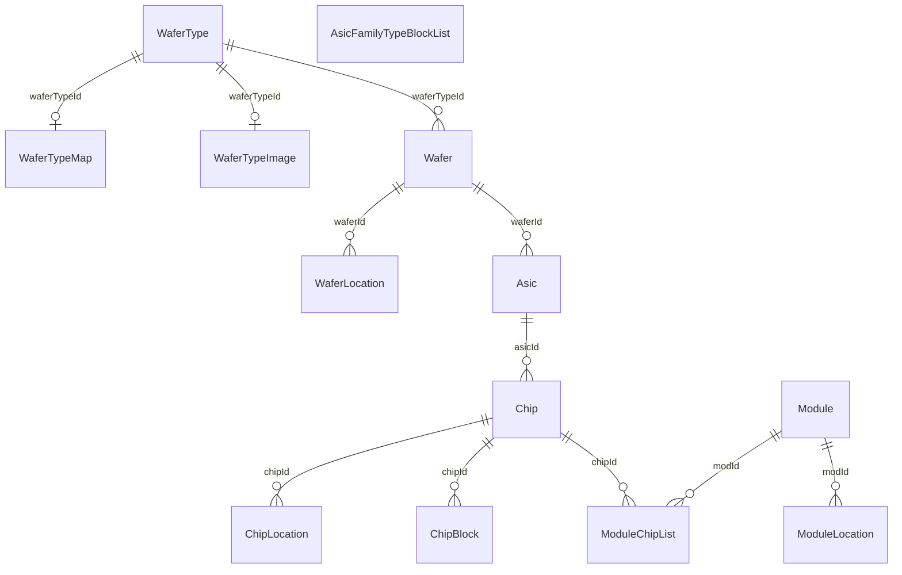
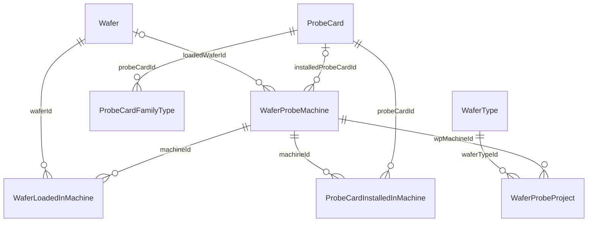
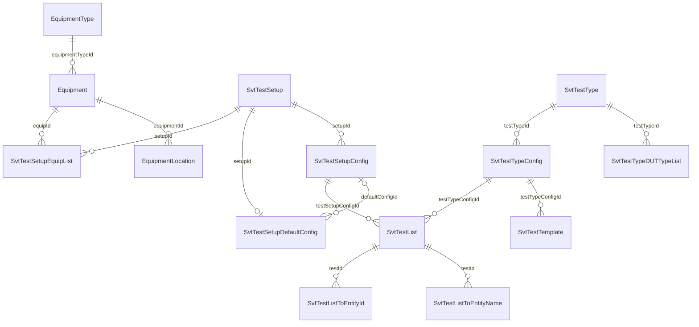

# Database schema

The current schema of the database that `svt-db-agent-next` owns: every table, column, key and enum type of the
schema `main`. This page is the authority for the schema. The migrations in `../src/migrations` build this schema,
and the entities in `../src/db/data` map it.

**The rule.** A change of the schema changes this page, a migration and the entities in the same pull request. A
proposal for a schema change is a change of this page ([§8](#8-how-to-change-the-schema)).

| Related page | Content |
|---|---|
| [domain-model.md](domain-model.md) | What the tables mean: the entities, their relations and their rules. |
| [messages.md](messages.md) | Which message reads or writes which table, and with which checks. |
| [wafer-map.md](wafer-map.md) | The JSON document in `WaferTypeMap.waferMap`, and how the `Asic` rows come from it. |
| [02-database-migration.md](02-database-migration.md) | How a migration is made and run, and how a table maps onto a MikroORM entity. |

**State.** This page describes the schema after the migration `Migration20261112000004_config_body_text`, the latest of
5 migrations. It was checked on 2026-11-18 against a database that the migrations built from an empty
database (PostgreSQL 17.7): 33 tables of the domain and 21 enum types
([§9](#9-how-to-check-this-page)).

## 1. Conventions

- **One schema.** All tables and enum types are in the schema `main`. The schema name is one setting of the agent
  (`SVT_DB_AGENT_DB_SCHEMA`).
- **Quoted identifiers.** Tables are in PascalCase (`"WaferType"`) and columns are in camelCase
  (`"waferTypeId"`). SQL must quote them.
- **Primary key.** A table has `id integer GENERATED BY DEFAULT AS IDENTITY` (24 tables). The exceptions
  are the tables whose key is a foreign key (`WaferTypeMap`, `WaferTypeImage`, `SvtTestSetupDefaultConfig`) and
  the link tables with a key of two columns. In the tables below, "identity" in the column **Default** means this
  clause.
- **Foreign keys.** Each of the 34 foreign keys is `DEFERRABLE` (initially immediate) and has no `ON DELETE` or
  `ON UPDATE` action. The database thus refuses to delete a row that another row refers to.
- **Constraint names.** The names are the PostgreSQL defaults: `<Table>_pkey`, `<Table>_<column>_key`,
  `<Table>_<column>_fkey`. Two unique indexes have their own names (`SvtTestTypeConfig`, `SvtTestTemplate`).
- **Enum types.** A column with a fixed list of values has a native PostgreSQL enum type ([§6](#6-enum-types)).
  In the tables below, the type is written `enum <name>`.
- **Dates and times.** A `date` column has day resolution. The three `timestamp` columns of `SvtTestList` are
  `timestamp without time zone` and hold UTC.
- **JSON documents.** `WaferTypeMap.waferMap`, `Equipment.specification` and `WaferProbeProject.local2GlobalMap`
  are `json` (not `jsonb`). The two `configBody` columns are `text`, so they can hold JSON5 too. In all five, the agent stores the text that
  the client sent and returns the same text.
- **Nothing else.** The schema has no view, no function, no trigger and no check constraint. The only indexes are
  those of the keys and of the unique constraints.
- **No delete.** No message deletes a row of an entity. `UpdateSvtTestType` replaces the rows of
  `SvtTestTypeDUTTypeList` of one test type; that is the only delete that the agent makes.

## 2. Overview

| Area | Tables | Section |
|---|---|---|
| Silicon | `WaferType`, `WaferTypeMap`, `WaferTypeImage`, `Wafer`, `WaferLocation`, `Asic`, `Chip`, `ChipLocation`, `ChipBlock`, `AsicFamilyTypeBlockList`, `Module`, `ModuleChipList`, `ModuleLocation` | [§3](#3-silicon) |
| Wafer probing | `WaferProbeMachine`, `WaferLoadedInMachine`, `ProbeCard`, `ProbeCardFamilyType`, `ProbeCardInstalledInMachine`, `WaferProbeProject` | [§4](#4-wafer-probing) |
| Equipment and testing | `EquipmentType`, `Equipment`, `EquipmentLocation`, `SvtTestSetup`, `SvtTestSetupConfig`, `SvtTestSetupDefaultConfig`, `SvtTestSetupEquipList`, `SvtTestType`, `SvtTestTypeDUTTypeList`, `SvtTestTypeConfig`, `SvtTestTemplate`, `SvtTestList`, `SvtTestListToEntityName`, `SvtTestListToEntityId` | [§5](#5-equipment-and-testing) |
| Technical | `mikro_orm_migrations` | [§7](#7-technical-table) |

The agent maps 28 tables to entities. It does not map 5 tables:
`WaferTypeImage`, `Module`, `ModuleChipList`, `ModuleLocation`, `SvtTestSetupEquipList`.
No message reads or writes them. They exist because the database had them before the agent, and the first migration
keeps them.

The diagrams show the foreign keys. A label is the column of the child table. `||` is "exactly one", `|o` and
`o|` are "zero or one", `o{` is "zero or more".

**Silicon**



**Wafer probing**



**Equipment and testing**



## 3. Silicon

Wafer types, wafers, the dies of a wafer (ASICs), chips, chip blocks and their location histories.

### 3.1 `WaferType`

The design of a wafer: one engineering run, one foundry, one technology.

- **Entity:** `SvtDbWaferTypeEntity` ([`src/db/data/wafer-types/svt-db-wafer-type.entity.ts`](../src/db/data/wafer-types/svt-db-wafer-type.entity.ts)).
- **Written by:** `CreateWaferType`. No message changes a row.

| Column | Type | Null | Default | Key | Meaning |
|---|---|---|---|---|---|
| `id` | `integer` | no | identity | PK |  |
| `name` | `varchar(50)` | no |  | unique | The name of the wafer type. |
| `engineeringRun` | enum `engineeringRun` | no |  | unique | The engineering run. One wafer type for each run. |
| `foundry` | enum `foundryName` | no |  |  | The foundry that makes the wafers. |
| `technology` | enum `waferTech` | no |  |  | The process of the foundry. |

### 3.2 `WaferTypeMap`

The wafer map of a wafer type. At most one row for each wafer type.

- **Entity:** `SvtDbWaferTypeMapEntity` ([`src/db/data/wafer-types/svt-db-wafer-type-map.entity.ts`](../src/db/data/wafer-types/svt-db-wafer-type-map.entity.ts)).
- **Written by:** `CreateWaferType`, together with the `WaferType` row. No message changes a row.

| Column | Type | Null | Default | Key | Meaning |
|---|---|---|---|---|---|
| `waferTypeId` | `integer` | no |  | PK, FK → `WaferType.id` | The wafer type. |
| `waferMap` | `json` | no |  |  | The wafer map, a JSON document ([wafer-map.md](wafer-map.md)). The agent stores the text that the client sent and returns it unchanged. |

### 3.3 `WaferTypeImage`

An image of a wafer type.

- **Entity:** none. The agent does not map this table.
- **Written by:** No message reads or writes this table.

| Column | Type | Null | Default | Key | Meaning |
|---|---|---|---|---|---|
| `waferTypeId` | `integer` | no |  | PK, FK → `WaferType.id` | The wafer type. |
| `imageBase64String` | `text` | no |  |  | The image as base64 text. |

### 3.4 `Wafer`

One physical wafer.

- **Entity:** `SvtDbWaferEntity` ([`src/db/data/wafers/svt-db-wafer.entity.ts`](../src/db/data/wafers/svt-db-wafer.entity.ts)).
- **Written by:** `CreateWafer`; `UpdateWafer` (the three dates); `UpdateWaferLocation` (`generalLocation`).

| Column | Type | Null | Default | Key | Meaning |
|---|---|---|---|---|---|
| `id` | `integer` | no | identity | PK |  |
| `waferTypeId` | `integer` | no |  | FK → `WaferType.id` | The wafer type. |
| `serialNumber` | `varchar(50)` | no |  | unique | The serial number that the foundry gives. |
| `batchNumber` | `integer` | no |  |  | The lot number of the foundry. |
| `thinningDate` | `date` | yes |  |  | Empty at registration. |
| `dicingDate` | `date` | yes |  |  | Empty at registration. |
| `productionDate` | `date` | yes |  |  | Empty at registration. |
| `generalLocation` | enum `wpGeneralLocation` | yes |  |  | The current location: the value of the newest row of `WaferLocation`. The schema permits `NULL`; `CreateWafer` requires a value. |

### 3.5 `WaferLocation`

The location history of a wafer: one row for each move, and one row for the creation.

- **Entity:** `SvtDbWaferLocationEntity` ([`src/db/data/wafers/svt-db-wafer-location.entity.ts`](../src/db/data/wafers/svt-db-wafer-location.entity.ts)).
- **Written by:** `CreateWafer` (the first row); `UpdateWaferLocation`. Rows are only added.

| Column | Type | Null | Default | Key | Meaning |
|---|---|---|---|---|---|
| `waferId` | `integer` | no |  | FK → `Wafer.id` | The wafer. |
| `generalLocation` | enum `wpGeneralLocation` | no |  |  | The location after this move. |
| `date` | `date` | yes | `CURRENT_DATE` |  | The day of the move. |
| `username` | `varchar(50)` | yes |  |  | Free text from the client. `NULL` on the row that a create message writes. |
| `note` | `text` | yes |  |  | Free text. `Location at creation` on the row that a create message writes. |
| `id` | `integer` | no | identity | PK | Surrogate key. The agent reads the history of a wafer in the order of this column. |

### 3.6 `Asic`

One die of a wafer.

- **Entity:** `SvtDbAsicEntity` ([`src/db/data/asics/svt-db-asic.entity.ts`](../src/db/data/asics/svt-db-asic.entity.ts)).
- **Written by:** `CreateWafer` (one row for each die of the wafer map); `CreateAsic`. No message changes a row.

| Column | Type | Null | Default | Key | Meaning |
|---|---|---|---|---|---|
| `id` | `integer` | no | identity | PK |  |
| `waferId` | `integer` | no |  | FK → `Wafer.id` | The wafer. |
| `serialNumber` | `varchar(50)` | no |  | unique | Derived from the wafer and the position ([wafer-map.md](wafer-map.md)). |
| `familyType` | enum `asicFamilyType` | no |  |  | The chip design that the die implements. |
| `waferMapPosition` | `varchar(50)` | no |  |  | The position on the wafer map, `<row>_<column>`. |
| `quality` | enum `asicQuality` | no |  |  | The mechanical state of the die. It comes from the wafer map. |

### 3.7 `Chip`

An ASIC after dicing, handled as its own object.

- **Entity:** `SvtDbChipEntity` ([`src/db/data/chips/svt-db-chip.entity.ts`](../src/db/data/chips/svt-db-chip.entity.ts)).
- **Written by:** `CreateChip`, `CreateManyChips`; `UpdateChipLocation` (`generalLocation`).

| Column | Type | Null | Default | Key | Meaning |
|---|---|---|---|---|---|
| `id` | `integer` | no | identity | PK |  |
| `asicId` | `integer` | no |  | FK → `Asic.id` | The ASIC that the chip was diced from. The column is not unique. The agent rejects a second chip for one ASIC. |
| `serialNumber` | `varchar(50)` | no |  | unique | The serial number of the chip. |
| `generalLocation` | enum `wpGeneralLocation` | no |  |  | The current location: the value of the newest row of `ChipLocation`. |

### 3.8 `ChipLocation`

The location history of a chip.

- **Entity:** `SvtDbChipLocationEntity` ([`src/db/data/chips/svt-db-chip-location.entity.ts`](../src/db/data/chips/svt-db-chip-location.entity.ts)).
- **Written by:** `CreateChip`, `CreateManyChips` (the first row); `UpdateChipLocation`. Rows are only added.

| Column | Type | Null | Default | Key | Meaning |
|---|---|---|---|---|---|
| `chipId` | `integer` | no |  | FK → `Chip.id` | The chip. |
| `generalLocation` | enum `wpGeneralLocation` | no |  |  | The location after this move. |
| `date` | `date` | yes | `CURRENT_DATE` |  | The day of the move. |
| `username` | `varchar(50)` | yes |  |  | Free text from the client. `NULL` on the row that a create message writes. |
| `note` | `text` | yes |  |  | Free text. `Location at creation` on the row that a create message writes. |
| `id` | `integer` | no | identity | PK | Surrogate key. The agent reads the history of a chip in the order of this column. |

### 3.9 `ChipBlock`

A functional block of a chip, tested as its own device.

- **Entity:** `SvtDbChipBlockEntity` ([`src/db/data/chips/svt-db-chip-block.entity.ts`](../src/db/data/chips/svt-db-chip-block.entity.ts)).
- **Written by:** `CreateChip` and `CreateManyChips`, only when `SVT_DB_AGENT_FEATURE_CHIP_BLOCKS` is on (default: off).

| Column | Type | Null | Default | Key | Meaning |
|---|---|---|---|---|---|
| `id` | `integer` | no | identity | PK |  |
| `chipId` | `integer` | no |  | FK → `Chip.id` | The chip. |
| `blockType` | enum `blockType` | no |  |  | The kind of block. |
| `serialNumber` | `varchar(50)` | no |  | unique | `<blockType>_<serial number of the chip>` on a row that the agent creates. |

### 3.10 `AsicFamilyTypeBlockList`

Which block types a family type has. Configuration data.

- **Entity:** `SvtDbAsicFamilyTypeBlockListEntity` ([`src/db/data/chips/svt-db-asic-family-type-block-list.entity.ts`](../src/db/data/chips/svt-db-asic-family-type-block-list.entity.ts)).
- **Written by:** No message writes this table. The rows are entered directly in the database.

| Column | Type | Null | Default | Key | Meaning |
|---|---|---|---|---|---|
| `asicFamilyType` | enum `asicFamilyType` | no |  | PK (part) | The family type. |
| `blockType` | enum `blockType` | no |  | PK (part) | A block type that chips of this family type have. |

Primary key: (`asicFamilyType`, `blockType`).

### 3.11 `Module`

An assembly of chips. Modules are not built: no message reads or writes the three `Module` tables.

- **Entity:** none. The agent does not map this table.
- **Written by:** No message.

| Column | Type | Null | Default | Key | Meaning |
|---|---|---|---|---|---|
| `id` | `integer` | no | identity | PK |  |
| `modType` | enum `moduleType` | no |  |  | The type of the module. |
| `serialNumber` | `varchar(50)` | no |  | unique |  |
| `generalLocation` | enum `wpGeneralLocation` | no |  |  | The current location. |

### 3.12 `ModuleChipList`

The chips of a module.

- **Entity:** none. The agent does not map this table.
- **Written by:** No message.

| Column | Type | Null | Default | Key | Meaning |
|---|---|---|---|---|---|
| `modId` | `integer` | no |  | PK (part), FK → `Module.id` | The module. |
| `chipId` | `integer` | no |  | PK (part), FK → `Chip.id` | A chip of the module. |

Primary key: (`modId`, `chipId`).

### 3.13 `ModuleLocation`

The location history of a module.

- **Entity:** none. The agent does not map this table.
- **Written by:** No message.

| Column | Type | Null | Default | Key | Meaning |
|---|---|---|---|---|---|
| `modId` | `integer` | no |  | FK → `Module.id` | The module. |
| `generalLocation` | enum `wpGeneralLocation` | no |  |  |  |
| `date` | `date` | yes | `CURRENT_DATE` |  |  |
| `username` | `varchar(50)` | yes |  |  |  |
| `note` | `text` | yes |  |  |  |
| `id` | `integer` | no | identity | PK | Surrogate key. |

## 4. Wafer probing

Wafer probe machines with their live state, probe cards, wafer probe projects, and the two histories.

### 4.1 `WaferProbeMachine`

A wafer probe machine (a prober), with its live state: the loaded wafer and the installed probe card.

- **Entity:** `SvtDbWpMachineEntity` ([`src/db/data/wp/svt-db-wp-machine.entity.ts`](../src/db/data/wp/svt-db-wp-machine.entity.ts)).
- **Written by:** `CreateWaferProbeMachine`; `UpdateWaferProbeMachine` (`hostName`, `connectionType`, `connectionPort`, `generalLocation`, `software`, `swVersion`); `UpdateWpMachineLoadedWafer` (the two `loadedWafer…` columns); `UpdateWpMachineInstalledProbeCard` (the two `installedProbeCard…` columns).

| Column | Type | Null | Default | Key | Meaning |
|---|---|---|---|---|---|
| `id` | `integer` | no | identity | PK |  |
| `serialNumber` | `varchar(50)` | no |  | unique | The serial number of the machine. |
| `name` | `varchar(50)` | no |  | unique | The name of the machine. |
| `hostName` | `varchar(200)` | no |  |  | The host of the control software of the machine. |
| `connectionType` | enum `wpConnectionType` | no |  |  | How a client connects to the control software. |
| `connectionPort` | `integer` | no |  |  | The port of the control software. |
| `generalLocation` | enum `wpGeneralLocation` | no |  |  | The location. A machine has no location history. |
| `software` | enum `wpSwType` | no |  |  | The control software. |
| `swVersion` | `varchar(50)` | no |  |  | The version of the control software. |
| `vendor` | enum `wpVendor` | no |  |  | The vendor of the machine. |
| `loadedWaferId` | `integer` | yes |  | FK → `Wafer.id` | The wafer that is on the machine now. `NULL` when the machine is empty. |
| `loadedWaferOrientation` | enum `waferMapOrientation` | yes |  |  | The orientation of the loaded wafer. |
| `installedProbeCardId` | `integer` | yes |  | FK → `ProbeCard.id` | The probe card that is on the machine now. `NULL` when there is none. |
| `installedProbeCardOrientation` | enum `waferMapOrientation` | yes |  |  | The orientation of the installed probe card. |

### 4.2 `WaferLoadedInMachine`

The load history of a machine: one row for each load and each explicit unload.

- **Entity:** `SvtDbWpWaferLoadedInMachineEntity` ([`src/db/data/wp/svt-db-wp-wafer-loaded-in-machine.entity.ts`](../src/db/data/wp/svt-db-wp-wafer-loaded-in-machine.entity.ts)).
- **Written by:** `UpdateWpMachineLoadedWafer`. Rows are only added.

| Column | Type | Null | Default | Key | Meaning |
|---|---|---|---|---|---|
| `machineId` | `integer` | no |  | FK → `WaferProbeMachine.id` | The machine. |
| `waferId` | `integer` | no |  | FK → `Wafer.id` | The wafer. |
| `orientation` | enum `waferMapOrientation` | yes |  |  | The orientation of the wafer. `NULL` on an `Unloaded` row. |
| `date` | `date` | yes | `CURRENT_DATE` |  | The day of the load or unload. The database sets it. |
| `username` | `varchar(50)` | yes |  |  | The agent does not write this column: it is `NULL` on a row that the agent writes. |
| `status` | enum `waferInMachineStatus` | yes |  |  | `Loaded` or `Unloaded`. |
| `id` | `integer` | no | identity | PK | Surrogate key. It gives the order of the history. |

### 4.3 `ProbeCard`

A probe card.

- **Entity:** `SvtDbWpProbeCardEntity` ([`src/db/data/wp/svt-db-wp-probe-card.entity.ts`](../src/db/data/wp/svt-db-wp-probe-card.entity.ts)).
- **Written by:** No message writes this table. The rows are entered directly in the database.

| Column | Type | Null | Default | Key | Meaning |
|---|---|---|---|---|---|
| `id` | `integer` | no | identity | PK |  |
| `serialNumber` | `varchar(50)` | no |  | unique | The serial number of the card. |
| `vendor` | enum `pcVendor` | no |  |  | The vendor. |
| `name` | enum `pcName` | no |  | unique | The name of the card, a value of an enum type. |
| `model` | enum `pcModel` | no |  |  | The model. |
| `version` | `integer` | no |  |  |  |
| `arriveDate` | `date` | no |  |  | The day on which the card arrived. |
| `location` | enum `pcLocation` | no |  |  | The location, from its own enum type. A probe card has no location history. |
| `type` | enum `pcType` | no |  |  | The type of card. |
| `vendorCleaningInterval` | `integer` | no |  |  | The cleaning interval that the vendor gives. The schema does not record the unit. |

### 4.4 `ProbeCardFamilyType`

The family types that a probe card can probe.

- **Entity:** `SvtDbWpProbeCardFamilyTypeEntity` ([`src/db/data/wp/svt-db-wp-probe-card-family-type.entity.ts`](../src/db/data/wp/svt-db-wp-probe-card-family-type.entity.ts)).
- **Written by:** No message writes this table. The rows are entered directly in the database.

| Column | Type | Null | Default | Key | Meaning |
|---|---|---|---|---|---|
| `probeCardId` | `integer` | no |  | PK (part), FK → `ProbeCard.id` | The probe card. |
| `asicFamilyType` | enum `asicFamilyType` | no |  | PK (part) | A family type that the card can probe. |

Primary key: (`probeCardId`, `asicFamilyType`).

### 4.5 `ProbeCardInstalledInMachine`

The install history of a machine: one row for each install of a probe card.

- **Entity:** `SvtDbWpProbeCardInstalledInMachineEntity` ([`src/db/data/wp/svt-db-wp-probe-card-installed-in-machine.entity.ts`](../src/db/data/wp/svt-db-wp-probe-card-installed-in-machine.entity.ts)).
- **Written by:** `UpdateWpMachineInstalledProbeCard`, on an install. A removal of the card writes no row: `probeCardId` is `NOT NULL`. Rows are only added.

| Column | Type | Null | Default | Key | Meaning |
|---|---|---|---|---|---|
| `machineId` | `integer` | no |  | FK → `WaferProbeMachine.id` | The machine. |
| `probeCardId` | `integer` | no |  | FK → `ProbeCard.id` | The probe card. |
| `orientation` | enum `waferMapOrientation` | yes |  |  | The orientation of the card. |
| `date` | `date` | yes | `CURRENT_DATE` |  | The day of the install. The database sets it. |
| `username` | `varchar(50)` | yes |  |  | The agent does not write this column: it is `NULL` on a row that the agent writes. |
| `id` | `integer` | no | identity | PK | Surrogate key. It gives the order of the history. |

### 4.6 `WaferProbeProject`

The definition of one probing job: one family type, on one wafer type, on one machine.

- **Entity:** `SvtDbWpProjectEntity` ([`src/db/data/wp/svt-db-wp-project.entity.ts`](../src/db/data/wp/svt-db-wp-project.entity.ts)).
- **Written by:** `CreateWaferProbeProject`. No message changes a row.

| Column | Type | Null | Default | Key | Meaning |
|---|---|---|---|---|---|
| `id` | `integer` | no | identity | PK |  |
| `wpMachineId` | `integer` | no |  | FK → `WaferProbeMachine.id` | The machine. |
| `waferTypeId` | `integer` | no |  | FK → `WaferType.id` | The wafer type. |
| `asicFamilyType` | enum `asicFamilyType` | yes |  |  | The family type that the project probes. |
| `orientation` | enum `waferMapOrientation` | yes |  |  | The orientation of the wafer for this project. |
| `name` | `varchar(100)` | no |  | unique | The name of the project. |
| `alignmentDie` | `varchar(100)` | yes |  |  | The reference die for the alignment. |
| `homeDie` | `varchar(100)` | yes |  |  | The home die. |
| `local2GlobalMap` | `json` | yes |  |  | A JSON document: the map from the coordinates of the prober to the coordinates of the wafer map. Stored and returned as the text that the client sent. |

## 5. Equipment and testing

Equipment, test setups, test types, their configurations, test templates and tests.

### 5.1 `EquipmentType`

A kind of laboratory instrument.

- **Entity:** `SvtDbEquipmentTypeEntity` ([`src/db/data/equipment/svt-db-equipment-type.entity.ts`](../src/db/data/equipment/svt-db-equipment-type.entity.ts)).
- **Written by:** `CreateEquipmentType`. No message changes a row.

| Column | Type | Null | Default | Key | Meaning |
|---|---|---|---|---|---|
| `id` | `integer` | no | identity | PK |  |
| `name` | `varchar(50)` | no |  | unique | The name of the type. |

### 5.2 `Equipment`

A laboratory instrument.

- **Entity:** `SvtDbEquipmentEntity` ([`src/db/data/equipment/svt-db-equipment.entity.ts`](../src/db/data/equipment/svt-db-equipment.entity.ts)).
- **Written by:** `CreateEquipment`; `UpdateEquipmentLocation` (`generalLocation`).

| Column | Type | Null | Default | Key | Meaning |
|---|---|---|---|---|---|
| `id` | `integer` | no | identity | PK |  |
| `name` | `varchar(50)` | no |  | unique | The name of the instrument. |
| `equipmentTypeId` | `integer` | no |  | FK → `EquipmentType.id` | The equipment type. |
| `generalLocation` | enum `wpGeneralLocation` | no |  |  | The current location: the value of the newest row of `EquipmentLocation`. |
| `specification` | `json` | yes |  |  | A free-form JSON document, or `NULL`. Stored and returned as the text that the client sent. |

### 5.3 `EquipmentLocation`

The location history of an instrument.

- **Entity:** `SvtDbEquipmentLocationEntity` ([`src/db/data/equipment/svt-db-equipment-location.entity.ts`](../src/db/data/equipment/svt-db-equipment-location.entity.ts)).
- **Written by:** `CreateEquipment` (the first row); `UpdateEquipmentLocation`. Rows are only added.

| Column | Type | Null | Default | Key | Meaning |
|---|---|---|---|---|---|
| `equipmentId` | `integer` | no |  | FK → `Equipment.id` | The instrument. |
| `generalLocation` | enum `wpGeneralLocation` | no |  |  | The location after this move. |
| `date` | `date` | yes | `CURRENT_DATE` |  | The day of the move. |
| `username` | `varchar(50)` | yes |  |  | Free text from the client. `NULL` on the row that a create message writes. |
| `note` | `text` | yes |  |  | Free text. `Location at creation` on the row that a create message writes. |
| `id` | `integer` | no | identity | PK | Surrogate key. The agent reads the history of a instrument in the order of this column. |

### 5.4 `SvtTestSetup`

A test setup: a test bench at a location.

- **Entity:** `SvtDbSvtTestSetupEntity` ([`src/db/data/svt-test-setups/svt-db-svt-test-setup.entity.ts`](../src/db/data/svt-test-setups/svt-db-svt-test-setup.entity.ts)).
- **Written by:** `CreateSvtTestSetup`. No message changes a row.

| Column | Type | Null | Default | Key | Meaning |
|---|---|---|---|---|---|
| `id` | `integer` | no | identity | PK |  |
| `name` | `varchar(100)` | yes |  |  | The name of the setup. The schema permits `NULL` and duplicates. |
| `generalLocation` | enum `wpGeneralLocation` | yes |  |  | The location. A setup has no location history. |

### 5.5 `SvtTestSetupConfig`

A named configuration of a test setup.

- **Entity:** `SvtDbSvtTestSetupConfigEntity` ([`src/db/data/svt-test-setups/svt-db-svt-test-setup-config.entity.ts`](../src/db/data/svt-test-setups/svt-db-svt-test-setup-config.entity.ts)).
- **Written by:** `CreateSvtTestSetup` (the first configuration of the setup); `CreateSvtTestSetupConfig`. No message changes a row.

| Column | Type | Null | Default | Key | Meaning |
|---|---|---|---|---|---|
| `id` | `integer` | no | identity | PK |  |
| `setupId` | `integer` | no |  | FK → `SvtTestSetup.id` | The test setup. |
| `name` | `varchar(100)` | no |  | unique | The name. It is unique in the whole table, not only in its setup. |
| `note` | `text` | yes |  |  | Free text. |
| `configBody` | `text` | no |  |  | The configuration, a JSON or JSON5 document kept as text. Stored and returned unchanged. A list does not return it; `GetSvtTestSetupConfigBody` does. |
| `createdAt` | `date` | yes | `CURRENT_DATE` |  | The day of creation. |

### 5.6 `SvtTestSetupDefaultConfig`

The default configuration of a test setup. At most one row for each setup.

- **Entity:** `SvtDbSvtTestSetupDefaultConfigEntity` ([`src/db/data/svt-test-setups/svt-db-svt-test-setup-default-config.entity.ts`](../src/db/data/svt-test-setups/svt-db-svt-test-setup-default-config.entity.ts)).
- **Written by:** `CreateSvtTestSetup`; `UpdateSvtTestSetup` (it changes the row, or creates it when the setup has none).

| Column | Type | Null | Default | Key | Meaning |
|---|---|---|---|---|---|
| `setupId` | `integer` | no |  | PK, FK → `SvtTestSetup.id` | The test setup. |
| `defaultConfigId` | `integer` | yes |  | FK → `SvtTestSetupConfig.id` | The default configuration. The agent accepts only a configuration of the same setup; the schema does not enforce it. |

### 5.7 `SvtTestSetupEquipList`

The instruments of a test setup. Planned: no message reads or writes this table.

- **Entity:** none. The agent does not map this table.
- **Written by:** No message.

| Column | Type | Null | Default | Key | Meaning |
|---|---|---|---|---|---|
| `setupId` | `integer` | no |  | PK (part), FK → `SvtTestSetup.id` | The test setup. |
| `equipId` | `integer` | no |  | PK (part), FK → `Equipment.id` | An instrument of the setup. |

Primary key: (`setupId`, `equipId`).

### 5.8 `SvtTestType`

A kind of test.

- **Entity:** `SvtDbSvtTestTypeEntity` ([`src/db/data/svt-test-types/svt-db-svt-test-type.entity.ts`](../src/db/data/svt-test-types/svt-db-svt-test-type.entity.ts)).
- **Written by:** `CreateSvtTestType`. No message changes a row.

| Column | Type | Null | Default | Key | Meaning |
|---|---|---|---|---|---|
| `id` | `integer` | no | identity | PK |  |
| `name` | `varchar(100)` | no |  | unique | The name of the test type. |

### 5.9 `SvtTestTypeDUTTypeList`

The DUT types that a test type applies to.

- **Entity:** `SvtDbSvtTestTypeDutTypeEntity` ([`src/db/data/svt-test-types/svt-db-svt-test-type-dut-type.entity.ts`](../src/db/data/svt-test-types/svt-db-svt-test-type-dut-type.entity.ts)).
- **Written by:** `CreateSvtTestType`; `UpdateSvtTestType` (it replaces all rows of the test type).

| Column | Type | Null | Default | Key | Meaning |
|---|---|---|---|---|---|
| `dutType` | enum `dutType` | no |  | PK (part) | A DUT type. |
| `testTypeId` | `integer` | no |  | PK (part), FK → `SvtTestType.id` | The test type. |

Primary key: (`dutType`, `testTypeId`).

### 5.10 `SvtTestTypeConfig`

A named configuration of a test type.

- **Entity:** `SvtDbSvtTestTypeConfigEntity` ([`src/db/data/svt-test-types/svt-db-svt-test-type-config.entity.ts`](../src/db/data/svt-test-types/svt-db-svt-test-type-config.entity.ts)).
- **Written by:** `CreateSvtTestType` (the first configuration of the type); `CreateSvtTestTypeConfig`. No message changes a row.

| Column | Type | Null | Default | Key | Meaning |
|---|---|---|---|---|---|
| `id` | `integer` | no | identity | PK |  |
| `testTypeId` | `integer` | no |  | FK → `SvtTestType.id`, unique (part) | The test type. |
| `name` | `varchar(100)` | no |  | unique (part) | The name. It is unique in its test type. |
| `note` | `text` | yes |  |  | Free text. |
| `configBody` | `text` | no |  |  | The configuration, a JSON or JSON5 document kept as text. Stored and returned unchanged. A list does not return it; `GetSvtTestTypeConfigBody` does. |
| `createdAt` | `date` | yes | `CURRENT_DATE` |  | The day of creation. |

Unique: (`testTypeId`, `name`), index `SvtTestTypeConfig_testTypeId_name_idx`.

### 5.11 `SvtTestTemplate`

A test template: "this test type configuration is enabled for this DUT type".

- **Entity:** `SvtDbSvtTestTemplateEntity` ([`src/db/data/svt-test-types/svt-db-svt-test-template.entity.ts`](../src/db/data/svt-test-types/svt-db-svt-test-template.entity.ts)).
- **Written by:** `CreateSvtTestTemplate`; `UpdateSvtTestTemplate` (`isEnabled`).

| Column | Type | Null | Default | Key | Meaning |
|---|---|---|---|---|---|
| `id` | `integer` | no | identity | PK |  |
| `dutType` | enum `dutType` | yes |  | unique (part) | The DUT type. |
| `testTypeConfigId` | `integer` | no |  | FK → `SvtTestTypeConfig.id`, unique (part) | The test type configuration. |
| `isEnabled` | `boolean` | yes | `true` |  | If the template is offered. The agent reads `NULL` as `true`. |

Unique: (`dutType`, `testTypeConfigId`), index `SvtTestTemplate_dutType_testTypeConfigId_idx`.

### 5.12 `SvtTestList`

A test: one execution of one test type configuration on one test setup configuration.

- **Entity:** `SvtDbSvtTestEntity` ([`src/db/data/svt-tests/svt-db-svt-test.entity.ts`](../src/db/data/svt-tests/svt-db-svt-test.entity.ts)).
- **Written by:** `CreateSvtTest`; `UpdateSvtTestStart` (`startedAt`); `UpdateSvtTestFinish` (`finishedAt`, `pathToResult`, `testResultStatus`).

| Column | Type | Null | Default | Key | Meaning |
|---|---|---|---|---|---|
| `id` | `integer` | no | identity | PK |  |
| `testTypeConfigId` | `integer` | no |  | FK → `SvtTestTypeConfig.id` | The test type configuration. |
| `testSetupConfigId` | `integer` | no |  | FK → `SvtTestSetupConfig.id` | The test setup configuration. |
| `createdAt` | `timestamp` | yes | `CURRENT_TIMESTAMP` |  | When the test was created, UTC. The database sets it. |
| `startedAt` | `timestamp` | yes |  |  | When the test started, UTC. `NULL` until the start is recorded. |
| `finishedAt` | `timestamp` | yes |  |  | When the test finished, UTC. `NULL` until the finish is recorded. |
| `pathToResult` | `text` | yes |  |  | Where the result data is. `NULL` until the finish is recorded. |
| `testResultStatus` | enum `testResultStatus` | yes |  |  | The result. `NULL` when the test has no result. |

### 5.13 `SvtTestListToEntityName`

The kind of the device under test (DUT) of a test.

- **Entity:** `SvtDbSvtTestDutEntityNameEntity` ([`src/db/data/svt-tests/svt-db-svt-test-dut-entity-name.entity.ts`](../src/db/data/svt-tests/svt-db-svt-test-dut-entity-name.entity.ts)).
- **Written by:** `CreateSvtTest` (one row for each test).

| Column | Type | Null | Default | Key | Meaning |
|---|---|---|---|---|---|
| `testId` | `integer` | no |  | PK (part), FK → `SvtTestList.id` | The test. |
| `dutEntityName` | enum `dutEntityName` | no |  | PK (part) | The table of the device: `Asic`, `Chip` or `ChipBlock`. |

Primary key: (`dutEntityName`, `testId`).

### 5.14 `SvtTestListToEntityId`

The id of the device under test (DUT) of a test.

- **Entity:** `SvtDbSvtTestDutIdEntity` ([`src/db/data/svt-tests/svt-db-svt-test-dut-id.entity.ts`](../src/db/data/svt-tests/svt-db-svt-test-dut-id.entity.ts)).
- **Written by:** `CreateSvtTest` (one row for each test).

| Column | Type | Null | Default | Key | Meaning |
|---|---|---|---|---|---|
| `testId` | `integer` | no |  | FK → `SvtTestList.id` | The test. |
| `dutId` | `integer` | no |  |  | The `id` of the device in the table that `SvtTestListToEntityName` names. No foreign key is possible: the target table changes with the kind. The agent checks at creation that the device exists. |
| `id` | `integer` | no | identity | PK | Surrogate key. |

## 6. Enum types

A value of an enum type is data. The list below is what the migrations create. A database in use can have more
values: a new value is added with `ALTER TYPE main."<type>" ADD VALUE`, by a migration or by the owner of the
database. The agent reads the values from the database for each request (`GetAllEnums`), so a new value works
without a new build. The copy of the values in the code
([`src/db/data/enums/svt-db-enum-values.ts`](../src/db/data/enums/svt-db-enum-values.ts)) is generated, and
[02 §4](02-database-migration.md#4-enums-keep-postgres-enums) says how.

The order of the values is the order of the type in the database.

| Enum type | Values | Used by |
|---|---|---|
| `asicFamilyType` | 86 values, listed below the table | `Asic.familyType`, `AsicFamilyTypeBlockList.asicFamilyType`, `ProbeCardFamilyType.asicFamilyType`, `WaferProbeProject.asicFamilyType` |
| `asicQuality` | `MechanicallyDamaged`, `MechanicallyInteger`, `CoveredByGreenLayer` | `Asic.quality` |
| `blockType` | `AncMPW1_SLDO`, `AncMPW1_NVBG`, `AncMPW1_CML_TRANSCEIVER`, `AncMPW2_SLDO`, `AncMPW2_NVBG`, `AncMPW2_CML_TRANSCEIVER` | `AsicFamilyTypeBlockList.blockType`, `ChipBlock.blockType` |
| `dutEntityName` | `Asic`, `Chip`, `ChipBlock` | `SvtTestListToEntityName.dutEntityName` |
| `dutType` | `MOSAIX`, `BABYMOSAIX`, `AncMPW2_SLDO` | `SvtTestTemplate.dutType`, `SvtTestTypeDUTTypeList.dutType` |
| `engineeringRun` | `ER1`, `ER2`, `ER3`, `LAS1`, `AncMPW1`, `AncMPW2` | `WaferType.engineeringRun` |
| `foundryName` | `TowerSemiconductor`, `Xfab` | `WaferType.foundry` |
| `moduleType` | `IB0`, `IB1`, `IB2` | `Module.modType` |
| `pcLocation` | `CERN`, `Prague`, `LosAlamos`, `BNL`, `RAL` | `ProbeCard.location` |
| `pcModel` | `NKF7-TS3500-CABLEOUT-MLO(EVS-P)`, `MOSAIX-LEC-TS3500-CABLEOUT-OTHERS-MLOO-EVS-P-VY540`, `MosaixLeft`, `MosaixRight`, `LAS`, `BabyMOSS`, `Ancillary` | `ProbeCard.model` |
| `pcName` | `NKF7_MPI`, `MOSAIX_LEC`, `BabyMOSS_Korea`, `Mosaix_Korea` | `ProbeCard.name` |
| `pcType` | `Vertical`, `Cantilever` | `ProbeCard.type` |
| `pcVendor` | `MPI`, `Korea`, `Synergie`, `FormFactorPC` | `ProbeCard.vendor` |
| `testResultStatus` | `SUCCESS`, `PARTIAL_SUCCESS`, `FAILURE`, `ERROR`, `CANCELLED` | `SvtTestList.testResultStatus` |
| `waferInMachineStatus` | `Loaded`, `Unloaded` | `WaferLoadedInMachine.status` |
| `waferMapOrientation` | `North`, `South`, `East`, `West` | `ProbeCardInstalledInMachine.orientation`, `WaferLoadedInMachine.orientation`, `WaferProbeMachine.loadedWaferOrientation`, `WaferProbeMachine.installedProbeCardOrientation`, `WaferProbeProject.orientation` |
| `waferTech` | `TPSCo65`, `Xfab110` | `WaferType.technology` |
| `wpConnectionType` | `TCPIP`, `GPIB`, `RS232`, `USB`, `Ethernet`, `Modbus`, `LAN` | `WaferProbeMachine.connectionType` |
| `wpGeneralLocation` | `CERN`, `CERN_186_R_E10`, `Prague`, `LosAlamos`, `BNL`, `RAL`, `Darsburry`, `Brunel`, `Birmingham`, `Liverpool`, `LBL` | `Chip.generalLocation`, `ChipLocation.generalLocation`, `Equipment.generalLocation`, `EquipmentLocation.generalLocation`, `Module.generalLocation`, `ModuleLocation.generalLocation`, `SvtTestSetup.generalLocation`, `Wafer.generalLocation`, `WaferLocation.generalLocation`, `WaferProbeMachine.generalLocation` |
| `wpSwType` | `Sentio`, `VeloxCascade` | `WaferProbeMachine.software` |
| `wpVendor` | `MPI`, `CascadeMicrotech`, `FormFactor` | `WaferProbeMachine.vendor` |

The 86 values of `asicFamilyType`:

```text
MOST MOSS BABYMOSS BABYMOST NKF7 MOSAIX BABYMOSAIX LAS AncMPW1 AncMPW2 AncMPW3 AncBrain AncASIC
CE65_V1CG_15U_SQ CE65_V2CG_15U_SQ CE65_V2CG_18U_SQ CE65_V2CG_18U_HSQ CE65_V2CG_22U5_SQ CE65_V2CG_22U5_HSQ
CE65_V2CN_15U_SQ CE65_V2CN_18U_SQ CE65_V2CN_18U_HSQ CE65_V2CN_22U5_SQ CE65_V2CN_22U5_HSQ AO10P AO10 AO10B S
DESY NONAME1 CE65_V1CN_15U_SQ NONAME2 CE65_V1CB_15U_SQ dPTSN dPTS AF15P AF15B AF15 RAL_TXRX_ER1 TTS_5 TTS_4
CE65_V2CB_15U_SQ CE65_V2CB_22U5_SQ CE65_V2CB_18U_HSQ CE65_V2CB_22U5_HSQ CE65_V2CB_18U_SQ NKF5 NKF6 NONAME5
SEU_2_INFN_BAR_GDR SEU_1_INFN_BAR_GDR TTS_3 TTS_2 TTS_1 ER2_APTS_OA_10_G ER2_APTS_OA_10_P3 ER2_APTS_OA_10_P4
ER2_APTS_OA_10_P5 ER2_APTS_SF_10_G ER2_APTS_SF_10_P3 ER2_APTS_SF_10_P4 ER2_APTS_SF_10_P5 ER2_APTS_SF_12_G
ER2_APTS_SF_15_S ER2_APTS_SF_15_M ER2_APTS_SF_15_G ER2_APTS_SF_30_G ER2_APTS_SF_40_G ER2_APTS_SF_50_G
ER2_APTS_SF_50_NW ER2_APTS_SF_MOSAIX ER2_BNL_ADC ER2_BNL_DATATR ER2_BG_TMON ER2_DPTS ER2_DPTS_P3 ER2_DPTS_P5
ER2_NAPA_v2 ER2_RING_OSC_v1 ER2_RING_OSC_v2 ER2_SEU3 ER2_SERIALIZER ER2_SPARC ER2_TDC_HEID ER2_TTS1 ER2_TTS2
```

The enum type `blockType` has the name `chipBlockType` on the wire (the field `chipBlockType`). A rename of the
type in the database is planned and is not done ([02 §2](02-database-migration.md#2-what-migration-1-adds)).

## 7. Technical table

### 7.1 `mikro_orm_migrations`

The record of the migrations that ran on this database. MikroORM owns it.

- **Written by:** The MikroORM migrator: the agent at start, or `npm run db:migration:up`.

| Column | Type | Null | Default | Key | Meaning |
|---|---|---|---|---|---|
| `id` | `integer` | no | sequence | PK |  |
| `name` | `varchar(255)` | no |  |  | The class name of a migration that ran. |
| `executed_at` | `timestamptz(6)` | no | `CURRENT_TIMESTAMP(6)` |  | When it ran. |

## 8. How to change the schema

A feature that needs a schema change goes through these steps. The pull request that delivers the feature
contains the migration, the entities and this page, so that this page is always the current schema.

| # | Step | Result |
|---|---|---|
| 1 | Start from the Story (the GitHub issue) that describes the feature. | The need is written down before the solution. |
| 2 | **Propose.** Change this page to the schema that the feature needs: the tables of §3 to §5, the enum types of §6 and the diagrams of §2. If an entity gets a new meaning or a new rule, change [domain-model.md](domain-model.md) too. | The diff of this page is the proposal. A reviewer sees each new table, column, key and enum value. |
| 3 | Say in the pull request what the proposal does with the rows that exist, and which messages change. | The reviewer can judge the migration before it is written. |
| 4 | **Implement.** Write the migration ([02 §1](02-database-migration.md#1-baseline-from-the-live-database-not-from-the-files)): raw SQL, each step guarded, never an edit of a migration that ran. Add it to the list `SVT_DB_MIGRATIONS`, which the agent applies at start. Change the entities ([02 §3](02-database-migration.md#3-mapping-the-schema-onto-mikroorm)). | `npm run db:migration:up` builds the proposed schema. |
| 5 | Change the handlers, the DTOs and the e2e specs. If a message changes, change the contract first ([the flow](../../Documentation/flows/add-kafka-message-type.md)) and [messages.md](messages.md). | The agent uses the new schema. |
| 6 | **Check** ([§9](#9-how-to-check-this-page)), and set the migration name in the **State** paragraph at the top of this page. | The page, the migration and the entities agree. |

A value of an enum type that the code depends on (`testResultStatus`, `dutEntityName`, `waferInMachineStatus`)
is a schema change and goes through these steps. For the other enum types, see §6.

## 9. How to check this page

The entities against a migrated database. The command must print `Schema is up-to-date`:

```bash
npm run db:schema:update:dump
```

This page against a migrated database. The query lists every column of the schema with its type, in the order of
the tables of this page:

```sql
SELECT c.relname AS "table", a.attname AS "column", format_type(a.atttypid, a.atttypmod) AS type,
       NOT a.attnotnull AS nullable, a.attidentity <> '' AS identity, pg_get_expr(d.adbin, d.adrelid) AS "default"
FROM pg_attribute a
JOIN pg_class c ON c.oid = a.attrelid
JOIN pg_namespace n ON n.oid = c.relnamespace
LEFT JOIN pg_attrdef d ON d.adrelid = a.attrelid AND d.adnum = a.attnum
WHERE n.nspname = 'main' AND c.relkind = 'r' AND a.attnum > 0 AND NOT a.attisdropped
ORDER BY c.relname, a.attnum;
```

The keys and the foreign keys:

```sql
SELECT c.relname AS "table", k.conname AS name, pg_get_constraintdef(k.oid) AS definition
FROM pg_constraint k
JOIN pg_class c ON c.oid = k.conrelid
JOIN pg_namespace n ON n.oid = c.relnamespace
WHERE n.nspname = 'main'
ORDER BY c.relname, k.contype, k.conname;
```

The enum types and their values are the query of the enum values service
([05 §4](05-implementation-notes.md#4-the-data-layer)).
