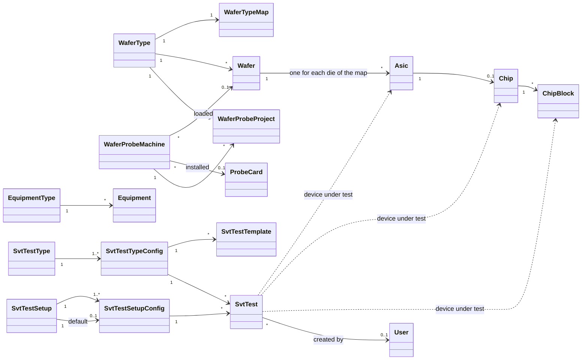
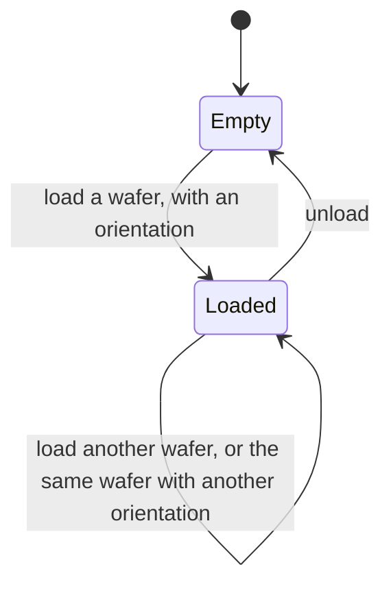
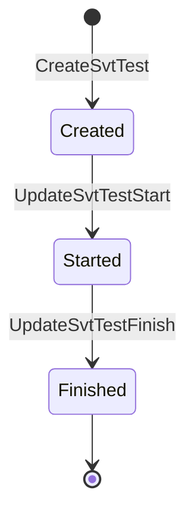

# Domain model

How `svt-db-agent-next` models the domain: the entities, their relations, their life cycles, and the rules that
keep the data consistent. The agent is the only service that reads and writes the database, so this page is the
authority for the data model of SVTSW.

For each rule, this page says who enforces it: the database (a key or a constraint) or the agent (a check in a
handler). A rule that only the agent enforces does not hold for a row that is written directly in the database.

| Related page | Content |
|---|---|
| [database-schema.md](database-schema.md) | The tables, columns, keys and enum types. |
| [messages.md](messages.md) | What the agent does for each request: the checks in order, the statuses, the rows written. |
| [wafer-map.md](wafer-map.md) | The wafer map, and how the ASICs of a wafer come from it. |
| [`Documentation/domain-model.md`](../../Documentation/domain-model.md) | What the entities mean in the terms of the laboratory, for all services. |
| [`Documentation/glossary.md`](../../Documentation/glossary.md) | The terms, with their names in the database, on the wire and in TypeScript. |

**Open** marks a point that is not decided ([§8](#8-open-points)).

## 1. The model

The model has three areas of the laboratory, and the users of the installation (§4.5). An entity of the model is
one table, except where §2 says so.

The history rows of a location, a load and an install also point to the `User` of the request (§4.5). They are not
entities of their own, so the diagram does not show them.

## 2. Entities

"Changes" lists every message that can change a row after its creation. Where the column is empty, the entity does
not change after creation. No message deletes an entity.

| Entity | Tables | Business key | Created by | Changes |
|---|---|---|---|---|
| Wafer type | `WaferType`, `WaferTypeMap` | `name`; `engineeringRun` | `CreateWaferType` | |
| Wafer | `Wafer`, `WaferLocation` | `serialNumber` | `CreateWafer` | `UpdateWafer` (three dates), `UpdateWaferLocation` |
| ASIC | `Asic` | `serialNumber` | `CreateWafer` (all dies), `CreateAsic` | |
| Chip | `Chip`, `ChipLocation` | `serialNumber` | `CreateChip`, `CreateManyChips` | `UpdateChipLocation` |
| Chip block | `ChipBlock` | `serialNumber` | `CreateChip`, `CreateManyChips`, behind a feature switch | |
| Wafer probe machine | `WaferProbeMachine`, `WaferLoadedInMachine`, `ProbeCardInstalledInMachine` | `serialNumber`; `name` | `CreateWaferProbeMachine` | `UpdateWaferProbeMachine`, `UpdateWpMachineLoadedWafer`, `UpdateWpMachineInstalledProbeCard` |
| Probe card | `ProbeCard`, `ProbeCardFamilyType` | `serialNumber`; `name` | no message: entered in the database | |
| Wafer probe project | `WaferProbeProject` | `name` | `CreateWaferProbeProject` | |
| Equipment type | `EquipmentType` | `name` | `CreateEquipmentType` | |
| Equipment | `Equipment`, `EquipmentLocation` | `name` | `CreateEquipment` | `UpdateEquipmentLocation` |
| Test setup | `SvtTestSetup`, `SvtTestSetupDefaultConfig` | none: `name` is not unique | `CreateSvtTestSetup` | `UpdateSvtTestSetup` (the default configuration) |
| Test setup configuration | `SvtTestSetupConfig` | `name`, in the whole system | `CreateSvtTestSetup` (the first), `CreateSvtTestSetupConfig` | |
| Test type | `SvtTestType`, `SvtTestTypeDUTTypeList` | `name` | `CreateSvtTestType` | `UpdateSvtTestType` (the DUT types) |
| Test type configuration | `SvtTestTypeConfig` | `name`, in its test type | `CreateSvtTestType` (the first), `CreateSvtTestTypeConfig` | |
| Test template | `SvtTestTemplate` | DUT type + test type configuration | `CreateSvtTestTemplate` | `UpdateSvtTestTemplate` (`isEnabled`) |
| Test | `SvtTestList`, `SvtTestListToEntityName`, `SvtTestListToEntityId` | none | `CreateSvtTest` | `UpdateSvtTestStart`, `UpdateSvtTestFinish` |
| User | `SvtUser` | `login`, in lower case | `CreateUser`; the first Admin is entered in the database | `UpdateUser` (`name`, `role`, `isActive`), `UpdateUserPassword` |

Two more sets of rows are configuration data without a message: which block types a family type has
(`AsicFamilyTypeBlockList`), and the values of the enum types ([database-schema.md §6](database-schema.md#6-enum-types)).

## 3. Relations, and who enforces them

| Relation | In the model | The database enforces | The agent enforces |
|---|---|---|---|
| Wafer type → wafer map | exactly one | at most one (the key of `WaferTypeMap` is the wafer type) | It writes both rows in one transaction. `CreateWafer` rejects a wafer type without a map. |
| Wafer → wafer type | exactly one | foreign key, `NOT NULL` | The wafer type must exist. |
| ASIC → wafer | exactly one | foreign key, `NOT NULL` | The wafer must exist (`CreateAsic`). |
| Chip → ASIC | exactly one | foreign key, `NOT NULL` | The ASIC must exist. |
| ASIC → chip | at most one | nothing: `Chip.asicId` is not unique | It rejects a second chip for an ASIC, and an ASIC that is twice in one request. **Open.** |
| Chip block → chip | exactly one | foreign key, `NOT NULL` | The agent creates blocks only together with their chip. |
| Location row → wafer, chip or equipment | exactly one | foreign key, `NOT NULL` | The parent must exist. |
| Machine → loaded wafer | at most one | foreign key, nullable | The wafer must exist. The agent does not check if the wafer is on another machine. |
| Machine → installed probe card | at most one | foreign key, nullable | The probe card must exist. The agent does not check if the card is on another machine. |
| Project → machine, wafer type | exactly one of each | foreign keys, `NOT NULL` | Both must exist. |
| Equipment → equipment type | exactly one | foreign key, `NOT NULL` | The equipment type must exist. |
| Setup configuration → setup | exactly one | foreign key, `NOT NULL` | The setup must exist. |
| Setup → default configuration | at most one | at most one row for a setup; the configuration must exist | The configuration must be one of the same setup. |
| Type configuration → test type | exactly one | foreign key, `NOT NULL` | The test type must exist. |
| Test type → DUT types | zero or more | one row for each pair | Each value must be a value of the enum `dutType`. |
| Template → type configuration | exactly one | foreign key, `NOT NULL`; the pair (DUT type, configuration) is unique | The configuration must exist. |
| Test → type configuration, setup configuration | exactly one of each | foreign keys, `NOT NULL` | Both must exist. |
| Test → device under test | exactly one | nothing: the link rows have no foreign key to the device | It writes one kind row and one id row, and it checks that the device exists. **Open.** |
| Location, load or install row → user | at most one | foreign key, nullable | The user of the header `svt_userId` must exist (the dispatcher checks it before the handler). |
| Test → the user who created it | at most one | foreign key, nullable | The same. |

Where the agent checks that a parent exists, the reply for a missing parent is a clear error and no row is written.
The exact status and text of each check are in [messages.md](messages.md).

## 4. Rules by area

### 4.1 Silicon

- **A wafer type and its map are created together and do not change.** The agent validates the map before it
  stores it ([wafer-map.md](wafer-map.md)).
- **The registration of a wafer creates its ASICs.** `CreateWafer` writes the wafer, the first row of its location
  history, and one ASIC for each die of the map of its wafer type. All rows are written in one transaction, or none.
- **The serial number and the position of an ASIC are derived**, not entered: they come from the wafer and from the
  map ([wafer-map.md](wafer-map.md)). The family type and the quality come from the map too.
- **A wafer needs a location at registration.** The column permits `NULL`; the agent does not.
- **`UpdateWafer` changes only the three dates** (thinning, dicing, production). It rejects a change of the
  location: a move is `UpdateWaferLocation`.
- **One chip for each ASIC.** The family type of a chip is the family type of its ASIC; a chip has no family type
  of its own.
- **Chip blocks are behind a switch.** With `SVT_DB_AGENT_FEATURE_CHIP_BLOCKS` on, a new chip gets one block for each
  block type of the family type of its ASIC (`AsicFamilyTypeBlockList`). The default is off. **Open.**
- **Modules are not in the model.** The three `Module` tables exist, and the agent does not map them.

### 4.2 Location

Wafers, chips and equipment have a current location (`generalLocation`) and a location history.

- The create message writes the first history row, with the note `Location at creation`, without a `username`, and
  with the user of the request (§4.5).
- A move (`Update<Entity>Location`) adds one history row and sets the current location to the location of that row.
  The two writes are one transaction.
- The history is only added to. The agent reads it in the order in which the rows were written.
- A history row has a day (`date`), not a time.
- A move records the user of the request (§4.5). The free text `username` of a move is stored as the client sends
  it; the UI sends none. **Open:** whether `username` goes.
- A wafer probe machine and a test setup have a location and no history. A probe card has a location from its own
  enum type and no history.

### 4.3 Wafer probing

A wafer probe machine holds its live state in its own row: the loaded wafer with its orientation, and the installed
probe card with its orientation.

- **A load needs an orientation and a wafer that exists.** An unload of an empty machine is an error.
- **Each load adds one row to the load history, with the status `Loaded`.** A load on a machine that has a wafer
  adds one `Loaded` row for the new wafer; it adds no `Unloaded` row for the wafer before it. An explicit unload
  adds one `Unloaded` row.
- **An install of a probe card adds one row to the install history.** The orientation of the card is optional.
- **A load row, an unload row and an install row record the user of the request** (§4.5). The agent writes no
  `username` there.
- **A removal of the probe card clears the state of the machine and adds no history row.** The history table
  cannot hold a row without a probe card. **Open.**
- `UpdateWaferProbeMachine` changes the address, the software and the location of a machine. It cannot change the
  loaded wafer or the installed probe card.
- Probe cards and their family types are read-only for the agent. A wafer probe project is created once and does
  not change.

### 4.4 Testing

- **A test setup always has a configuration.** `CreateSvtTestSetup` writes the setup, its first configuration, and
  the row that makes this configuration the default, in one transaction.
- **The default configuration of a setup is one of its own configurations.** `UpdateSvtTestSetup` changes only the
  default configuration. A setup without a default row has the default `null`.
- **A test type always has a configuration.** `CreateSvtTestType` writes the test type, its DUT types and its first
  configuration in one transaction.
- **`UpdateSvtTestType` replaces the DUT types** of the test type with the list of the request. An empty list
  removes all of them. **Open.**
- **A configuration document is opaque.** The agent checks that it is JSON. It stores the text and returns the same
  text. A configuration does not change after creation.
- **A template says that a test type configuration is offered for a DUT type.** Only `isEnabled` changes. A change
  of a template does not change the tests that exist.
- **A test has exactly one device under test**: an ASIC, a chip or a chip block. The test names the kind of device
  (`dutEntityName`) and its id (`dutId`). `CreateSvtTest` checks that the device exists and writes the test and its
  two link rows in one transaction.

- **The agent does not enforce this order.** It records a start or a finish as it comes, and it writes a line in
  its log when one is out of order. **Open.**
- **The result status** is a value of the enum `testResultStatus`, or `null` for a test without a result.
- **The times are UTC.** `createdAt` comes from the database.
- **A test records the user who created it** (§4.5): the user of `CreateSvtTest`. The start and the finish record no
  user yet: the test agents that send them do not send the header (#391).

### 4.5 Users

A user of the installation is one row of `SvtUser`. Other services point to a user by its `id`, never by a name
([the decision record](../../Documentation/decisions/2026-11-users-and-roles.md)).

- **The roles are levels.** A user has one role of the enum `userRole`: `User` < `Expert` < `Developer` < `Admin`.
  A role has every right of the roles below it. The code depends on the four values, so a change of them is a
  schema change. `isEpicUserRoleAtLeast` of `svt-ts-types` compares two roles.
- **The login is unique and follows one rule:** 3 to 50 characters of `a-z`, `0-9`, `.`, `_` and `-`. The agent
  trims the login of a request and makes it lower case, so `Anna.Rossi` and `anna.rossi` are one login. The
  database enforces both the unique login and, with a check constraint, the rule, also for a row entered by hand.
  The login does not change after creation.
- **A user is never deleted.** It is switched off (`isActive` false) and its row stays, because other rows will
  point to it. A user that is switched off cannot log in; the BFF checks that.
- **The installation keeps one active Admin.** The agent refuses a change that would switch off the last active
  Admin, or give it another role. It checks and writes in one transaction, and the changes of users run one at a
  time, so two changes at the same time cannot remove the last two Admins. Only the agent enforces the rule: a row
  changed directly in the database can break it.
- **The first Admin is entered by hand.** The migration creates no user, and no account with a known password
  exists. Its login must follow the rule of the login: the database refuses another.
- **The password hash is opaque.** The BFF makes it; the agent stores it and never reads it. Only the reply of
  `GetUserCredentials` holds it, and the agent never writes it to its log.
- **The agent does not check who sends a user message.** The rule that only an Admin manages the users belongs to
  the BFF.
- **A history row and a test record the user of the request.** The user is the one of the header `svt_userId`: a
  location row (`userId`), a load, unload or install row (`userId`), and a test (`createdByUserId`). A request
  without the header writes no user (`NULL`), and so do the rows from before this rule. No request names the user in
  its body. A reply names the user by its id and its `name`, also when the user was switched off later: the rows
  stay the work of that user.

## 5. Values that the agent derives

A reply has fields that are not columns of the table of the entity. The agent computes them for each reply.

| Field in the reply | Comes from |
|---|---|
| `chipId` of an ASIC | The chip that refers to the ASIC, or `null`. |
| `familyType` of a chip | The family type of its ASIC. |
| `asicFamilyTypes` of a probe card | The rows of `ProbeCardFamilyType`. |
| `defaultConfigId` of a test setup | The row of `SvtTestSetupDefaultConfig`, or `null`. |
| `dutTypes` of a test type | The rows of `SvtTestTypeDUTTypeList`. |
| `testTypeId` of a test template | The test type of its test type configuration. |
| `dutEntityName` and `dutId` of a test | The two link rows of the test, or `null`. |
| `userName` of a history record | The `name` of the user of the row, or `null`. |
| `createdByUserName` of a test | The `name` of the user who created the test, or `null`. |

## 6. Rules for all entities

- **Identity.** Each entity has a numeric `id` from the database. A client never sets it.
- **Unique business keys.** The database enforces them with unique constraints ([§2](#2-entities)). A request
  that breaks one gets an error, and no row is written.
- **No delete.** No message deletes an entity. A correction or a deletion is a manual action in the database.
- **One transaction for each message.** A message that writes several rows writes all of them or none.
- **Enum values are checked against the database.** A value in a request must be a value that the enum type has
  at that moment.
- **One writer.** Only the agent connects to the database. Every other service sends it a message.

## 7. What the model does not hold

Rights per page or per message: the model has the four roles only (§4.5). Which user created or changed an entity:
only the history rows and the tests record a user (§4.5). The content of a test result: the model has only the path
to it. The outcome of wafer
probing. The list of equipment of a test setup: the table `SvtTestSetupEquipList` exists, and nothing reads or
writes it. Modules. An audit trail other than the location, load and install histories.

## 8. Open points

A decision on one of these points changes the model, and then it changes this page.

| Point | State today |
|---|---|
| One chip for each ASIC | Only the agent enforces it. A unique constraint on `Chip.asicId` is not decided. |
| The serial number of a chip | The client sends it. No format is defined. |
| Chip blocks | The creation is built and switched off. The name of a block (`<blockType>_<serial number of the chip>`) is not confirmed. |
| The enum type `blockType` | Its name on the wire is `chipBlockType`. The rename in the database is planned ([02 §2](02-database-migration.md#2-what-migration-1-adds)). |
| The removal of a probe card | It leaves no history row. A status column on `ProbeCardInstalledInMachine` is proposed. |
| The meaning of the orientations | One enum type serves the wafer and the probe card. What each orientation describes is not written down. |
| The free text `username` of a history row | It stays beside `userId`: older rows hold a name there, and a client without a user id may send one. Its removal is not decided. |
| `UpdateSvtTestType` | It replaces the list of DUT types. The owners of the clients did not confirm this meaning. |
| Several devices for one test | The link tables permit it. The agent writes one. |
| The order of start and finish of a test | Not enforced. Who enforces it is not decided. |
| The result status of a test | The five values are in use. The test teams did not confirm the vocabulary. |
| The path to the result | Free text. What it points to is not defined. |
