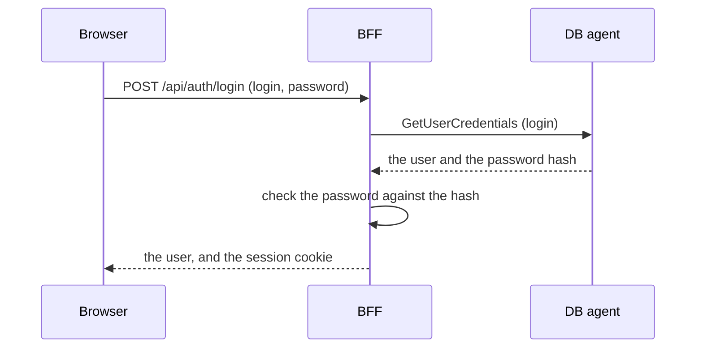
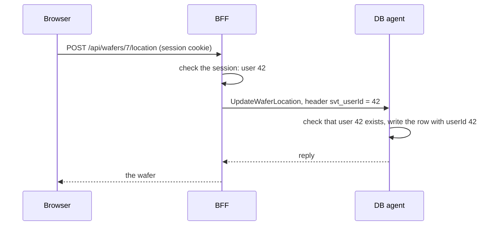

# 2026-11: Users and roles for the whole system

**Decided 2026-11-26** (ok-cern). The proposal is [ticket 391](https://github.com/SVT-WP2/SVTSW/issues/391), and the
work is planned in [ticket 392](https://github.com/SVT-WP2/SVTSW/issues/392). On this date nothing of it is built:
[the last section](#not-done-yet) says which ticket delivers what.

One list of users, with four roles, lives in the database of the installation. The BFF logs people in against it,
an Admin manages the users in the UI, and every Kafka request that is made for a user carries the id of that user.

This record covers the DB agent and the UI. It does not decide the sessions on the prober, or how WPAgent and the
test agents use the users: that part of the proposal stays open in ticket 391.

## Why

| Part | The state before |
|---|---|
| UI | The log-in is in the browser only: two users are written in the Angular code, and the logged-in user is kept in `localStorage`. |
| BFF | It checks nothing. Every `/api` route answers anybody who can reach the server. |
| DB | No user table. Five history tables have a free-text `username` column, and the UI always sends `null`. |
| Kafka | A request does not say who it is for. |
| WPAgent | Its own list of names, in a file inside the image (`WPAgent/configs/WPUserHierarchy.json`). A new user needs a deploy. |

Each service has its own idea of a user, so nobody can say who did what. The system will also run in the networks
of other universities, where a list of names inside an image does not fit.

## 1. One user list, in the database

- The users are a table of the database of the installation, `SvtUser`, owned by the DB agent. No outside log-in
  service is used (no CERN SSO): the system must also work outside the CERN network.
- A user is a row with an integer `id`. A service, a table or a message points to a user by that id, never by a
  name. A reply that people read may carry the name of the user beside the id.
- A user is never deleted. An Admin switches a user off and the row stays, so the history keeps its names.
- The first Admin of an installation is entered by hand in the database. After that, an Admin creates the other
  users in the UI. No account with a known password exists by default.
- The installation always keeps one active Admin. The DB agent refuses the change that would remove the last one.

## 2. Four roles, as levels

Every user has one role. A role includes everything that the roles below it may do.

| Role | On the prober | In the UI |
|---|---|---|
| `User` | The user-level commands | Every page, except the user management |
| `Expert` | Also the expert-level commands | The same |
| `Developer` | Every command | The same |
| `Admin` | Every command | Also the user management: create a user, change it, give it a role, switch it off |

- `User`, `Expert` and `Developer` are the three levels that WPAgent has today. `Admin` is new.
- The column "On the prober" is what the levels mean. WPAgent starts to use these users in a later step (ticket
  391); until then it keeps its own file of names.
- Each service decides what a role may do in that service. For now there is one rule, in the BFF: the user
  management needs `Admin`. Every other page and route stays open to every logged-in user, as before.
- A request never carries a role. A service that needs the role reads it from the DB agent by the user id, so a
  request cannot claim a role.

## 3. The user of a request is a Kafka header

A request says which user it is for in the message header `svt_userId`. The value is the user id as a decimal
string (`42`). The body stays `{ "type": ..., "data": ... }` for every message.

```
Topic:   svt.db-agent.request
Headers: kafka_correlationId  = 1647f30ff6d9acbea7ce5
         kafka_replyTopic     = svt.db-agent.request.reply
         kafka_replyPartition = 0
         svt_userId           = 42
Value:   { "type": "UpdateWaferLocation", "data": { "waferId": 7, "generalLocation": "CERN" } }
```

- The user is the person who asked for the work. A service that works for that person passes the same header on
  in its own requests.
- The header is optional for now: a request without it is served as before. The BFF sends it for every request of
  a logged-in user. WPAgent and the test agents do not send it yet.

The alternative was a key in the body. The header was chosen for these reasons:

| | Header (chosen) | A key in the body |
|---|---|---|
| Fits the conventions | Yes. The [conventions](../Kafka/SvtKafkaConventions.md) already put what is *about* the request in headers (`kafka_correlationId`, `kafka_replyTopic`). The body is the request itself. | It changes the envelope `{ type, data }` that every service shares. |
| Work in the DB agent | One place: its Kafka controller already reads a header. No request DTO changes. | A key in `data` touches every DTO, and several messages reject an unknown key of `data`. A key beside `data` avoids that, but changes the envelope. |
| Work in the BFF | One place: the function that sends a request. | The same. |
| Passing it on | A service copies it to its own requests without reading the body. | The service must parse and rebuild the body. |
| Old clients | A request without the header is still valid. | The same, if the key is optional. |
| Seeing it while debugging | One step further away: Kafka UI shows the headers beside the value. The DB agent therefore logs the user id for each request. | Visible in the value. |
| Type | Bytes on the wire. The format is fixed, and the DB agent answers `BadRequest` for anything else. | A JSON number. |

The header carries the user only. A header for the name of the program that sends a request is not decided.

## 4. Who checks what

| Service | What it does | What it does not do |
|---|---|---|
| BFF | Checks the password at a log-in and gives the browser a session. Checks the session on every route, and the `Admin` rule on the user management. Adds `svt_userId` to every request to Kafka. | It stores no users. |
| DB agent | Stores the users. Checks that the user of `svt_userId` exists. Stores that id on the rows that record who did something. | It checks no role, and it never sees a plain password. |
| A service that works for a user (later) | Passes `svt_userId` on. Reads the role from the DB agent when it needs it. | It keeps no users of its own. |

- The services on Kafka trust each other, as before: only our services can write to the broker. A check of the
  role in the DB agent would not stop a service that can write any header. The role is therefore checked where a
  person enters the system, in the BFF.
- The DB agent accepts the id of a user that is switched off. A measurement that is already running must still be
  able to write its rows. Switching a user off stops the log-in and the UI, not the work that runs.

## 5. Passwords and the session

- The BFF alone turns a password into a hash and checks a password. A plain password is never sent on Kafka,
  stored or logged. The DB agent stores the hash as a string that it does not read.
- The hash is a slow, salted one (scrypt). It travels on Kafka in the reply to one message, `GetUserCredentials`,
  which the BFF sends at a log-in.
- The session of the UI is a signed token in a cookie that the code in the browser cannot read (`HttpOnly`). The
  BFF makes it at the log-in and checks it on every request. It lasts 12 hours by default.
- An unknown log-in, a wrong password and a user that is switched off get the same answer.

## The two flows

A log-in:



A request of a logged-in user:



## Known limits

- **No HTTPS yet.** The UI is served over plain HTTP, so a password crosses the network of the laboratory
  unencrypted, and the cookie cannot have the `Secure` flag. HTTPS is a separate task of the infrastructure.
- **The password hash travels on Kafka**, and it stays in the topics until the broker deletes old records: in the
  reply topic (`GetUserCredentials`) and in the request topic (`CreateUser`, `UpdateUserPassword`, ticket 396).
  Access to the broker and to Kafka UI must stay limited to the team.
- **A session lives until it expires.** A changed password does not end the other open sessions of that user. A
  user that is switched off in the UI loses access with the next request (ticket 396); one switched off by hand in
  the database, within 30 seconds.
- **No flow for a forgotten password.** An Admin sets a new one.

## Not decided here

- The sessions on the prober: who holds a machine, the take-over, a command that disconnects the agent.
- How WPAgent uses these users and roles, and the end of `UserLogIn` and `UserLogOut`.
- The header from WPAgent, TestAgent and ITS3TestAgent, and the moment when the header becomes required.
- A header for the name of the program that sends a request.
- A rule per page and role in the UI.
- HTTPS.

The first four are a part of ticket 391.

## Not done yet

| What | Ticket |
|---|---|
| The table `SvtUser`, the enum type `userRole` and the five user messages of the DB agent | [393](https://github.com/SVT-WP2/SVTSW/issues/393) |
| The header in the conventions; the DB agent reads and checks it | [394](https://github.com/SVT-WP2/SVTSW/issues/394) |
| The log-in in the BFF and in the UI, the session, the header on every request of the BFF | [395](https://github.com/SVT-WP2/SVTSW/issues/395) |
| The user management in the UI, and the change of the own password | [396](https://github.com/SVT-WP2/SVTSW/issues/396) |
| The user id on the history rows and on a test, and the name of the user in the grids | [397](https://github.com/SVT-WP2/SVTSW/issues/397) |

When a ticket is done, the docs of the service describe the result: `DbAgentNext/docs` (the schema, the domain
model, the messages), `Documentation/Kafka/SvtKafkaConventions.md` (the header) and `UI/docs/ARCHITECTURE.md` (the
log-in). This record stays as the reason why.
