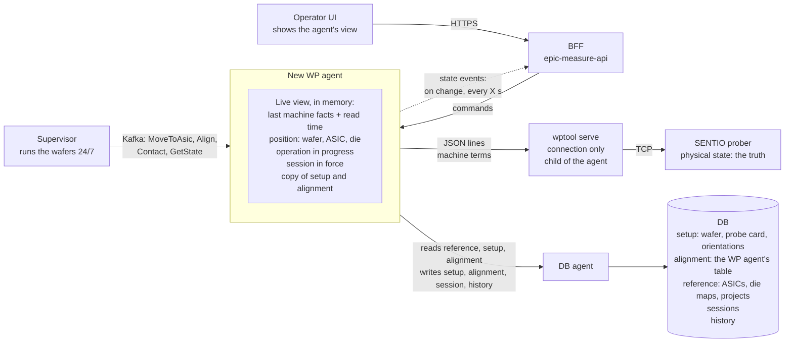
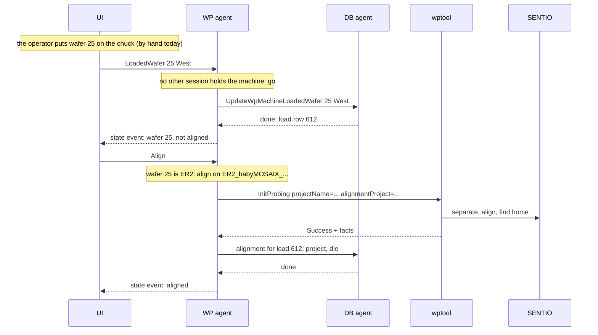
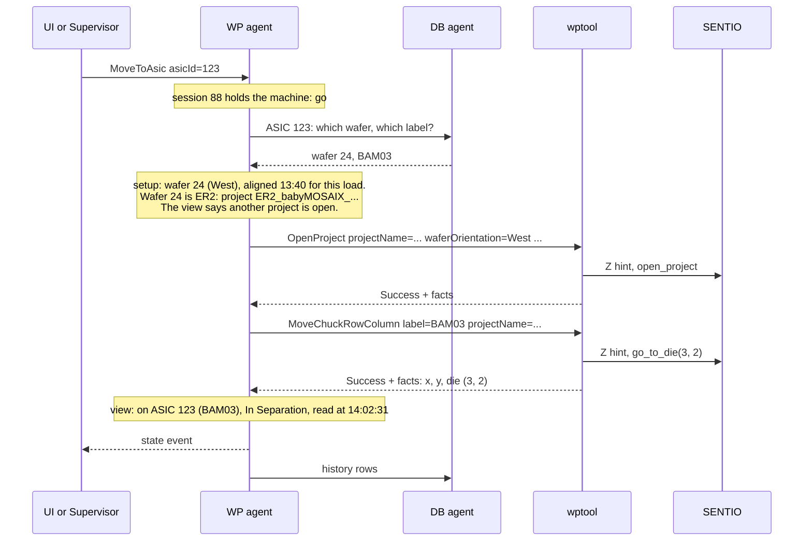
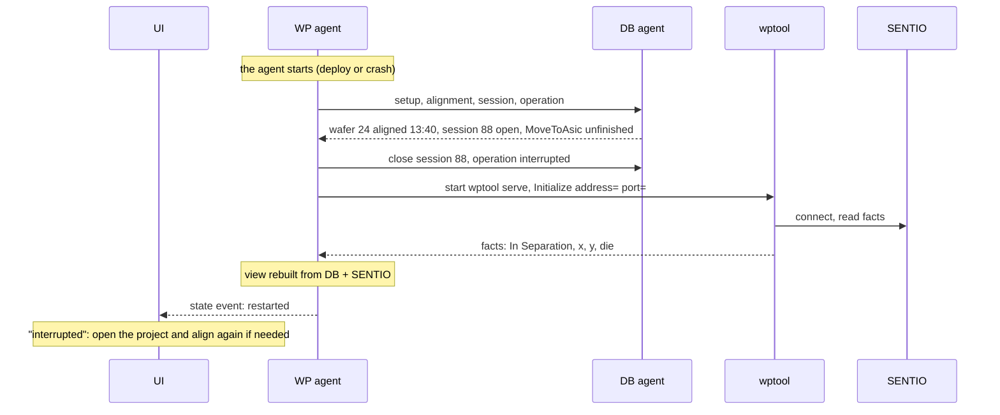

# 2026-11: the state of the wafer prober, and who keeps it

**Decided 2026-11-28.** Which part of the wafer prober's state lives where, who writes it, and how the data flows
between the UI, the Supervisor, the new WP agent, the DB, the stateless WP tool and SENTIO. The WP tool is built first
([2026-11-wp-tool-phase-1](2026-11-wp-tool-phase-1.md)); the new WP agent comes after it, with a new Kafka interface and
sessions, side by side with today's WPAgent until WPAgent is removed. This record is the design that the agent will be
built to.

## What the system must do

- Run production measurements of thousands of wafers, 24 hours a day.
- Let a non-expert operator drive it from the UI. The UI shows where the chuck is in microns, and in our terms: which
  wafer, which ASIC, which die, at contact or not, aligned or not.
- Give the Supervisor a simple interface in business terms: "go to ASIC 123", "contact", "separate", "what is the
  state".
- Survive restarts and deploys without losing what cannot be read back from the machine.

The new WP agent is the one service that knows all of this at any moment, and the only caller of the WP tool.

## Decisions

1. **The WP tool is stateless.** It keeps only the open connection to SENTIO. Every input comes with the request; every
   machine fact is read live and returned in the reply. Its config holds the machine's address and port, and the log
   file. The machine has no name in the tool; a name belongs to the agent.
2. **The new WP agent owns the live view, in memory**, and publishes it as state events. The DB holds no copy of
   SENTIO's state. History rows may record the facts after each command, as an audit trail, not as state.
3. **Memory holds only what can be rebuilt.** Whatever SENTIO cannot report, and the DB does not have yet, is written to
   the DB the moment it happens.
4. **The setup stays on the machine record; the alignment gets a table of the WP agent.** The DB already keeps the
   loaded wafer, the probe card and both orientations on `WaferProbeMachine`, with the histories `WaferLoadedInMachine`
   and `ProbeCardInstalledInMachine` ([database-schema.md](../../DbAgentNext/docs/database-schema.md), sections 4.1,
   4.2, 4.5). That is a fact about the machine, and both agents see the same wafer while they run side by side. The
   alignment is the agent's operating data: a new table, whose rows point to the load they were made for, so any new
   load, by either agent, leaves the old alignment behind.
5. **Setup changes from the UI go through the agent.** The UI asks the new agent to record a new wafer or probe card;
   the agent sends `UpdateWpMachineLoadedWafer` or `UpdateWpMachineInstalledProbeCard` to the DB agent and updates its
   view. Today's WPAgent keeps writing them as it does now, until it is removed.
6. **One DB, through the DB agent.** The agent has no database of its own, and the WP tool has no state file.
7. **The DB agent guards the setup and the alignment with the session id.** While a session holds the machine, it
   refuses a write of the machine's setup or alignment that does not carry that session's id. Kafka has no
   authentication today, so this is what stops a stray sender in the middle of a measurement. Without an open session
   (today's WPAgent has none) a write passes as today.
8. **The UI relies only on the agent's state events.** The agent sends the state after every change and also every X
   seconds, the way today's WPAgent sends its heartbeat. The UI never polls. What the periodic event carries:
   - No session holds the machine: the last copy, with its read time, so the UI can show its age ("read 14 min ago").
     The agent does not read SENTIO then: a person may be working at the SENTIO screen, and every read puts SENTIO into
     remote mode for a moment.
   - A session holds the machine: the agent reads SENTIO fresh when the copy is older than X seconds and no command is
     running. Every reply brings fresh facts anyway, and the tool runs one request at a time, so a read during
     `RunPTPA` would only wait and then delay the session's next command.
   - Opening a session always starts with a fresh read, so the copy is true from the session's first moment.
   - An `Error` reply of the tool carries no facts, so after one the agent sends `ShowStatus` (a precise move that missed its target has still moved the chuck).
9. **After a restart, the DB is what we rely on.** A restart of SENTIO most probably cannot be detected, and the agent
   does not try. Working by hand, the operator decides, and the UI offers to open the project and to align again. In
   automatic measurements, opening the project and aligning are always the first steps of a test execution: the
   Supervisor's job, not the agent's.

Two rules follow from them:

- **Memory holds only what can be rebuilt.** After a restart the agent reads the machine facts from SENTIO again, and
  the setup, the alignment, the sessions and the reference data from the DB.
- **Show from the copy, decide from the machine.** The UI and the Supervisor read the agent's copy, with its read time.
  Whether the chuck may move is asked of SENTIO, live, inside the WP tool, right before each move. A stale copy can
  mislead a person for a few seconds; it can never move the chuck at contact.

## The kinds of state

| Kind | What | Source of truth | Changes | Kept where |
|---|---|---|---|---|
| Physical | chuck X, Y, Z; Z hint (contact, separation); work area; open project; current die; PTPA on; overtravel; contact height | SENTIO | every move, and whenever a person uses the SENTIO screen | SENTIO. The agent holds the last-read copy in memory, with its read time. Never saved as state. |
| Setup | the loaded wafer and its orientation; the probe card and its orientation; their histories | DB, the machine record | a wafer is loaded or unloaded, a probe card is installed | `WaferProbeMachine`, `WaferLoadedInMachine`, `ProbeCardInstalledInMachine`, as today. The agent keeps a copy for the session. |
| Alignment | when the wafer was aligned, with which project and die, for which load | DB, the WP agent's table | an alignment succeeds | DB, written only by the new agent. A new load leaves it behind by construction. |
| Reference | wafers and their ASICs; ASIC to die label; die maps; the project per wafer type; the project to align with; the machine's address | DB and the die-map files | almost never | DB; die maps in `Shared/svt-wp-core` |
| Control | the session (owner user and process); the operation in progress; agent and tool health | the new WP agent | per session, per command | Sessions in the DB (ticket [#391](https://github.com/SVT-WP2/SVTSW/issues/391)). The running operation in memory. |
| Derived | "on ASIC 123 of wafer 24", "safe to move" | computed by the agent | whenever an input changes | Nowhere. The agent computes it and publishes it with the view. |
| History | every command: who, when, parameters, result, the machine facts after it | DB | append only | DB (with `svt_userId`, [2026-11-users-and-roles](2026-11-users-and-roles.md)) |

The WP tool keeps the connection only.

## Who owns what



The agent's API speaks business terms (ASIC, wafer); the tool's speaks machine terms (project, die column and row). The
translation happens once, in the agent.

## Setup and alignment in the DB

| Table | What | Written by | Notes |
|---|---|---|---|
| `WaferProbeMachine` | `loadedWaferId`, `loadedWaferOrientation`, `installedProbeCardId`, `installedProbeCardOrientation`: what is on the machine now | `UpdateWpMachineLoadedWafer`, `UpdateWpMachineInstalledProbeCard` | exists (schema 4.1) |
| `WaferLoadedInMachine` | one row per load and per unload: machine, wafer, orientation, date, status | `UpdateWpMachineLoadedWafer`; rows are only added | exists (schema 4.2). Its `id` names a load. |
| `ProbeCardInstalledInMachine` | one row per install of a probe card | `UpdateWpMachineInstalledProbeCard`; rows are only added | exists (schema 4.5) |
| `WpAgentWaferAlignment` (new, working name) | `waferLoadId` (FK to `WaferLoadedInMachine.id`), `machineId`, `alignedAt`, `alignmentProject`, `alignDieCol`, `alignDieRow`, `alignedByUserId` | the new WP agent only, when an alignment succeeds (`InitProbing`, or `AlignWafer` and `FindHome`); rows are only added | The machine's alignment is the latest row whose `waferLoadId` is the machine's latest `Loaded` row. A new load, by either agent, writes a new load row, so the old alignment no longer matches: the reset needs no write and cannot be forgotten. |

- The names of the new table, its fields and its DB agent messages are working names. The ticket that adds the table
  proposes it as a schema change on [database-schema.md](../../DbAgentNext/docs/database-schema.md).
- The rule "a new wafer means a new alignment" also sits in the agent: "go to ASIC 123" is refused while the loaded
  wafer has no alignment for its current load, with "align the wafer first".

## The state the agent publishes

One document per machine: the answer to `GetState` and the body of every state event. The values are examples.

```jsonc
{
  "machine":   { "id": 1, "name": "WPMIT", "address": "192.0.2.10", "port": 35555 },          // DB, reference
  "health":    { "agentOnline": true, "toolConnected": true },                                // agent
  "session":   { "id": 88, "userId": 12, "process": "Supervisor", "openedAt": "2026-11-28T13:58:02Z" },  // agent, saved in DB
  "operation": { "command": "MoveToAsic", "step": "MoveChuckRowColumn", "startedAt": "2026-11-28T14:02:20Z" }, // agent, memory
  "setup":     { "wafer": { "id": 24, "orientation": "West", "loadId": 612 },
                 "probeCard": { "id": 3, "orientation": "West" } },                           // DB, the machine record and its load history
  "alignment": { "loadId": 612, "alignedAt": "2026-11-28T13:40:12Z",
                 "project": "ER2_babyMOSAIX_Vertical_V0_NotchW_ArrowW", "die": { "col": -1, "row": 1 } },  // DB, the WP agent's table
  "facts":     { "readAt": "2026-11-28T14:02:31Z", "after": "MoveChuckRowColumn",
                 "x": 12345.6, "y": -2345.0, "z": 10377.7, "zHint": "In Separation",
                 "workArea": "OffAxis", "die": { "col": 3, "row": 2 },
                 "project": "ER2_babyMOSAIX_Vertical_V0_NotchW_ArrowW" },                     // SENTIO through the tool, a copy in memory
  "position":  { "waferId": 24, "asicId": 123, "label": "BAM03" },                           // derived: facts.die + setup + die map
  "derived":   { "safeToMove": true }                                                        // derived; display only
}
```

## Loading a new wafer



The new load row means that the old alignment no longer applies. The agent writes the result of the alignment at once,
because SENTIO cannot report it later.

## Going to an ASIC



The tool checks the Z hint live before each move. Each reply carries the facts SENTIO reported, and the agent updates its
view from them. The DB gets the history and no copy of the machine.

## After a restart



Closing the session on a restart is the rule proposed for ticket #391.

## Options we did not take

| Option | Why not |
|---|---|
| A copy of SENTIO's state in the DB | A row that looks like truth but goes stale when someone uses the SENTIO screen or the agent is down; a DB write per move, around the clock. |
| A state file in the WP tool | A second store to keep in step with the DB, a second recovery path, and sessions would pull users into the tool. |
| No copy at all, always live | Every look puts SENTIO into remote mode, and there is no answer while a long command runs. |
| A database of the agent's own | One DB for the whole system, through the DB agent. |
| The alignment in the agent's memory | Lost on every restart, and SENTIO cannot report it. |
| The alignment in the Wafer table or on the machine record | It is the WP agent's operating data, not a property of the wafer or of the machine. |
| A new table for the whole setup | The machine record already holds the setup with its histories, and both agents see the same wafer while they run side by side. |

## What it changes in the WP tool

Nothing in its principle: the tool stays stateless, and the agent starts it in `serve` mode as its only caller. The
machine facts of every reply carry the absolute chuck position X, Y, Z, which the UI needs, and the open project when
SENTIO can report it (tickets [#408](https://github.com/SVT-WP2/SVTSW/issues/408) and
[#409](https://github.com/SVT-WP2/SVTSW/issues/409)).

## Notes for later

- **The physical load:** today a wafer is loaded by hand at the machine, and the operator records it through the agent.
  Later it will probably be a tool command (step 2 of the tool plan). The agent records it the same way either way.
- **The periodic state event:** the value of X.
- **The guard of decision 7** comes with the sessions of ticket #391.
