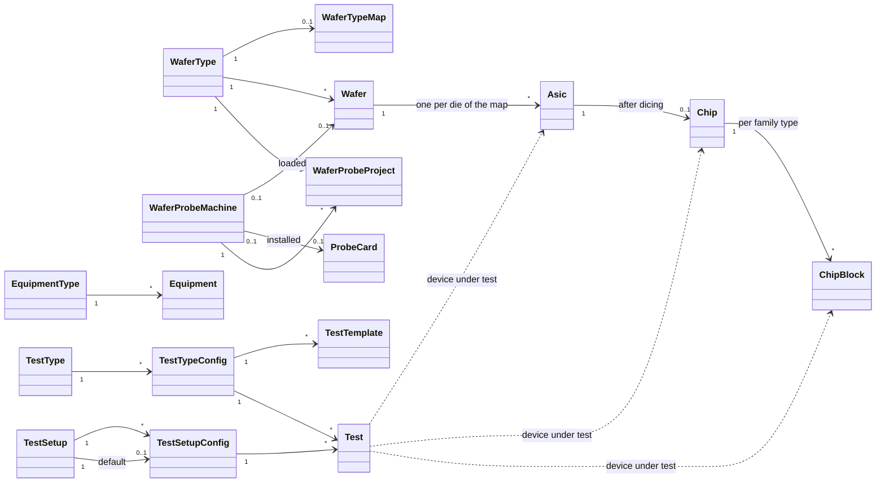
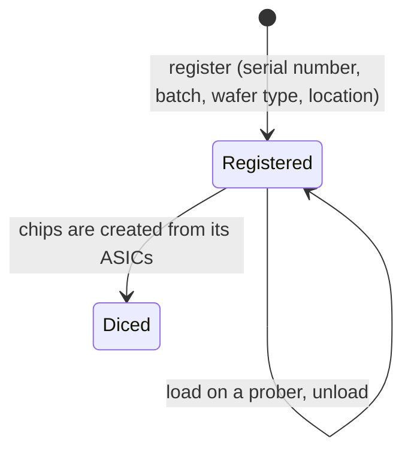
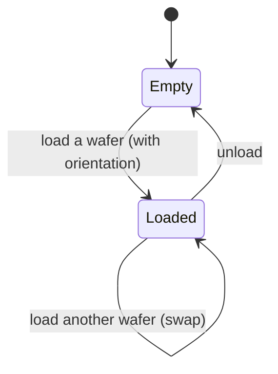
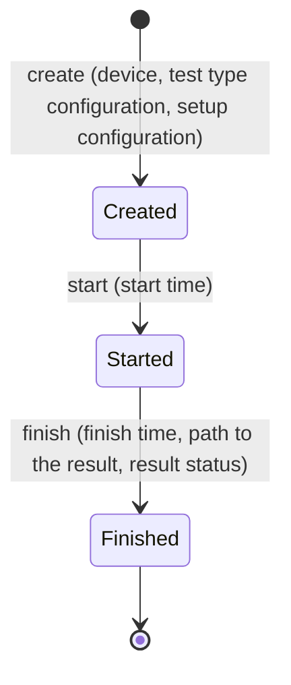

# Domain model

The entities of SVTSW in business terms: what each entity is, how the entities relate, and how they change from
creation to the end of their life. This page does not depend on one service. It is the authority for what an entity
**means**. The terms are defined in the [glossary](glossary.md).

How the data is stored and served is the business of the DB agent, the only service that connects to the
database:

- the data model (the relations, and for each rule who enforces it) is in
  [DbAgentNext/docs/domain-model.md](../DbAgentNext/docs/domain-model.md);
- the tables, columns, keys and enum types are in
  [DbAgentNext/docs/database-schema.md](../DbAgentNext/docs/database-schema.md), the authority for the schema;
- what the DB agent does for each request is in [DbAgentNext/docs/messages.md](../DbAgentNext/docs/messages.md);
- the shapes on the wire are in the contracts of [Kafka/](Kafka/SvtKafkaConventions.md).

A rule that only one service enforces is marked with that service. **Open** marks what is not decided.

## 1. The three areas

| Area | Entities | Question it answers |
|---|---|---|
| Silicon | wafer type, wafer type map, wafer, ASIC, chip, chip block | Which pieces of silicon exist, where they come from and where they are |
| Wafer probing | wafer probe machine, probe card, wafer probe project | Which wafer is on which prober, with which probe card and which project |
| Testing | equipment, test setup, test type, their configurations, test template, test | Which test ran on which device, on which setup, with which configuration and which result |

The users of the installation are not an area of the laboratory; they are in [§5a](#5a-users).

## 2. Silicon

### 2.1 Wafer type and wafer type map

A **wafer type** is the design of a wafer: one engineering run, one foundry, one technology. There is one wafer type
for each engineering run.

A wafer type has one **wafer type map**: a JSON document that describes every die on a wafer of that type. It says
which groups of ASICs exist, where each die is, its family type and its mechanical quality. The format is in
[`WaferMap/GlobalWaferMapFormat.txt`](WaferMap/GlobalWaferMapFormat.txt); the maps in use are in
`Configurations/WaferTypeMappings/`. The DB agent validates the map when the wafer type is created: every family
type of the map must be a value of the family type enumeration.

A wafer type and its map do not change after creation: no message updates them.

### 2.2 Wafer

A **wafer** is one physical silicon wafer of a wafer type. Its identity is the serial number of the foundry. It
also has the batch number (the lot number of the foundry), a current location, and three dates that are empty at
registration and are filled later: thinning, dicing, production.

- **Registration creates the ASICs.** When a wafer is registered, the DB agent creates one ASIC for each die of the
  map of its wafer type, and the first row of its location history. The wafer, the history row and the ASICs are
  written together or not at all.
- "Diced" is not a stored state. A wafer is diced when its dicing date is set and chips exist for its ASICs; the
  system does not connect the two facts.
- A wafer is never deleted through the system (§6).

### 2.3 ASIC

An **ASIC** is one die on a wafer. ASICs are created in bulk at the registration of the wafer. A message that
creates one ASIC exists, and the UI does not use it. An ASIC has:

- a **serial number** that is derived from the wafer and the position, not entered (the rule is in
  [DbAgentNext/docs/wafer-map.md §4](../DbAgentNext/docs/wafer-map.md#4-asic-generation));
- a **family type**: the chip design that the die implements (`MOSAIX`, `BABYMOSS`, `AncMPW2`, …);
- a **position** on the wafer map (`<row>_<column>`);
- a **quality**: mechanically integer, mechanically damaged, or covered by the green layer. It comes from the map.

An ASIC does not change after creation. It stays in the system after dicing: the chip refers to it.

### 2.4 Chip

A **chip** is an ASIC after dicing: a single die that is handled as its own object. It has its own serial number
and its own location history. A chip refers to exactly one ASIC, and its family type is the family type of that
ASIC.

- **One chip for each ASIC.** The DB agent rejects a second chip for the same ASIC. The database does not enforce
  it. **Open:** whether the schema must enforce it.
- A chip is created one at a time, or many at a time for one location.
- **Open:** who assigns the serial number of a chip, and in which format.

### 2.5 Chip block

A **chip block** is a functional block of an ancillary ASIC (`SLDO`, `NVBG`, `CML_TRANSCEIVER`), tested as its own
device. Which blocks a family type has is configuration data, maintained by hand.

The creation of the blocks of a new chip is built in the DB agent, but it is switched off. **Open:** the naming of
the blocks; the future users define it.

### 2.6 Module

A **module** is an assembly of several chips. Tables for modules exist in the database, and the entity is not
built: no service creates, lists or moves a module. Modules are out of scope until they are designed.

## 3. Location

Wafers, chips and equipment have a **general location**: an institute or a room (`CERN`, `CERN_186_R_E10`,
`Prague`, …). The room level and the institute level are values of one enumeration, by decision.

- Each of these entities has a **location history**: one row for each move, with the location, the date (day
  resolution), the user who moved it and a note. The first row is written at creation, with the note
  `Location at creation`, and names the user who created the entity.
- A move is its own operation. It appends a history row, and that row becomes the current location. A general
  update of the entity cannot change the location.
- The history is append-only.
- **The user of a move** is the logged-in user of the request ([§5a](#5a-users)). A row has no user when the
  request had none, and the rows from before the users have none. A row can also hold a free-text user name that a
  client sent; the UI sends none, and older rows may hold one.
- Wafer probe machines also have a general location, without a history. Probe cards have a location from a
  separate enumeration, without a history.

## 4. Wafer probing

A **wafer probe machine** (a prober) is a station that probes wafers. It has a vendor, its control software and a
network address. It also carries the live state: which wafer is loaded, in which orientation, and which probe card
is installed, in which orientation.

A **probe card** is the needle card that is mounted on a prober. It has a vendor, a model, a type, a cleaning
interval, and the family types that it can probe. Probe cards and their family types are entered directly in the
database; no service creates them.

A **wafer probe project** is the definition of one probing job on the side of the prober: one family type, on one
wafer type, on one machine. It has the orientation, the alignment die, the home die, and the map from the local
coordinates of the prober to the global coordinates of the wafer map. Expert users write these values; no service
validates them.

- Each load and each unload is appended to the load history of the machine. A swap writes one "loaded" row: a load
  implies that the previous wafer was unloaded.
- A load needs an orientation. An unload of an empty machine is an error.
- An install of a probe card is appended to the install history. **Open:** a removal of the card clears the state
  of the machine and leaves no history row; a status on the history is proposed.
- One orientation enumeration serves wafers and probe cards. **Open:** what the two orientations describe (notch
  position, rotation of the card).
- WPAgent, the control software of the prober, is the main actor here: it reads machines and projects, looks up
  ASICs during probing, and records loads and installs.

The outcome of probing (which die passed) is not in the model.

## 5. Testing

### 5.1 What is needed before a test

| Entity | Meaning |
|---|---|
| **Equipment**, **equipment type** | A laboratory instrument (power supply, oscilloscope, …) of a type, with a location history and a free-form specification. |
| **Test setup** | A test bench at a location. |
| **Test setup configuration** | A named JSON document for a setup. A setup has one or more, and one of them is the **default**: the one that the TestAgent loads when the setup is selected. The default belongs to the same setup. |
| **Test type** | A kind of test, for example an impedance test. It names the DUT types that it applies to. |
| **Test type configuration** | A named JSON document for a test type. The first one is created with the test type. |
| **DUT type** | The category of the device under test. A DUT type is a family type or a block type. |
| **Test template** | "Test type configuration X is enabled (or disabled) for DUT type Y." The templates are the menu of tests that can run on a DUT type. A disabled template does not change the tests that were created from it. |

The configuration documents are opaque: the system stores and returns the text, and only checks that it is JSON.
The list of equipment of a setup is planned; nothing writes or reads it yet.

### 5.2 Test

A **test** is one execution of one test type configuration, on one device, on one test setup configuration.

The **device under test** (DUT) is an ASIC, a chip or a chip block. The test names the kind of device and its id.
The DB agent checks at creation that the device exists; the database cannot, because the reference has three
possible targets. **Open:** whether one test can have several devices.

- The times are UTC.
- The **result status** is one of `SUCCESS`, `PARTIAL_SUCCESS`, `FAILURE`, `ERROR`, `CANCELLED`. A test without a
  result has no status. **Open:** the vocabulary is not confirmed by the test teams.
- The **path to the result** says where the result data is. The result data is not in the model. **Open:** what
  the path points to.
- The order created, started, finished is not enforced: the DB agent records a start or a finish as it comes, and
  logs one that is out of order. The TestAgent is expected to send them in order. **Open:** who enforces the order.
- The UI shows a simpler status, which the BFF derives: `SUCCESS` and `PARTIAL_SUCCESS` are "Completed", `FAILURE`
  and `ERROR` are "Failed", `CANCELLED` is "Cancelled", no result is "Pending".
- No service of this repository sends a start or a finish yet.
- A test records the **user who created it** ([§5a](#5a-users)). The start and the finish record no user yet.

## 5a. Users

A **user** is a person who works with the system. The users are one list for the whole installation, in its
database ([the decision record](decisions/2026-11-users-and-roles.md)).

- A user has a **login** (the name typed at log-in, unique, in lower case), a **name** shown to people, a **role**,
  and a password, of which the system keeps only a hash.
- The **role** is one of four levels: `User` < `Expert` < `Developer` < `Admin`. A role has every right of the
  roles below it. An Admin manages the users.
- A user is never deleted. An Admin **switches it off**; a user that is switched off cannot log in.
- The installation always keeps one active Admin. The DB agent refuses the change that would remove the last one.
- The first Admin of an installation is entered by hand in the database.
- **A record says who did it.** A location history row, a load or install row of a prober, and a test point to the
  user of the request that wrote them. The user is the one of the session, not a name that the client types. A user
  who is switched off later still names those records.

## 6. Rules for all entities

- **Identity.** Each entity has a numeric id from the database. The business keys are unique: the serial numbers
  of wafers, ASICs, chips, chip blocks, probe cards and machines; the names of wafer types, equipment types,
  equipment, probe cards, machines, projects and test types; the logins of users. A test setup configuration has a name that is unique
  in the whole system; a test type configuration has a name that is unique in its test type; a template is unique
  for its DUT type and configuration.
- **No delete.** No service deletes an entity. A correction or a deletion is a manual action of a database expert.
- **Enumerations.** The lists of values (family types, locations, vendors, qualities, …) are enumerations in the
  database. The DB owner adds a value directly in the database. The UI reads the values through the DB agent, which
  always returns the values that the database has at that moment.
- **One writer.** The DB agent is the only service that reads and writes the database. Every other service sends
  it a message ([system overview](system-overview.md)).

## 7. Not in the model

Rights per page beyond the four roles; which user created or changed an entity, except the history rows and the
tests, which name their user ([§5a](#5a-users)); the content of test results; the outcome of wafer probing; maintenance and cleaning
counters of probe cards; modules; an audit trail other than the location and machine histories; archival.
