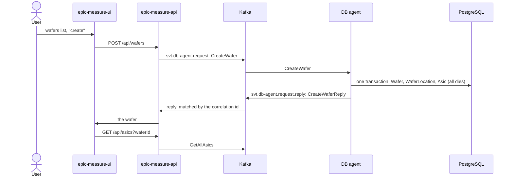

# Register a wafer

**Goal.** A wafer is in the database with the first row of its location history and one ASIC for each die of its
wafer type map.

**Touches.** The [UI and its BFF](../../UI/docs/ARCHITECTURE.md), the
[DB agent](../../DbAgentNext/docs/README.md). Afterwards: [WPAgent](../../WPAgent/README.md).

This flow is not a change of the code. It says what happens, service by service, when a user registers a wafer, so
that you know where to look. What a wafer is: [domain model §2.2](../domain-model.md#22-wafer).

## Before you start

- **The wafer type exists and has a map.** A wafer type is created on the page `/admin/general/wafer-types` of the
  UI, with the map as a file (the maps are in `Configurations/WaferTypeMappings/`). The request is
  `POST /api/wafer-types`, and the message is `CreateWaferType`. The DB agent validates the map and writes
  `WaferType` and `WaferTypeMap`. Every family type of the map must be a value of the database
  ([Add an ASIC family type](add-asic-family-type.md)).
- **The location is a value of the enum `wpGeneralLocation`.**

## Steps

| # | Service | What happens | Where (files, tables, messages) | Docs |
|---|---|---|---|---|
| 1 | UI | The user opens the dialog from the wafers list and fills the form. The form loads the wafer types and the enum values | page `UI/apps/epic-measure-ui/src/modules/wafers/pages/wafers-list/`; dialog and form in `UI/libs/epic-ui/shared/wafers/main/src/` (`services/epic-wafer-create-dialog.service.ts`, `forms/wafer-update/`) | [UI/docs/RECIPES.md](../../UI/docs/RECIPES.md) |
| 2 | UI | The store sends the request through the API client | `UI/libs/epic-ui/api/main/src/wafers/services/epic-wafers.api-client.ts`: `POST /api/wafers` | same |
| 3 | BFF | The controller validates the body and the service sends the Kafka request, with the id of the logged-in user in the header `svt_userId` | `UI/apps/epic-measure-api/src/modules/wafers/` (`controllers/epic-wafers-controller.ts`, `services/epic-wafers.service.ts`); message `CreateWafer` on `svt.db-agent.request`; types in `Shared/svt-ts-types` | [UI/docs/ARCHITECTURE.md](../../UI/docs/ARCHITECTURE.md) |
| 4 | DB agent | The handler checks the request: the location is required and is a value of the enum; the wafer type exists and has a map | `DbAgentNext/src/modules/handlers/wafers/` | [DbAgentNext/docs/messages.md §3.2](../../DbAgentNext/docs/messages.md#32-wafers) |
| 5 | DB agent | It generates the ASICs from the map: serial number, position, family type and quality of each die | `DbAgentNext/src/db/data/wafer-maps/svt-db-asic-generation.ts` | [DbAgentNext/docs/wafer-map.md §4](../../DbAgentNext/docs/wafer-map.md#4-asic-generation) |
| 6 | DB agent | It writes the wafer, the first location row (note `Location at creation`, `userId` of the header) and the ASICs in one transaction | tables `Wafer`, `WaferLocation`, `Asic`; `DbAgentNext/src/db/data/wafers/svt-db-wafers.repository.ts` | [DbAgentNext/docs/02 §6](../../DbAgentNext/docs/02-database-migration.md#6-transactions) |
| 7 | DB agent, BFF | The reply `CreateWaferReply` has the new wafer. The BFF turns it into the HTTP response, or into an HTTP error for a status that is not `Success` | reply on `svt.db-agent.request.reply` | [UI/docs/ARCHITECTURE.md](../../UI/docs/ARCHITECTURE.md) |
| 8 | UI | The details page of the wafer loads the ASICs | `GET /api/asics` with the wafer id; message `GetAllAsics` | |

What follows in the life of the wafer:

| Event | Request | Message | Tables |
|---|---|---|---|
| A move | from the UI | `UpdateWaferLocation` | `WaferLocation` (with the `userId` of the logged-in user), `Wafer.generalLocation` |
| A date is set (thinning, dicing, production) | from the UI | `UpdateWafer` | `Wafer` |
| A load on a prober, an unload | from the UI, or from WPAgent (`WPAgent/services/WPDbKafkaClient.py`) | `UpdateWpMachineLoadedWafer` | `WaferProbeMachine`, `WaferLoadedInMachine` (`userId`: the user of the UI; none from WPAgent, which sends no header yet) |
| Chips are created from its ASICs | from the UI | `CreateChip`, `CreateManyChips` | `Chip`, `ChipLocation` |

## Check

- The page `/wafers/details/<id>` of the UI shows the wafer and its ASICs. The number of ASICs is the number of
  existing dies of the map.
- `GET /api/wafers/<id>/location-history` has one row, with the note `Location at creation`, and `userId` and
  `userName` of the user who registered the wafer. The location history in the UI shows that name in "Updated By".
- The e2e specs of this flow: `DbAgentNext/test-e2e/wafers/`, and `UI/apps/epic-measure-api/test-e2e/` for the path
  from HTTP to the database.

## Pitfalls

- **A duplicate serial number** (of the wafer, or of one generated ASIC) is an error, and nothing is written.
- **A wafer type without a map** is an error.
- **The location cannot change with `UpdateWafer`.** A move is `UpdateWaferLocation`.
