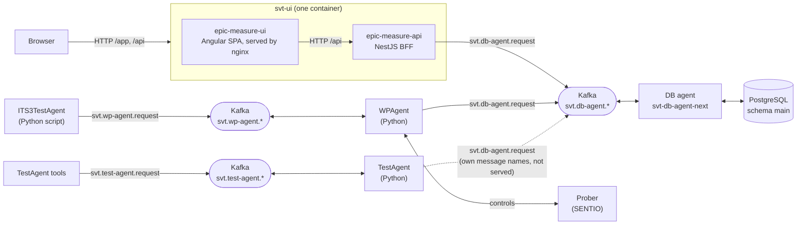

# System overview

The services of SVTSW, the Kafka topics between them, and which service owns which data. A flow in
[flows/](flows/README.md) starts from this picture. The terms are those of the [glossary](glossary.md); what the
data means is in the [domain model](domain-model.md).

This page is the authority for which service owns what. How a service works inside is in the docs of that service
(§2).

## 1. The picture

Three facts decide most questions:

1. **The DB agent is the only service that connects to PostgreSQL.** Every other service that needs data sends a
   request to the DB agent over Kafka.
2. **Every request over Kafka is a request with a reply.** The reply goes to the request topic plus `.reply`, and
   the client matches it by a correlation id ([conventions](Kafka/SvtKafkaConventions.md)).
3. **The UI talks only to its BFF.** The BFF has no connection to WPAgent or TestAgent: what the UI shows about
   probers and tests comes from the database, through the DB agent.

## 2. Services

| Service | Role | Stack | Folder | Owner | Contract | Docs |
|---|---|---|---|---|---|---|
| `epic-measure-ui` | The UI: a single-page application | Angular, Nx | `UI/apps/epic-measure-ui` | ok-cern | HTTP types in `Shared/svt-ts-types` | [UI/docs](../UI/docs/ARCHITECTURE.md), [UI/CLAUDE.md](../UI/CLAUDE.md) |
| `epic-measure-api` | The BFF: turns the HTTP requests of the UI into Kafka requests to the DB agent | NestJS, kafkajs | `UI/apps/epic-measure-api` | ok-cern | client of the DB agent contract | same |
| `svt-db-agent-next` | The DB agent of every environment: serves the database to all other services | NestJS, MikroORM, PostgreSQL | `DbAgentNext/` | ok-cern | [`svt.db-agent-next.kafka.yaml`](Kafka/svt.db-agent-next.kafka.yaml) | [DbAgentNext/docs](../DbAgentNext/docs/README.md): the domain model, the schema, the messages |
| `svt-db-agent` | The C++ DB agent. Frozen, without support ([decision](decisions/2026-11-db-agent-next-only.md)). Not a part of the system under development | C++ | `DbAgent/` | ycorrales | [`svt.db-agent.kafka.yaml`](Kafka/svt.db-agent.kafka.yaml) | none for this system: the folder describes its own frozen state |
| `epic-db-agent` | The mock DB agent: the same messages, data in memory. For UI work without a database; not deployed | NestJS | `UI/apps/epic-db-agent` | ok-cern | the DB agent contract | [UI/docs](../UI/docs/ARCHITECTURE.md) |
| WPAgent | Controls a wafer prober (SENTIO) on commands from Kafka; reads and records the state of the prober through the DB agent | Python, confluent-kafka | `WPAgent/` | leyreflores, angie-kistina | [`svt.wp-agent.kafka.yaml`](Kafka/svt.wp-agent.kafka.yaml) | [WPAgent/README.md](../WPAgent/README.md) |
| TestAgent | Runs tests on a test setup on commands from Kafka | Python, confluent-kafka | `TestAgent/` | not in the root README | [`TestAgent/docs/svt.test-agent.kafka`](../TestAgent/docs/svt.test-agent.kafka) | [TestAgent/README.md](../TestAgent/README.md) |
| ITS3TestAgent | A command-line runner: test sequences on the chips of a CSV file. It drives WPAgent over Kafka | Python script | `ITS3TestAgent/` | not in the root README | client of the WPAgent contract | [ITS3TestAgent/README.md](../ITS3TestAgent/README.md) |
| SVTSupervisor | Planned. The folder is empty | | `SVTSupervisor/` | icali | none | none |

Not services: `Shared/svt-ts-types` (the TypeScript contract types that the UI workspace and the DB agent compile,
[README](../Shared/svt-ts-types/README.md)), `Configurations/` (wafer maps and other configuration files),
`Utilities/` (one script that converts a wafer map to SENTIO coordinates), `ExternalDrivers/` (empty),
`Environment/` and `Dev/` (§5).

## 3. Kafka topics

The naming rules are in [SvtKafkaConventions.md](Kafka/SvtKafkaConventions.md): topic names are in dash-case with
dots (`svt.<service>.<purpose>`), a reply topic is the request topic plus `.reply`, the body is JSON
`{ type, data }`, and the headers `kafka_correlationId`, `kafka_replyTopic` and `kafka_replyPartition` make a
request with a reply.

| Topic | Produced by | Consumed by | Purpose |
|---|---|---|---|
| `svt.db-agent.request` | BFF, WPAgent, TestAgent | the DB agent (consumer group `svt.db-agent.request`) | requests to the database |
| `svt.db-agent.request.reply` | the DB agent | BFF, WPAgent, TestAgent | replies |
| `svt.db-agent.heartbeat` | the DB agent, every 2 s | the health check of the C++ image | liveness |
| `svt.wp-agent.request` | ITS3TestAgent, the WPAgent command-line sender | WPAgent | commands for the prober (open a project, move the chuck, load a wafer, …) |
| `svt.wp-agent.request.reply` | WPAgent | ITS3TestAgent, the sender | replies |
| `svt.wp-agent.heartbeat` | WPAgent | ITS3TestAgent, WPAgent's own health check | liveness. Not in the WPAgent contract |
| `svt.wp-agent.cache` | WPAgent, with each heartbeat | none | a snapshot of the state of the agent. Not in a contract |
| `svt.test-agent.request` | the TestAgent tools | TestAgent | commands to run tests |
| `svt.test-agent.request.reply` | TestAgent | none outside TestAgent | replies and progress |

Only one DB agent serves an environment: `svt-db-agent-next` and the frozen C++ agent use the same consumer group.
The mock DB agent uses its own group (`epic-ui.fake-db-agent`).

Which DB agent messages each client sends:

| Client | Messages |
|---|---|
| BFF | The messages behind the pages of the UI: wafer types, wafers, ASICs, chips, chip blocks, equipment, wafer probing, test setups, test types, templates, tests, enums |
| WPAgent | `GetAllWaferProbeProjects`, `GetAllWaferProbeMachines`, `GetAllAsics`, `UpdateWpMachineLoadedWafer`, `UpdateWpMachineInstalledProbeCard` |
| TestAgent | `GetAllAsics`, and three names that the contract does not have: `GetAllChip` (the contract has `GetAllChips`), `ResolveChipName`, `Create<chip name>Test` (the contract has `CreateSvtTest`). It also sends other header names, so the DB agent sends it no reply (§6) |

## 4. Who owns which data

| Data | Owner | How it changes |
|---|---|---|
| Everything in PostgreSQL (schema `main`) | the DB agent | Only through a message of the DB agent contract. The schema is that of [DbAgentNext/docs/database-schema.md](../DbAgentNext/docs/database-schema.md); it changes through a proposal on that page and a migration of the DB agent |
| Wafer types, wafers, chips, equipment, test setups, test types, templates, tests | the DB agent; the UI is the client that creates them | UI → BFF → DB agent |
| The loaded wafer and the installed probe card of a machine, and their histories | the DB agent; WPAgent and the UI are the clients | `UpdateWpMachineLoadedWafer`, `UpdateWpMachineInstalledProbeCard` |
| The values of the enumerations | the DB owner | Added directly in the database; the DB agent returns them with `GetAllEnums` |
| Probe cards with their family types, and the list of block types of a family type | the DB owner | Entered directly in the database; no message writes them |
| Wafer maps | the files of `Configurations/WaferTypeMappings/`; the database has a copy for each wafer type | The copy is written one time, when the wafer type is created |
| The live state of a prober (position of the chuck, open project) | WPAgent | Commands on `svt.wp-agent.request` |
| The result data of a test | outside this repository | The database has only the path to the result |
| Users | nobody | §6 |

The decisions about the data (what a valid wafer is, when a chip can be created) are rules of the DB agent
([DbAgentNext/docs/domain-model.md](../DbAgentNext/docs/domain-model.md),
[messages.md](../DbAgentNext/docs/messages.md)). What an entity means is in the [domain model](domain-model.md).
The BFF adds the status that the UI shows for a test.

## 5. Where it runs

| Where | What runs | Described in |
|---|---|---|
| **dev** server | `svt-ui` (UI + BFF) on port 8090, `svt-db-agent-next`, Kafka | [Environment/README.md](../Environment/README.md) |
| **prod** server | `svt-ui` on port 80, `svt-db-agent-next`, Kafka | same |
| A developer machine | Kafka (9084/9085), PostgreSQL (5500), and the application services | [Dev/README.md](../Dev/README.md). `svt-db-agent-next` runs with `npm start` from `DbAgentNext/`; the application compose file still builds the C++ agent |
| The prober computer | WPAgent, as a systemd service | [WPAgent/README.md](../WPAgent/README.md) |

TestAgent and ITS3TestAgent are not in a compose file. The database of dev and prod is not in the compose stacks:
the DB agent gets its connection from the `.env` file of the server.

The browser reaches one container: nginx serves the UI under `/app` and passes `/api/` to the BFF in the same
container. Inside the network, the services reach Kafka as `kafka:9094`. The DB agent has no public port; its
health endpoint (`GET /health`, port 7676) is for the container health check.

## 6. Known gaps

These are facts of the current system, not plans.

- **The local application stack still runs the frozen C++ DB agent.** `svt-db-agent-next` is the DB agent of every
  environment by decision ([record](decisions/2026-11-db-agent-next-only.md#not-done-yet)); the compose files of
  the local stack are not switched yet.

- **TestAgent is not connected to the database.** It sends message names that the DB agent does not serve (§3),
  with the headers `correlationId` and `replyTopic` in place of `kafka_correlationId` and `kafka_replyTopic`, so
  it gets no reply. The messages that record the start and the finish of a test (`UpdateSvtTestStart`,
  `UpdateSvtTestFinish`) exist in the DB agent, and no service sends them. The topic `svt.test-agent.status` is
  in the TestAgent contract; the code sends progress to the reply topic.
- **No service starts a test on the TestAgent.** The UI creates a test in the database; nothing sends the command
  to the TestAgent, so every test stays "Pending" ([Run an SVT test](flows/run-svt-test.md)).
- **No authentication.** The BFF accepts every request. The login of the UI is a check in the browser.
- **SVTSupervisor does not exist yet.**
- **The BFF has two endpoints that are not backed by the DB agent**: `/api/tcp` opens a TCP connection to an
  address that the caller gives, and the WebSocket `/ws/iv-mnt` is a stub.
