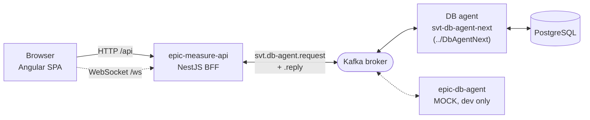
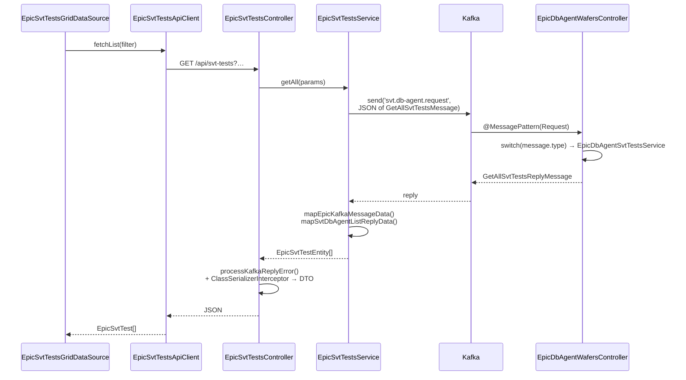
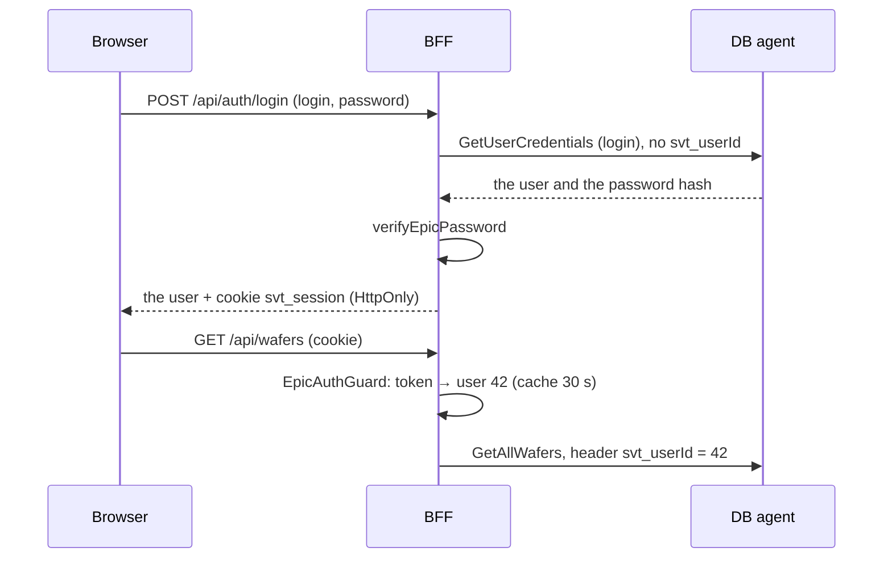

# Architecture Map

Orientation document for the `UI/` Nx workspace. Companion to [RECIPES.md](RECIPES.md) (how to add things)
and [../CLAUDE.md](../CLAUDE.md) (conventions).

## 1. System context

`UI/` is one workspace inside the larger `SVTSW` repo. In production the Angular app and the NestJS BFF
are packaged into a **single container** (nginx serving the SPA + the Node API). The BFF talks to one other
service, the DB agent, and only over Kafka.



The DB agent is `svt-db-agent-next`, the standalone NestJS app [`../DbAgentNext`](../../DbAgentNext/README.md). It
is the DB agent of every environment, and the only service that connects to PostgreSQL. It is not part of this
workspace: the two share the contract types of `../Shared/svt-ts-types` and nothing else. Its data model, its
database schema and what it does for each message are in
[`../DbAgentNext/docs`](../../DbAgentNext/docs/README.md).

The C++ agent in `../DbAgent` is frozen and gets no support. Do not build on its code, its docs or its contract.

`epic-db-agent` exists so the whole stack can run on a laptop with nothing but a Kafka broker. It implements
the same Kafka contract as the DB agent, backed by in-memory arrays.

The other services of the repo (WPAgent, TestAgent) are clients of the same DB agent. The UI has no link to them:
see [`../Documentation/system-overview.md`](../../Documentation/system-overview.md).

## 2. Workspace layout

```
UI/
├── apps/
│   ├── epic-measure-ui/      Angular 21 SPA
│   ├── epic-measure-api/     NestJS BFF (HTTP + Kafka client)
│   └── epic-db-agent/        NestJS Kafka microservice — mock DB agent
├── libs/
│   ├── epic/                 Node-side shared code (API ↔ db-agent)
│   │   ├── entities/         DTO classes, RxJS / NestJS helpers around the Kafka contract
│   │   └── core/             low-level helpers (TCP connection factory)
│   └── epic-ui/              Angular-side shared code
│       ├── api/              HTTP clients  (+ __mock__ twins) — DB-agent domain types come from svt-ts-types
│       ├── common/           auth, layout, ag-grid, design-system components
│       ├── shared/<domain>/  feature domain libs (the bulk of the UI)
│       └── utils/            base classes, pipes, directives, material, colors
└── docker/                   nginx template + entrypoint for the prod image

../Shared/svt-ts-types/       contract types as plain TS only, outside the workspace — two entry points
├── main/                     HTTP contract types shared by the SPA and the Node apps — `svt-ts-types`
└── kafka/                    Kafka contract of the Node apps — `svt-ts-types/kafka`
```

The contract types are outside `UI/` because the DB agent, the standalone app `../DbAgentNext`, compiles them too
(`../Documentation/decisions/2026-11-repository-layout.md`). The workspace reaches them through the two aliases of
`tsconfig.base.json` only; how each tool handles a file outside `UI/` is in `../Shared/svt-ts-types/README.md`.

**The hard boundary:** `libs/epic/*` is Node-only and shared by the two NestJS apps. `libs/epic-ui/*` is
Angular-only. They never import each other. What they *share* is `../Shared/svt-ts-types`: the request / query /
response types of the DB-agent-backed HTTP API as plain TypeScript, with no decorators and no framework imports
(`npm run lint:shared` rejects them). The UI uses those types as its models; a BE DTO class `implements`
them (and, where the type has optional members, `libs/epic/entities/src/contract` checks that the two declare the
same members — `implements` cannot); the Kafka messages
(`svt-ts-types/kafka`) carry them directly while the wire shape equals the HTTP one. A field drifting between FE and BE is a
compile error instead of a silently ignored query param. (`iv-mnt` and `tcp` are not DB-agent operations; their
types still live in `libs/epic-ui/api`.)

## 3. Request lifecycle — one round trip

Following `GET /api/svt-tests` all the way down:



The receiver in this diagram is the mock DB agent. With the DB agent (`../DbAgentNext`) the BFF side is the same:
the same message goes to the same topic. The dispatcher of the agent then calls the handler of the message type
(`../DbAgentNext/docs/05-implementation-notes.md`, §3).

### Files involved, in order

| Step | File |
|---|---|
| Grid data source | `libs/epic-ui/shared/svt-tests/tests/src/services/epic-svt-tests-grid.data-source.ts` |
| HTTP client | `libs/epic-ui/api/main/src/svt-tests/services/epic-svt-tests.api-client.ts` |
| HTTP contract type (FE + BE) | `../Shared/svt-ts-types/main/src/svt-tests/responses/epic-svt-test.models.ts` |
| Controller | `apps/epic-measure-api/src/modules/svt-test/controllers/epic-svt-tests-controller.ts` |
| DTO (`implements` the contract type) | `libs/epic/entities/src/svt-tests/dtos/epic-svt-test.dto.ts` |
| Nest service | `apps/epic-measure-api/src/modules/svt-test/services/epic-svt-tests.service.ts` |
| Kafka contract | `../Shared/svt-ts-types/kafka/src/db-agent/kafka-messages/svt-db-agent-kafka-svt-tests.ts` |
| Mock handler | `apps/epic-db-agent/src/modules/db-agent/services/epic-db-agent-svt-tests.service.ts` |
| DB agent handler | `../DbAgentNext/src/modules/handlers/svt-tests/svt-db-agent-next-svt-tests.handlers.ts` |

## 4. The Kafka layer

The contract — envelope, message namespaces, wire types — is plain TypeScript in `../Shared/svt-ts-types/kafka`,
imported as `svt-ts-types/kafka` by the Node apps only (ESLint rejects it in Angular code). The RxJS operators and
`processKafkaReplyError()` used below stay in `libs/epic/entities`.

Everything goes through **two topics**, declared in
`../Shared/svt-ts-types/kafka/src/db-agent/kafka-messages/svt-db-agent-kafka.ts`:

```ts
svt.db-agent.request         // API → DB Agent
svt.db-agent.request.reply   // DB Agent → API  (NestJS request/response convention)
```

### Message envelope

Every message is `{ type, data }`, built from a class so the `type` is impossible to get wrong:

```ts
export class GetAllSvtTestsMessage extends EpicKafkaMessageClass<GetAllSvtTestsData> {
    readonly type = MessageType.GetAllSvtTests
}
```

Per domain there is one namespace (`SvtDbAgentKafkaSvtTests`) holding: a `MessageType` enum, request +
reply data types, request + reply classes, and the `RequestMessage | ReplyMessage | Message` unions.

### Standard reply shapes

| Shape | Type | Unwrap with |
|---|---|---|
| List | `{ items: T[], totalCount?: number }` | `mapSvtDbAgentListReplyData()` |
| Page | `{ items: T[], totalCount: number }` | — |
| One entity | `{ entity: T }` | `mapSvtDbAgentEntityReplyData()` |

The outer envelope is always unwrapped first with `mapEpicKafkaMessageData()`. Errors surface via
`processKafkaReplyError()` in the controller, which turns a Kafka reply error into an HTTP exception.

### Sending, in the Nest service

```ts
protected sendMessageAndGetReply<TReply>(message: SvtDbAgentKafkaSvtTests.Message): Observable<TReply> {
    return sendEpicDbAgentRequest<TReply>(this.kafkaClient, message)
}
```

`sendEpicDbAgentRequest()` (`apps/epic-measure-api/src/common/kafka`) is the one way to send: it makes the Kafka
record (the message as JSON, and the header `svt_userId` with the user of the HTTP request, [§10](#10-authentication))
when it is called, and delivers the reply in the context of that request. Each service must also
`subscribeToResponseOf(TopicName.Request)` in `onModuleInit()`. Every Kafka client connects at boot
(`connectEpicMeasureApiKafkaClients`, in `main.ts` and the e2e harness).

### Receiving, in the mock DB agent

There is **one** controller (`epic-db-agent-wafers.controller.ts` — the name is historical; it handles
everything) with a single `@MessagePattern(SvtDbAgentKafka.TopicName.Request)` and a big `switch` on
`message.type` dispatching to per-domain services.

The DB agent (`../DbAgentNext`) does not use this controller. It has a dispatcher with one handler entry for each
message type (`../DbAgentNext/docs/05-implementation-notes.md`).

> The authoritative contract lives outside this workspace, in
> `../Documentation/Kafka/SvtKafkaConventions.md` and `svt.db-agent-next.kafka.yaml` (`svt.db-agent.kafka.yaml` is the contract of the frozen C++ agent). Consult it before adding
> a message type.

## 5. NestJS API structure

Uniform per module under `apps/epic-measure-api/src/modules/<domain>/`:

```
controllers/     thin — validate, delegate, serialize; one per resource
services/        Kafka messaging; returns Observables of entities
models/          the DI token for the Kafka client (SERVICE_NAME)
epic-<x>.module.ts   registers ClientsModule.registerAsync (Kafka) + providers
index.ts
```

Bootstrap (`main.ts`, with `configureEpicMeasureApiApp()` that the e2e harness shares) sets: global prefix `api`,
extended query parser, a whitelisting/transforming `ValidationPipe`, 50 MB body limit, `cookie-parser`, the request
context ([§10](#10-authentication)), `WsAdapter` for WebSockets, Swagger at `/api/swagger`, and connects the Kafka
microservice with consumer group `epic-ui`.

**Every route needs a session** unless it is marked `@EpicPublic()`: the global guard `EpicAuthGuard` refuses the
others with `401` ([§10](#10-authentication)).

Controllers use `@UseInterceptors(ClassSerializerInterceptor)` + `@SerializeOptions({ type: XxxDto })` so the
DTO class controls what goes over the wire.

Registered modules: `Auth`, `Health`, `IvMnt`, `Tcp`, `Wafers`, `Asics`, `Wp`, `Enums`, `Chips`, `ChipBlocks`,
`Equipment`, `SvtTest`.

## 6. Angular structure

### App shell

`apps/epic-measure-ui/src/app/`

- `app.routes.ts` — a login route plus an authed `AppLayoutPageComponent` with **lazy-loaded** children.
  Dev-only routes are appended when `!environment.production`.
- `app.module.ts` — providers for router, HTTP (with `epicAuthInterceptor`), i18n, Material defaults, ECharts,
  icons, the root NgRx store, every `provideEpicXxxStore()`, and conditionally `provideMockData()`.
- `app.mock.providers.ts` — the `EpicXxxApiClient → EpicXxxApiClientMock` swap table.
- `models/app-sidebar-nav.models.ts` — the sidebar menu.

`src/modules/<feature>/` holds **routing + page components only**. Pages are thin: they wire a data source or
store facade to a presentational component from a `shared` lib.

### Feature domain libs

`libs/epic-ui/shared/<domain>/` — the standard skeleton (take only what you need):

```
src/
├── components/    presentational, @Input/@Output only
├── dialogs/       Material dialog wrappers
├── forms/         reactive forms + a *.factory.ts building the FormGroup
├── models/        *-grid.models.ts (AG Grid ColDefs), form/dialog models
├── services/      *-grid.data-source.ts, *-data.facade.ts, *-dialog.service.ts
├── store/         actions/ effects/ selectors/ + <x>.store.ts + services/<x>.store.facade.ts
├── epic-<x>-store.providers.ts    provideEpicXxxStore()
└── index.ts
```

`svt-tests` is split into four aliased entry points — `main` (test setups), `test-types`, `test-templates`,
`tests` — a useful precedent when a domain gets large.

### State management

**Pattern A — `SimpleDataSource`** (`libs/epic-ui/utils/main/src/models/search-query/simple-data-source.model.ts`)

An abstract class managing `{ data, loadingProcessing }` plus a filter subject. Subclass it, implement
`getDataObserver()`, and the page calls `connect()` / `load()` / `setFilter()` / `disconnect()`. This is the
lightweight default for grids.

```ts
@Injectable({ providedIn: 'root' })
export class EpicSvtTestsGridDataSource extends SimpleDataSource<EpicSvtTestsGrid.RowEntity[], Filter> {
    protected readonly api = inject(EpicSvtTestsApiClient)
    protected override getDataObserver(filterValue: Filter): Observable<EpicSvtTestsGrid.RowEntity[]> {
        return this.api.fetchList(filterValue)
    }
}
```

**Pattern B — NgRx feature store**

For entities many pages read and that are worth caching. Uses `@ngrx/entity` adapters, and a `ProcessingStore`
helper that tracks `{ inProgress, error }` per operation. Effects short-circuit on `isAllDataFetched` unless
`force` is passed. A `*.store.facade.ts` hides the store from components by dispatching a request action and
returning an Observable that resolves on the matching success/error action.

Currently registered stores: wafer types, wafer tests, WP, SVT test setups, SVT test types.

**Pattern C — `BaseEntitiesListCachedFacade`** — a trivial in-memory cache for reference lists.

### Grids

AG Grid is the workhorse. Each list has a `*-grid.models.ts` namespace exposing `ColId`, `RowEntity`,
`CellEventEvent`, `getColDefs()` and `getGridOptions()` (spreading `EpicAgGrid.getDefaultGridOptions()`).
Row actions are declared as cell schemas (`AgIconActionsCell.getCellSchema`) and surface as a single
`onCellEvent` switch in the component.

## 7. Path aliases

Defined in `tsconfig.base.json`. Always import through these.

| Alias | Points at |
|---|---|
| `@env`, `@env/*` | `apps/epic-measure-ui/src/environments` |
| `svt-ts-types` | `../Shared/svt-ts-types/main` — HTTP contract types, compiled into both sides |
| `svt-ts-types/kafka` | `../Shared/svt-ts-types/kafka` — Kafka contract (envelope, messages, wire types), Node side only |
| `epic/core`, `epic/entities` | `libs/epic/*` (Node side) |
| `epic-ui/api`, `epic-ui/api/__mock__` | HTTP clients (+ mocks) |
| `epic-ui/common`, `.../auth`, `.../ag-grid`, `.../components`, `.../layout` | design system |
| `epic-ui/utils`, `.../colors`, `.../material` | base classes and helpers |
| `epic-ui/shared/<domain>` | feature libs — `wafers`, `wafer-tests`, `wafer-types`, `asics`, `asic-tests`, `chips`, `chip-blocks`, `wp`, `equipment`, `equipment-types`, `iv-mnt`, `kafka`, `tcp`, `location` |
| `epic-ui/shared/svt-tests` | SVT test **setups** |
| `epic-ui/shared/svt-test/test-types` | SVT test types |
| `epic-ui/shared/svt-test/test-templates` | SVT test templates |
| `epic-ui/shared/svt-test/tests` | SVT test **runs** |

> The `svt-tests` aliases are inconsistent (`svt-tests/…` vs `svt-test/…`). That's the state of the file,
> not a typo to fix casually — changing it touches every importer.

## 8. Ports & environment

| Thing | Where | Value |
|---|---|---|
| Angular dev server | `apps/epic-measure-ui/project.json` | 7755, baseHref `/app/` |
| Dev proxy `/api` → | `apps/epic-measure-ui/proxy.conf.json` | `http://localhost:7373` |
| API dev port | `apps/epic-measure-api/.env.development` | `SVT_UI_API_PORT=7373` |
| API fallback port | `apps/epic-measure-api/src/main.ts` | 9393 |
| API port in the container | `Dockerfile` | `SVT_UI_API_PORT=9393`; nginx passes `/api/` to it |
| Kafka broker (dev) | `.env.development`, both Nest apps | `localhost:9085`, the broker of `../Dev/docker-compose.kafka-local.yml` |
| Kafka broker (inside the local network) | `../Dev/docker-compose.kafka-local.yml` | `kafka:9084` |
| Kafka UI (local) | `../Dev/docker-compose.kafka-local.yml` | http://localhost:8087 |
| Kafka broker (BFF e2e) | `apps/epic-measure-api/.env.test`, `../Dev/docker-compose.e2e.yml` | `localhost:9185` |
| DB agent (local) | `../DbAgentNext`, `npm start` | Kafka `localhost:9085`, PostgreSQL `localhost:5500`, http://localhost:7676/health |
| `svt-ui` container, local | `../Dev/docker-compose.swtsw.yml` | UI 7575, `KAFKA_BROKER=kafka:9084` |
| `svt-ui` container, dev server | `../Environment/Dev/docker-compose-svtsw-dev.yml` | UI 8090, `KAFKA_BROKER=kafka:9094` |
| `svt-ui` container, prod server | `../Environment/Prod/docker-compose-svtsw-prod.yml` | UI 80, `KAFKA_BROKER=kafka:9094` |
| Session secret | `.env.development`, `.env.test` (development values); the server `.env` | `SVT_UI_AUTH_SECRET`, [§10](#10-authentication) |

This folder has no compose file. The local stack is in `../Dev` and the server stacks are in `../Environment`.

`.env.{development,production,test}` are committed for both Nest apps — they hold ports and broker
addresses. `.env.test` of the API also holds the settings of the e2e database. `.env.development` and `.env.test`
of the API hold a session secret marked `DEVELOPMENT-ONLY-`, which protects nothing; `.env.production` has none.

Which DB agent a server runs is in `../Environment/README.md`: the dev server and the prod server run
`svt-db-agent-next`.

Consumer groups: `epic-ui` (API), `epic-ui.fake-db-agent` (mock agent), `svt.db-agent.request` (the DB agent). Run
only one DB agent on a broker, the mock or `svt-db-agent-next`. Their groups are different, so each of them receives
each request and each of them sends a reply.

## 9. Build & test

- Angular build: `@angular-devkit/build-angular:application` → `dist/apps/epic-measure-ui`.
  Production swaps `environment.ts` → `environment.prod.ts`.
- API and mock DB agent build: `webpack-cli` via `nx:run-commands`. The DB agent (`../DbAgentNext`) has its own
  build, tests and image, outside this workspace.
- BFF e2e: `npm run e2e::api` — HTTP → Kafka → the DB agent (`../DbAgentNext`) → PostgreSQL
  (`apps/epic-measure-api/test-e2e/README.md`).
- Tests: Vitest, jsdom environment, `@analogjs/vite-plugin-angular` for Angular compilation.
  One root `vitest.config.ts` + `test-setup.ts` covers the whole workspace — libs do **not**
  carry their own config. `npm test` runs everything in a single process; `nx test <project>`
  and `npm run test::affected` scope it per project. Coverage is thin today.
- Husky + lint-staged run on commit; `npm run pre-pull-request` is the gate before a PR.

CI/CD, release flow and the deploy workflows are documented in [../README.md](../README.md).

## 10. Authentication

The users and their roles are a table of the DB agent (`SvtUser`). The BFF logs people in against it; the browser
never sees a password hash, and keeps no user. Decisions: `../Documentation/decisions/2026-11-users-and-roles.md`.



| Piece | Where | What |
|---|---|---|
| Routes | `apps/epic-measure-api/src/modules/auth/controllers` | `POST /api/auth/login` (public: `200` + cookie, `401` with one text for every cause, `429` after 5 failed log-ins of a login within 5 minutes, for 60 s), `POST /api/auth/logout` (public, `204`, clears the cookie), `GET /api/auth/me`. Each attempt takes a slot of its login before any work: the failures of the last 5 minutes and the attempts that run now may not reach 5 together, beyond that `429` at once (no hash check, no Kafka request, `Retry-After: 10`). A failed attempt becomes a counted failure, a success clears the failures, an attempt without an answer gives its slot back (`EpicAuthLoginThrottleService`). |
| Password hash | `libs/epic/core/src/auth` | `hashEpicPassword` / `verifyEpicPassword`: scrypt, `scrypt$N$r$p$<salt>$<key>`. Only the BFF hashes and checks; a plain password is not logged, not sent, not returned. `npm run auth:hash-password` prints the hash for the first Admin (`../Environment/README.md`). |
| Session | `EpicAuthSessionService` | A JWT (HS256 only, `{ sub: "<user id>" }`, the id as a strict decimal string) in the cookie `SVT_UI_AUTH_COOKIE_NAME` (`svt_session`; `svt_session_dev` on the dev server, which shares its host with prod): `HttpOnly`, `SameSite=Strict`, `Path=/`, `Secure` when `SVT_UI_AUTH_COOKIE_SECURE=true`. Lifetime `SVT_UI_AUTH_SESSION_HOURS` (12). Key `SVT_UI_AUTH_SECRET` (32 characters at least, spaces around it not counted; one per environment; the BFF does not start without it, and refuses a `DEVELOPMENT-ONLY-` value when `NODE_ENV=production`). No session store: a token stays valid until it expires, also after a log-out. |
| Guard | `EpicAuthGuard` (`APP_GUARD`) | Every HTTP route needs a valid session of an active user unless it is marked `@EpicPublic()` (the log-in, the log-out, `/api/health`). The user is read with `GetAllUsers` through a cache of `SVT_UI_AUTH_USER_CACHE_SECONDS` (30 s): a user switched off loses access within that time. `@EpicRoles(EpicUserRole.X)` needs that role or a higher one (`403`); no route uses it yet. `@EpicCurrentUser()` is the user of the request. Swagger (`/api/swagger`, `-json`, `-yaml`) is outside the controllers and stays open. |
| No reply | `EpicAuthUsersService` | The two user reads of the log-in and the guard time out after 10 s (`EpicAuthSvc.DB_AGENT_TIMEOUT_MS`): `503` with a plain text. A timeout is not a failed log-in (the count stays), and a guard read that timed out is not kept in the cache. The other services have no timeout. |
| WebSocket | `modules/iv-mnt/iv-mnt.gateway.ts` | No HTTP guard: `handleConnection` checks the same cookie and closes the socket (code 4401) without a valid session. |
| Request context | `apps/epic-measure-api/src/common/request-context` | `AsyncLocalStorage`: `epicRequestContextMiddleware` opens one per request, the guard writes the user id. |
| Header | `sendEpicDbAgentRequest()` | Every Kafka request of a logged-in user carries `svt_userId`; without a user (the log-in, the guard's own read) the record has no header at all. The record is made when the service method is called, and the reply is delivered in the context of the request: a request sent while reacting to a reply (`switchMap`) carries the user of the request that started the chain. The mock DB agent ignores the header. |
| SPA | `libs/epic-ui/common/auth`, `libs/epic-ui/api/main/src/auth` | `EpicAuthService` keeps the user in memory only: `login` calls the BFF, `authorize` asks `GET /api/auth/me` once, `logout` calls the BFF and reloads (when the BFF does not answer, the user stays logged in and the page shows an error). `epicAuthInterceptor`: a `401` of another `/api` request clears the user and goes to `/auth/login`. The users of the code, the hash in the browser and the `localStorage` key `epic.user` are gone. |
| Mock mode | `EpicAuthApiClientMock` | The users `admin`, `developer`, `expert`, `user`; any password that is not empty. The mock user is kept in `localStorage` (`epic.mockAuth.login`) so that a reload keeps it. |
| Mock DB agent | `apps/epic-db-agent` | The five user messages on a list in memory: the same four logins, each with the password equal to the login (`admin` / `admin`). Laptop only. |

Roles: `User` < `Expert` < `Developer` < `Admin` (`isEpicUserRoleAtLeast` of `svt-ts-types`). The only role rule
planned is the user management (ticket 396). The login rule (`isEpicUserLogin`, `normalizeEpicUserLogin`) is in
`svt-ts-types` too: a log-in with a login that breaks it is an unknown login, without a Kafka request.

**Known limit: the lock of a login.** Anybody who knows a login can keep it locked: five wrong attempts a minute
answer `429` to the real user too. The lock is per login, on purpose (a lock per address would not stop an attacker
with many addresses); accepted for now.
