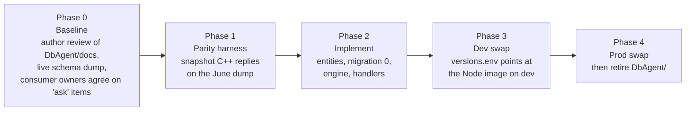

# DB Agent re-implementation in NestJS: working notes

**Status: proposal (2026-11-08). Nothing here is decided or built.**

These notes collect what a NestJS + MikroORM re-implementation of the SVT DB Agent would have to do.
They deliberately contain **no description of the current agent's behaviour**: that lives in
[DbAgent/docs](../../../DbAgent/docs/README.md) and is the reference these notes point into. Read
that first; it is pending review by the agent's author, and several decisions below depend on
what that review confirms.

## Files

| File | Content |
|---|---|
| [01-behaviour-decisions.md](01-behaviour-decisions.md) | For every drift and quirk in the current agent: preserve, fix, or ask. Plus the behaviour notes collected while documenting the C++. |
| [02-database-migration.md](02-database-migration.md) | What the first MikroORM migration has to contain, how the existing schema maps onto MikroORM, and the schema discrepancies to resolve against the live DB. |
| [03-parity-testing.md](03-parity-testing.md) | The black-box test plan that proves the clone behaves like the C++ where it should, and differs only where decided. |
| [04-runtime-and-deployment.md](04-runtime-and-deployment.md) | Env vars, heartbeat, healthcheck, consumer group, NestJS Kafka transport specifics, where the code lives, build and versioning. |
| [dev-plan/](dev-plan/README.md) | **The development plan for `SvtDbAgentNext`** (`apps/svt-db-agent-next`, database layer in its `src/db`): self-contained instructions per phase for the agents that build it, with the shared context in `dev-plan/00-context.md`. |

## Why NestJS + MikroORM (summary of the 2026-11-05 analysis)

- The Kafka request/reply protocol the agent speaks **is NestJS's microservice convention**
  (`kafka_correlationId`, `kafka_replyTopic`, `kafka_replyPartition`, `kafka_nest-is-disposed`).
  The C++ imitates it; the Python WPAgent client was written against it.
- The typed contract for all 55 message types already exists in `libs/epic-api-types/kafka`, and
  `apps/epic-db-agent` already dispatches every type over the NestJS Kafka transport, backed by
  in-memory arrays. The data layer is what is missing.
- Deployment is already uniform: the compose stack pins each service by image tag in
  `versions.env`, so swapping the image is a one-line change and rollback is the same line.
- The team that remains knows this stack (the UI and BFF are already here); nobody left knows C++.
- MikroORM brings what the current data layer lacks: transactions, bound parameters, `RETURNING`,
  DB-side pagination, and a migrations folder as the schema's source of truth.

Known counter-arguments, recorded so they are not forgotten: this concentrates UI, BFF and DB
agent on one maintainer; a Python agent would be maintainable by more physicists; the C++ was
possibly meant to integrate with FRED one day (one stale comment, nothing else). None of these was
judged strong enough to keep the C++, but the first two should be stated to the collaboration.

## What does not change

- The Kafka topics, the envelope, and the 55 message types. Consumers (`epic-measure-api`,
  WPAgent, TestAgent) are not touched by the swap. Contract corrections are a separate stream.
- The database. The clone starts on the existing schema; schema changes go through migrations
  and are applied while the C++ agent still runs wherever they are invisible to it.
- The `SVT_DB_AGENT_*` environment variables and the heartbeat topic, so the server-side `.env`
  stays the same. The compose service itself is a new one (`svt-db-agent-next`, own image and
  healthcheck), see [04 §6](04-runtime-and-deployment.md#6-where-the-code-lives-build-and-versioning).

## Phases

Gates: Phase 2 does not start before the author review and the live schema dump exist. Phase 3
does not start before the harness passes against the clone with every intentional difference
listed in [03-parity-testing.md](03-parity-testing.md). Phase 4 is a manual `deploy-prod` like any
other release.

## Open questions before Phase 2

1. ~~Prod and dev do not have the same schema~~
   ([DbAgent/docs/03 §5](../../../DbAgent/docs/03-database-schema.md#5-where-dump-doc-and-code-disagree)):
   prod lacks the September `SvtTestList` changes that `master` requires (S2–S5, S7) and stores
   `configBody` as `json` where dev has `text` (S10) — answered 2026-11-08 (Q27, Q31): prod is
   outdated; `Documentation/DB/DBTables/SVT_DB_Tables_SourceOfTruth.txt` is the authoritative schema
   (`configBody` is `text`) and migration 1 brings prod to it. When prod is migrated remains an
   operations decision ([02](02-database-migration.md)).
2. Every row marked **ask** in [01-behaviour-decisions.md](01-behaviour-decisions.md): they change
   a consumer-visible result and need the UI, WPAgent or TestAgent owners to agree.
3. ~~Whether the Module feature is in scope for the first release~~ — decided 2026-11-08: **out of
   scope**. The UI has no module concept, the C++ handler was never reachable, and no serial-number rule
   exists; the `Module*` tables stay unmapped.
4. ~~Where the code lives and how it is versioned~~ — decided 2026-11-08, see
   [04-runtime-and-deployment.md §6](04-runtime-and-deployment.md#6-where-the-code-lives-build-and-versioning):
   `apps/svt-db-agent-next` in the UI workspace, own image, version and pipelines, deployed to dev.
