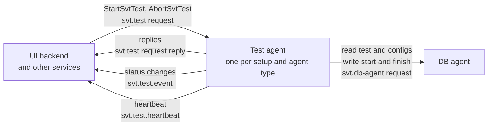
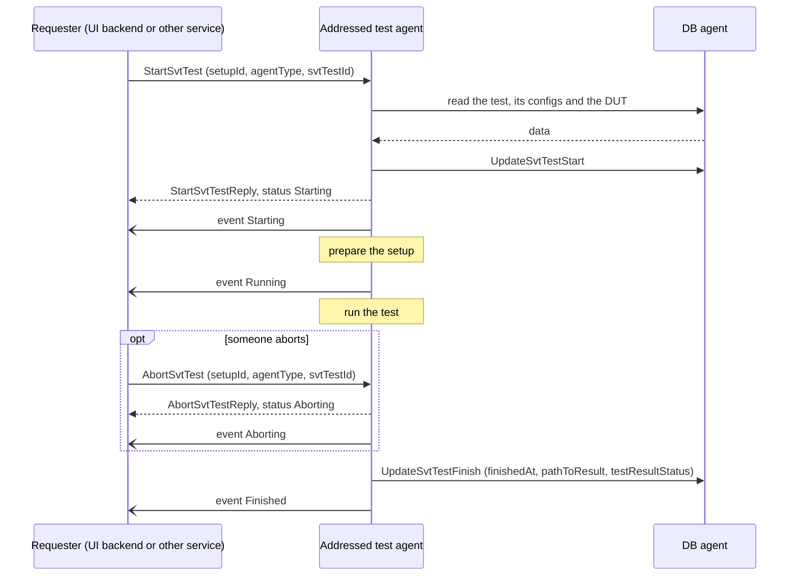
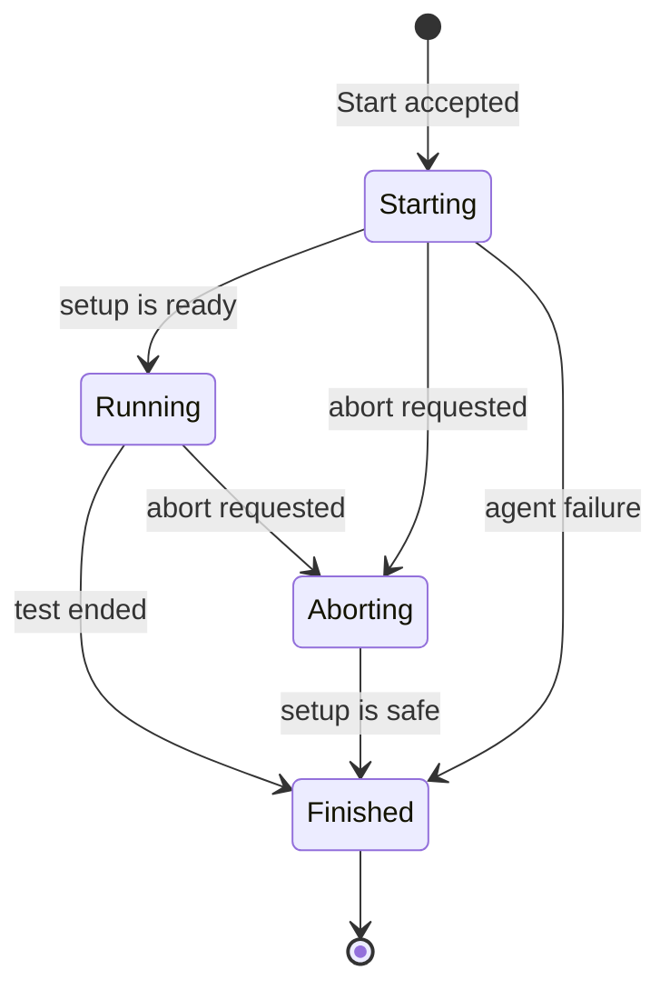
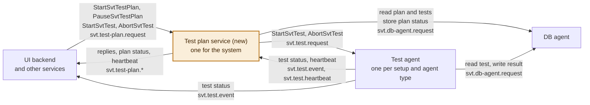
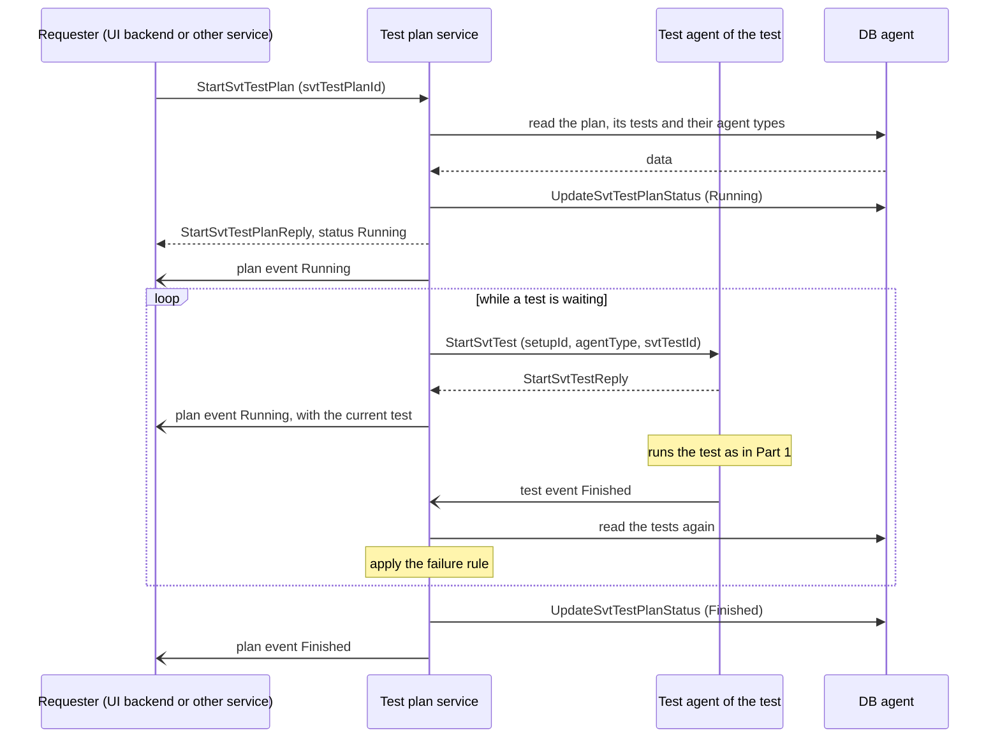
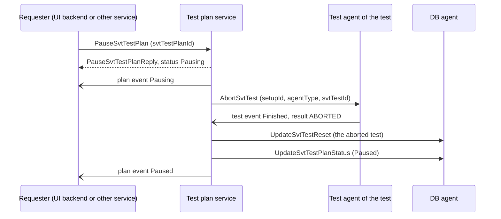
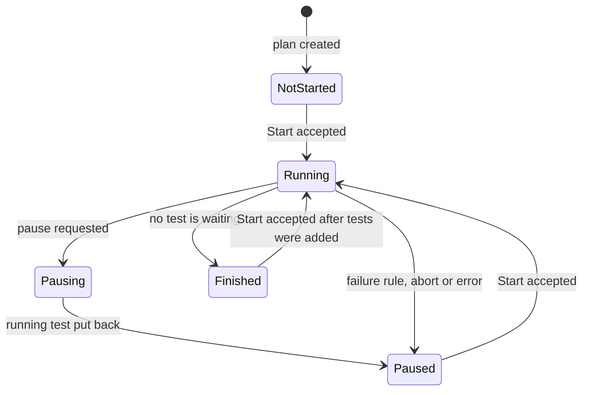
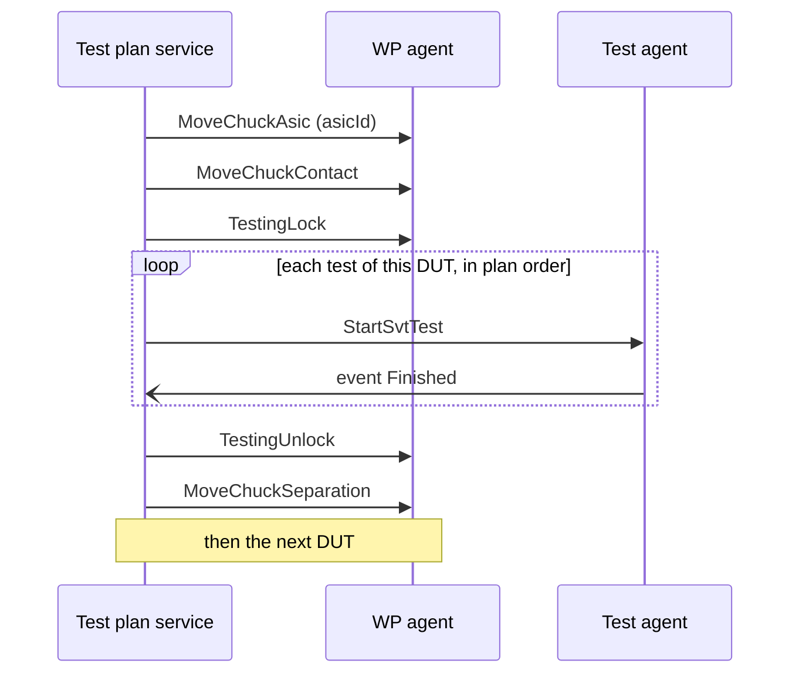

# SVT test processing: session summary

Sessions on 2026-09-24 and 2026-09-30, between Oleksandr Korchak and Claude.

The diagrams are written in Mermaid. GitHub shows them as pictures. VS Code and JetBrains IDEs need their Mermaid Markdown extension, otherwise you see the diagram source as text.

## Where things stand

| Topic | State |
| --- | --- |
| Kafka contract for running one test | Proposal written in `Documentation/Kafka/svt.test.kafka.yaml`. Committed as work in progress; the agent type change is not committed. |
| Kafka contract for running many tests as a plan | Proposal written in `Documentation/Kafka/svt.test-plan.kafka.yaml`. Not committed. |
| DB agent contract | The messages and fields that both proposals need are written into `Documentation/Kafka/svt.db-agent.kafka.yaml`. Not committed. Only the contract file is changed, not the DB tables and not the DB agent code. |
| Waiting on you | Part 1: eight choices. Part 2: ten choices, three of them are the decisions that were open before the proposal. |

Terms used below:

- **DUT**: device under test. It is an Asic, a Chip or a ChipBlock.
- **Setup**: a test bench, stored in the DB as `SvtTestSetup`.
- **Test agent**: the new service that executes tests. One runs per setup and agent type.
- **Agent type**: the kind of test agent that can process a test type. A new field `testProcessingAgentType` on `SvtTestType` and on `SvtTest`, with the values `TestAgent` and `ITS3TestAgent`.
- **Plan**: an ordered list of existing tests of one setup, stored in the DB as `SvtTestPlan`. New.
- **Test plan service**: the new service that runs plans. One runs for the whole system.
- **DB agent**: the existing service in front of the database (`svt.db-agent.*`).
- **WP agent**: the existing service that drives a wafer prober (`svt.wp-agent.*`).
- **UI backend**: the NestJS service between the browser and Kafka.

---

## Part 1. Running one test (contract written)

### What the contract is for

1. A user creates an SvtTest in the DB.
2. Someone asks a test agent to run it.
3. The agent reads the test, its configs and the DUT from the DB agent and runs the test.
4. While it runs, the agent publishes its status.
5. At the end the agent writes the result back through the DB agent.

### Decisions you made

| Question | Your decision |
| --- | --- |
| How many agents | One agent per setup and agent type. A setup can have one agent of each type. |
| How an agent is addressed | By the pair `setupId` and agent type. Both are part of the agent's configuration and both are sent in every command. Agents use the pair to filter the messages. |
| Where the caller gets the address | From the SvtTest. It gets two new fields, `setupId` and `testProcessingAgentType`. The DB agent fills both when the test is created. |
| Names of the two agent types | `TestAgent` and `ITS3TestAgent`, for now |
| Two agents on one setup | One test at a time per setup. The caller holds this rule, because the agents do not know about each other. |
| Who can start a test | The UI, one test at a time, and other services |
| Agent is already busy | The request is rejected. Nothing is queued. |
| Extra features in version 1 | Abort and heartbeat. No step progress and no log streaming. |
| Topic prefix | `svt.test.*` |
| Result of an aborted run | A new value `ABORTED` in the DB enum `testResultStatus` |
| How refusals are reported | The existing reply statuses plus a numeric `error.code` |
| What the agent knows about test types | `SvtTestType` is a generic entity that users create, so the agent cannot rely on its name. It gets one new field, `testProcessingAgentType`, an enum with two values, and the agent does not even read that: it reads the copy on the SvtTest. For the run itself the agent takes only the setup config body and the test type config body. |

### What defines a run

- An agent has no list of test types it supports and does not depend on the name of a test type.
- A test type says which kind of agent processes its tests, in the new field `testProcessingAgentType`.
- The DB agent copies that value to the SvtTest when the test is created. Callers and agents read it from the test. The agent never reads `SvtTestType`.
- A run is defined by two config bodies: the setup config and the test type config of the SvtTest, applied to its DUT.
- Both bodies are plain text for the contract. Their format is agreed between whoever writes the configs and the developers of that agent type.
- The agent checks the bodies before it accepts a test. If it cannot read or execute one, it answers `1005`.

### Who talks to whom

### Topics and messages

| Topic | Messages | Who sends | Content |
| --- | --- | --- | --- |
| `svt.test.request` | `StartSvtTest`, `AbortSvtTest` | UI backend or another service | `setupId`, `agentType`, `svtTestId` |
| `svt.test.request.reply` | `StartSvtTestReply`, `AbortSvtTestReply` | The addressed agent | The test's processing state, or an error |
| `svt.test.event` | `SvtTestProcessingStatusChanged` | Every agent | The full processing state on every status change |
| `svt.test.heartbeat` | `SvtTestAgentHeartbeat` | Every agent, every 5 s | Agent name, setup, agent type, status, the test it is running |

Routing rules:

- All agents read the same request topic, each with its own consumer group, so every agent sees every command.
- An agent handles and answers only the commands that carry its own `setupId` and its own `agentType`.
- The caller reads the pair from the SvtTest itself. No other lookup is needed.
- If the addressed agent is offline, nobody answers. Callers need a timeout; 15 s is recommended.
- The agents of one setup do not know about each other. The caller must not start a test on a setup while another agent of that setup is busy.
- An agent skips old commands when it starts, so a command sent while it was offline never runs later.

### How one run goes

Two points about the order:

- The reply to Start comes after the checks and after the test is marked as started in the DB. It does not wait for the test to end.
- `Finished` is published only after the result is stored in the DB, so whoever reacts to it can read the final test from the DB.

### Statuses

| Kind | Values | Meaning |
| --- | --- | --- |
| Processing status | `Starting`, `Running`, `Aborting`, `Finished` | Where the run is. `Finished` is the only final status. |
| Test result | `SUCCESS`, `PARTIAL_SUCCESS`, `FAILURE`, `ERROR`, `ABORTED` | How the run ended. `ABORTED` is new. `ERROR` also covers failures of the agent itself. |
| Agent status in the heartbeat | `Idle`, `Busy`, `Error` | An agent counts as offline when three heartbeats in a row are missing. |

### Error codes

| Code | Name | Reply status | Meaning |
| --- | --- | --- | --- |
| 1001 | InvalidMessage | BadRequest | Unknown message type, broken JSON or missing fields |
| 1002 | SvtTestNotFound | NotFound | The test does not exist |
| 1003 | SetupMismatch | BadRequest | The test belongs to another setup than `setupId` |
| 1004 | SvtTestAlreadyStarted | BadRequest | The test was already started or finished |
| 1005 | InvalidTestConfig | BadRequest | A config body cannot be read or cannot be executed by the agent |
| 1006 | AgentTypeMismatch | BadRequest | The test type of the test belongs to another agent type than `agentType` |
| 1007 | SvtTestNotRunning | BadRequest | Abort of a test the agent is not running |
| 2001 | AgentBusy | BadRequest | The agent is running another test |
| 2002 | AgentNotReady | UnexpectedError | The agent is in `Error` status |
| 3001 | DbAgentUnavailable | UnexpectedError | The DB agent did not answer in time |
| 3002 | DbAgentError | UnexpectedError | The DB agent answered with an error |
| 4001 | ExecutionFailed | events only | The run failed on the agent side; result is `ERROR` |
| 4002 | ExecutionInterrupted | events only | The agent restarted during the run; result is `ERROR` |
| 9999 | UnexpectedError | UnexpectedError | Anything else |

### Choices I made that you have not confirmed

1. **Command names.** `StartSvtTest` and `AbortSvtTest`, to match the Start button in the UI and `UpdateSvtTestStart` in the DB agent.
2. **When `startedAt` is written.** When the request is accepted, before the reply. This blocks a second start and lets the UI show the test as running at once.
3. **One SvtTest is one execution.** Running it again means creating a new SvtTest. Part 2 relaxes this for tests aborted by a pause.
4. **Only four processing statuses.** Whether the test passed, failed or was aborted is only in `testResultStatus`.
5. **How events are documented.** The message is the request body and the response is "204 No reply". This follows the header of the DB agent file. The WP agent file puts the message under the response instead.
6. **No status query command.** The heartbeat carries the running test, so a reloaded UI sees it within one heartbeat.
7. **Reply header `kafka_nest-is-disposed`.** NestJS only completes a request when a reply carries it. The DB agent already sends it.
8. **Names of the fields on the test.** `SvtTest.setupId` and `SvtTest.testProcessingAgentType`, the same names as on the setup config and the test type. The command fields stay `setupId` and `agentType`.

### The address of an agent

You decided that the pair `setupId` and `TestType.testProcessingAgentType` identifies one agent, and that agents use the pair to filter the messages. This replaces the earlier open question on `setupId`.

How it is written in the contract:

- Both values are in every command, as `setupId` and `agentType`. The agent compares them with its own configuration and needs no DB call to decide whether a message is its own.
- Both values are only an address. The agent still checks them against the SvtTest and answers `1003` for a wrong setup and `1006` for a wrong agent type.
- The heartbeat and the test status carry both values, so a listener can tell the agents of one setup apart.
- The caller reads both values from the SvtTest: `SvtTest.setupId` and `SvtTest.testProcessingAgentType`. The DB agent fills them when the test is created, the setup from the setup config and the agent type from the test type. They are not part of the create message.
- Both values on the test are copies. They cannot go stale today: a setup config has no update message, and `UpdateSvtTestType` can change only `dutTypes`. If the agent type of a test type becomes editable later, existing tests keep their value.
- The agent needs fewer DB calls. It reads the test, the two config bodies and the DUT. It no longer reads the setup config entity, the test type config entity or the test type.

With Part 2 the caller's extra work disappears. The UI sends only `svtTestId`, and the test plan service is the one caller that fills in the address.

### Things outside the contract that block or affect the agent

- **DB agent.** On `master` it does not implement `GetAllSvtTests`, `CreateSvtTest`, `UpdateSvtTestStart` or `UpdateSvtTestFinish`. They exist only as empty stubs on the unmerged branch `origin/289-db-test-list`.
- **DB.** The enum `testResultStatus` needs the new value `ABORTED`. `SvtTestType` needs the new required field `testProcessingAgentType` and its enum. `SvtTest` needs two new required fields, `setupId` and `testProcessingAgentType`, which the DB agent fills when it creates the test. Existing test types and tests need values.
- **UI backend.** It waits for a Kafka reply forever. It needs a timeout before it calls the agent, because an offline agent never answers.
- **UI.** The form that creates a test type needs the agent type. Its result values (None, Completed, Failed, Cancelled) do not match the DB enum. The Start and Stop buttons in the tests grid are not handled, and the Stop button sends the Start event.
- **Docs.** `svt.db-agent.kafka.yaml` describes the `id` of the start and finish updates as "Test template id." and their dates as date only. `SvtKafkaConventions.md` covers only request and reply, not events or heartbeats.

### How the contract file was checked

- A local script confirmed that the YAML parses, that every reference resolves and that the error codes in the table and the descriptions agree.
- It was opened in a local Swagger UI (the `swagger-ui-dist` package of the UI workspace). It loads without errors and shows all four messages.
- The first version is committed as work in progress (`4b1ef06`). The agent type change was checked the same way and is not committed.

---

## Part 2. Running many tests as a plan (contract written)

### What you want

- Start many tests for one DUT in one go.
- Later: run a plan over a whole wafer. Tests are grouped by DUT and the prober moves from DUT to DUT.
- Start and pause a plan. Pause means: abort the running test and stop.
- Run one single test of a plan by hand, without starting the whole plan.
- Possibly several test implementations per test type in future.

### Decisions you made

| Question | Your decision |
| --- | --- |
| After a pause, what happens to the aborted test | It goes back to "not executed" and is run again first |
| A test ends with `FAILURE` or `ERROR` | What happens to the rest of that DUT's tests is set per plan: continue, skip the rest of the DUT, or pause the plan |
| Order of tests within a DUT | The user arranges it when building the plan |
| Tests outside any plan | They still exist |
| Two agents on one setup | One test at a time per setup. The plan service holds this rule. |

### What the contract is for

1. A user builds a plan in the DB: a name, a setup, a failure rule and an ordered list of existing SvtTests.
2. Someone asks the test plan service to start the plan.
3. The service runs the tests one at a time through the contract from Part 1. The test agent stays as it is.
4. While the plan runs, the service publishes which test it is on and how many are left.
5. The plan ends as finished, or as paused. A paused plan continues with the next Start.

### Who talks to whom

### Topics and messages

| Topic | Messages | Who sends | Content |
| --- | --- | --- | --- |
| `svt.test-plan.request` | `StartSvtTestPlan`, `PauseSvtTestPlan` | UI backend or another service | `svtTestPlanId` |
| `svt.test-plan.request` | `StartSvtTest`, `AbortSvtTest` | UI backend or another service | `svtTestId`. No `setupId` and no `agentType`. |
| `svt.test-plan.request.reply` | The four replies | The test plan service | The plan's or the test's processing state, or an error |
| `svt.test-plan.event` | `SvtTestPlanProcessingStatusChanged` | The test plan service | The full state of the plan on every status change and on every next test |
| `svt.test-plan.heartbeat` | `SvtTestPlanServiceHeartbeat` | The test plan service, every 5 s | Service name and every running plan |

Routing rules:

- There is one service, so the commands carry no address.
- If the service is offline, nobody answers. Callers need a timeout; 15 s is recommended.
- The service skips old commands when it starts.
- One plan can run per setup. Plans of different setups run at the same time.
- The service runs one test at a time per setup, also when the setup has two agents.

### The plan in the DB

A plan is created and edited through the DB agent. The test plan service only runs it.

| Field | Meaning |
| --- | --- |
| `name` | Name of the plan |
| `setupId` | The setup it runs on. Every test of the plan must belong to this setup. |
| `failureRule` | `Continue`, `SkipDut` or `Pause` |
| `svtTestIds` | The tests. The order of the list is the order of execution. |
| `status` | `NotStarted`, `Running`, `Paused` or `Finished`. Written by the test plan service. |

- A test belongs to at most one plan.
- The tests of a plan can have different agent types. Each test goes to the agent of its own type, all on the setup of the plan.
- A plan cannot be edited while it is running.

### Which test is next

The service keeps no list of its own. Before every test it reads the plan's tests from the DB and sorts each one into a state:

| State | Condition |
| --- | --- |
| started | `startedAt` is set. The plan never runs it again. |
| skipped | Not started, the rule is `SkipDut`, and an earlier test of the same DUT in the plan ended with `FAILURE` or `ERROR` |
| waiting | Not started and not skipped |

- The next test is the first waiting test in the plan order.
- The plan is finished when no test is waiting.
- The states come only from the DB. They are the same after a pause and after a restart of the service, and the UI can compute them for its grids.
- There is no new SvtTest status and no `SKIPPED` result.

### How a plan runs

- The reply to Start comes after the checks and after the status is stored. It does not wait for the first test.
- `Paused` and `Finished` are published only after the status is stored in the DB.
- The status of each single test still comes from the agent on `svt.test.event`. The plan events do not repeat it.

### How a pause goes

- Only the test that the pause aborted is put back. A test that ended by itself just before keeps its result.
- A pause always ends in `Paused`, also when the agent does not answer.
- Start of a paused plan continues with the first waiting test.

### Statuses

| Kind | Values | Meaning |
| --- | --- | --- |
| Processing status in events | `Running`, `Pausing`, `Paused`, `Finished` | Where the run is |
| Status in the DB | `NotStarted`, `Running`, `Paused`, `Finished` | `Pausing` is not stored. The DB keeps `Running` until the plan is paused. |
| Failure rule | `Continue`, `SkipDut`, `Pause` | What a `FAILURE` or `ERROR` does to the plan |
| Pause reason | `PauseRequested`, `TestFailed`, `TestAborted`, `Error` | Why the plan is paused |

### What happens when something goes wrong

| What happens | What the plan does |
| --- | --- |
| A test ends with `FAILURE` or `ERROR`, rule `Continue` | Goes on with the next waiting test |
| A test ends with `FAILURE` or `ERROR`, rule `SkipDut` | Goes on. The rest of that DUT's tests are skipped. |
| A test ends with `FAILURE` or `ERROR`, rule `Pause` | Pauses, reason `TestFailed` |
| The running test is aborted by hand with `AbortSvtTest` | Pauses, reason `TestAborted`. The test keeps `ABORTED` and is not put back. |
| The agent of the next test is offline or in `Error` status | Pauses, reason `Error`. The test is not started and is taken again next time. |
| The agent refuses a test or does not answer | Pauses, reason `Error`. The test is not started and is taken again next time. |
| The agent goes offline during a test | Pauses, reason `Error`. The agent ends that test with `ERROR` when it is back. |
| The DB agent fails | Pauses, reason `Error` |
| The test plan service restarts | On startup it pauses every plan that was stored as `Running`. A test that was running ends normally on its agent. |

The service never counts a problem of its own as a test failure. The failure rule is applied only to real test results.

### Single tests

- `StartSvtTest` and `AbortSvtTest` exist on the plan service too. They take only `svtTestId`. The service adds the address (`setupId`, `agentType`) and forwards the command to that agent.
- They work for any test, in a plan or outside any plan.
- A single test is refused while a plan is running on its setup, also between two tests of the plan.
- The plan service is meant to be the only sender on `svt.test.request`. If something sends a Start straight to an agent between two tests of a plan, the agent refuses the plan's next test and the plan pauses with an error.

### Error codes

| Code | Name | Reply status | Meaning |
| --- | --- | --- | --- |
| 1001 | InvalidMessage | BadRequest | Unknown message type, broken JSON or missing fields |
| 1002 | SvtTestPlanNotFound | NotFound | The plan does not exist |
| 1003 | SvtTestNotFound | NotFound | The test does not exist |
| 1004 | SvtTestPlanAlreadyRunning | BadRequest | Start of a plan that is running or pausing |
| 1005 | SvtTestPlanNotRunning | BadRequest | Pause of a plan the service is not running |
| 1006 | NothingToRun | BadRequest | No test of the plan is waiting |
| 1007 | InvalidSvtTestPlan | BadRequest | The plan is empty or holds a test of another setup |
| 1008 | SvtTestNotRunning | BadRequest | Abort of a test that no online agent is running |
| 2001 | SetupBusy | BadRequest | A plan is running on the setup, or one of its agents is busy |
| 2002 | AgentOffline | UnexpectedError | No heartbeat from the agent that the test needs |
| 2003 | AgentNotReady | UnexpectedError | The agent that the test needs is in `Error` status |
| 3001 | DbAgentUnavailable | UnexpectedError | The DB agent did not answer in time |
| 3002 | DbAgentError | UnexpectedError | The DB agent answered with an error |
| 3003 | TestAgentUnavailable | UnexpectedError | The test agent did not answer in time |
| 3004 | TestAgentError | Same as the agent's reply | The test agent answered with an error. Its own code and message are in `error.cause`. |
| 4001 | TestAgentLost | events only | The agent went offline during a test of the plan |
| 4002 | ServiceRestarted | events only | The service restarted while the plan was running |
| 9999 | UnexpectedError | UnexpectedError | Anything else |

### What the DB agent has to add

| Message or change | Who needs it | Meaning |
| --- | --- | --- |
| `GetAllSvtTestPlans` | UI, plan service | List of plans, with filters for ids, setups and statuses |
| `CreateSvtTestPlan` | UI | Name, setup, failure rule and the ordered tests |
| `UpdateSvtTestPlan` | UI | Change name, rule or tests. Rejected while the plan is running. |
| `UpdateSvtTestPlanStatus` | Plan service | Stores the status |
| `UpdateSvtTestReset` | Plan service | Puts an `ABORTED` test back to "not started" |
| `testPlanId` on a test, and a filter for it | UI | Which plan a test belongs to |
| Two new enums | UI, plan service | Failure rule and plan status |
| `ABORTED` in `testResultStatus` | Test agent | Already needed by Part 1 |
| `testProcessingAgentType` on a test type, and its enum | UI | Already needed by Part 1 |
| `setupId` and `testProcessingAgentType` on a test | UI, plan service, test agent | Already needed by Part 1. The DB agent fills both on creation. |

All of them are written into `svt.db-agent.kafka.yaml`: five new messages under the tags `SvtTest` and `SvtTestPlan`, the new fields on `SvtTestDto` and `SvtTestTypeDto`, and three new enum names. The DB tables document and the DB agent code are not changed.

### Choices I made that you have not confirmed

The first three were the open decisions before the proposal. I took my own recommendation for each.

1. **Every run request goes through the plan service,** also single tests and tests outside any plan. If you do not want this, `StartSvtTest` and `AbortSvtTest` are removed from this contract and nothing else changes.
2. **Topic prefix `svt.test-plan.*` and one service for the whole system.** Where the code lives is still open. It does not change the contract.
3. **No wafer fields and no prober steps in this version.** The file has a short section on how they would be added later without changing the messages.
4. **Plans are created and edited through the DB agent.** The plan service has no create or edit commands.
5. **The plan status is stored in the DB.** Otherwise a plan list cannot show it without loading every test of every plan.
6. **Skipped tests are not marked in the DB.** Whether a test is skipped is worked out from the DB each time. One consequence: with `SkipDut`, a DUT that has a failed test stays skipped on every later Start. To run the rest of it, start those tests by hand or change the rule to `Continue`.
7. **A test aborted by hand is not put back.** Only Pause puts a test back. `AbortSvtTest` on the plan's running test leaves it `ABORTED` and pauses the plan.
8. **After a restart the service pauses its plans.** It does not continue them on its own. The user presses Start again.
9. **Same command names as on the agent.** `StartSvtTest` and `AbortSvtTest` on the plan service mean the same thing one level up, without the agent address.
10. **No status query command and one event type.** The heartbeat lists the running plans, as in Part 1.

### What this changes in Part 1

Not edited in `svt.test.kafka.yaml` yet. It depends on choice 1.

- The topics table there names "UI backend, other services" as the sender of `svt.test.request`. It would become the test plan service.
- The rule "one SvtTest is one execution" gets one exception: a test aborted by a pause is reset and runs again.
- The agent address (`setupId`, `agentType`) is filled in by the plan service only. The UI never needs it.

### Why not the other two options

- **Batch inside the test service.** There are already two separate test agent code bases: `TestAgent` for the SLDO bench and `ITS3TestAgent` for MOSAIX. Ordering, pause and prober handling would have to be written in each.
- **A "ready" flag on SvtTest plus a watcher.** The DB agent sends no change notifications, so the watcher would have to poll. A flag on single tests also has no place for the order, the failure rule or the wafer.

### Whole wafer later

Not part of the contract yet. The WP agent already has the commands this loop needs:

- `MoveChuckAsic` goes to a DUT by its DB id (`WPAgent/actions/WPTestingActions.py`, line 1331). It checks that the Asic is on the loaded wafer.
- `TestingLock` and `TestingUnlock` were written for an outside test service. The WP agent's state machine already has the path contact, locked, unlocked, separation.

What the plan contract would get: `waferId` and `wpMachineId` on the plan, the current DUT in the plan state, and error codes for the WP agent.

Two gaps to plan for:

- **One user at a time.** The WP agent accepts one logged-in user (`WPAgent/actions/WPLoginActions.py`, line 68), and its commands take a `user` field. `StartSvtTestPlan` would have to carry the user who started the plan.
- **No link between a setup and a prober.** Nothing in the DB says which prober serves a setup, so a wafer plan must name the prober itself.

The UI already has an earlier prototype of this idea, `EpicWaferTest`, with `wpMachineId`, `waferId`, a list of Asics, start and abort. It runs on mock data only. The plan could replace it.

### Several test services per test type

Keep one communication layer for all tests. The agent type decides which service gets a test.

- **Several services on one setup are possible.** Each is an agent of a different agent type and is addressed by `setupId` plus `agentType`. A new kind of test service means a new value in the enum.
- **Inside an agent**, a thin Kafka layer hands the two config bodies and the DUT to the test code. If one agent can run several kinds of test, which one to run has to be written in the test type config body. The contract does not see it.
- **"Busy" is per agent, not per setup.** The agents of a setup do not know about each other. The test plan service keeps the rule of one test at a time per setup.
- **Nothing in the DB says which agent types a setup has.** A user can create a test whose test type needs an agent that does not exist on that setup. It shows only at start, as "agent offline". The UI can warn earlier by reading the heartbeats.

### How the contract file was checked

- The same local script as in Part 1: the YAML parses, every reference resolves, every message type matches its path, and the error codes in the table, the enum and the descriptions agree.
- It was opened in a local Swagger UI. It loads without errors and shows all six messages.
- It has not been reviewed by the DB agent or test agent developers.
- It is not committed.

---

## Background: what exists in the repo today

| Area | What I found |
| --- | --- |
| `TestAgent/` | An early Kafka prototype for the SLDO bench. It runs only against an emulator. It uses `svt.test-agent.*` topics with a message shape that does not follow the conventions, and it cannot talk to the real DB agent. |
| `ITS3TestAgent/` | The real MOSAIX wafer runner, a command line script. It drives the prober itself through the WP agent. It does not use the DB agent and publishes no status. Its overall result values match the DB enum `testResultStatus`. |
| `WPAgent/` | Has the navigation and lock commands listed above. Its YAML contract is out of date compared with the code. |
| `DbAgent/` | Publishes only replies and a heartbeat. It sends no change notifications. |
| `UI/` | The browser never talks to Kafka; everything goes through the UI backend. The UI does not talk to the WP agent at all. No live push to the browser works today. The UI backend already marks the place where a live "Running" state should be merged in. |
| `SVTSupervisor/` | Empty placeholder, only the initial commit. |

## Next steps

1. Review the eight choices in Part 1.
2. Review the ten choices in Part 2. Choice 1 matters most, because it also changes the Part 1 file.
3. After that, update `svt.test.kafka.yaml` to match choice 1. Have the DB agent developers review the additions in `svt.db-agent.kafka.yaml`.
4. Decide where the test plan service lives: `SVTSupervisor/`, or a NestJS app in the UI workspace that reuses the existing Kafka types.
